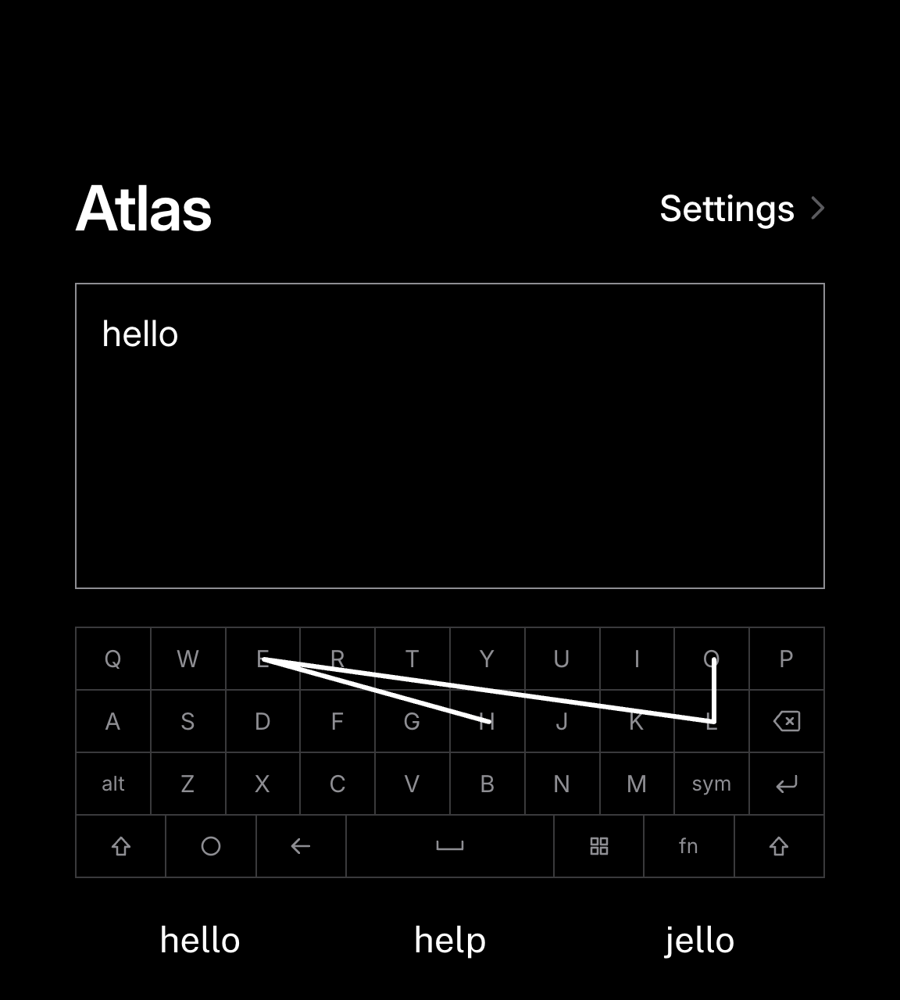
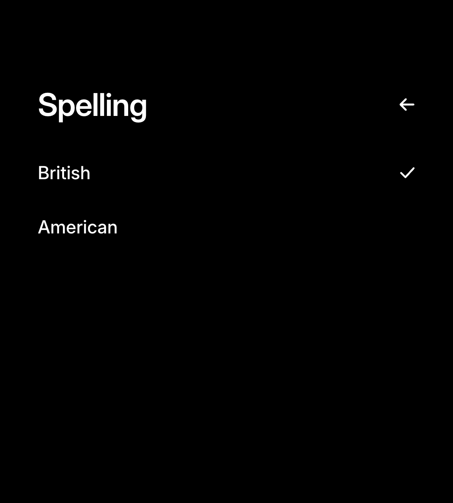
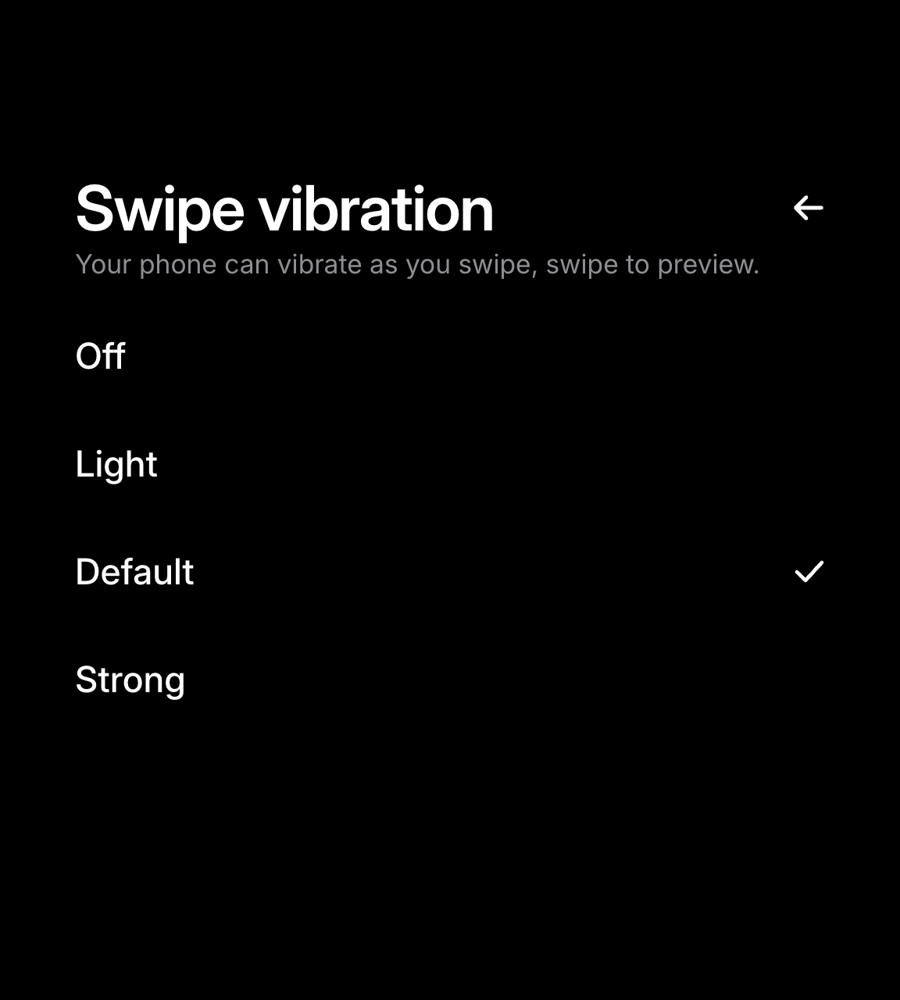

<div align="center">


# Atlas


**The all-in-one toolkit to power up your keyboard phone.**

<a href="https://apps.obtainium.imranr.dev/redirect?r=obtainium://add/https://github.com/juleshall4/atlas"></a>

**[Features](#features) · [Use](#use) · [Install](#install) · [Privacy](#privacy) · [Credits](#credits)**

</div>

---

> **Update, November 2026:** Swipe typing is the first feature in Atlas, and it's ready to try on the Unihertz Titan 2 Elite. Slide across the physical keys without pressing them, and Atlas types the word. I'm now working on more features!

## Features

### Swipe typing

Swipe typing currently supports only the Unihertz Titan 2 Elite.

<p align="center">
  
  
  
</p>

- Swipe across the physical keys to type.
- Get suggestions for both swiped and typed words.
- Lightly tap configured tap keys to type the letter and a space.
- Atlas learn your vocabulary the more you use it.

#### Use

| To do this | Do this |
| --- | --- |
| Swipe a word | Slide across the letters without pressing the keys, then lift. |
| Pick another word | Tap a suggestion on the strip above the keyboard. |
| Type a full stop | Press Space twice. |
| Use Shift or Alt | Press once for the next letter, twice quickly to lock, and again to release. |
| Find more symbols | Press Alt, then swipe sideways on the keyboard to explore. |

## Install

Atlas installs through [Obtainium](https://github.com/ImranR98/Obtainium), which also keeps it up to date.

1. Install [Obtainium](https://github.com/ImranR98/Obtainium/releases).
2. In Obtainium, tap **Add App**.
3. Paste the following URL as the app source, then tap **Add**:

   ```text
   https://github.com/juleshall4/atlas
   ```

4. Tap **Install**.

## Privacy

Everything runs and is stored locally on your device. No data is stored or monitored by me or any third party.

---

## Credits

Atlas is powered by and built with these projects:

- [Ink](https://github.com/No-Scrolling/ink): the app framework, an awesome tool built by my best friend, [vandamd](https://github.com/vandamd) (MIT)
- [FUTO Swipe](https://gitlab.futo.org/keyboard/swipe-library): swipe recognition (GPL-3.0)
- [FUTO Keyboard](https://github.com/futo-org/android-keyboard): contextual prediction (FUTO Source First)
- [FUTO Swipe models](https://huggingface.co/futo-org/futo-swipe): swipe typing models (FUTO Model Weights)
- [AOSP dictionaries](https://codeberg.org/Helium314/aosp-dictionaries/src/branch/main/dictionaries/main_en_gb.dict): British English dictionary (Apache 2.0)
- [Inter](https://github.com/rsms/inter): typeface (SIL Open Font Licence)
