<div align="center">


### TitanKeys

**The keys your Titan deserves.**

A keyboard built for the Unihertz Titan 2 Elite. Type as you always have, swipe whole words on the same keys, and reach every symbol, emoji and setting without touching the screen.

</div>

> TitanKeys is an independent, modified version of [Atlas](https://github.com/juleshall4/atlas) by Julian Hall. Atlas is the original project and the base of everything here. This fork started in November 2026, and its changes are in the git history. It is not made by, affiliated with, or endorsed by Atlas, FUTO, or Unihertz.

<p align="center">
  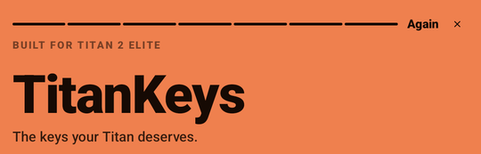
</p>

<p align="center">
  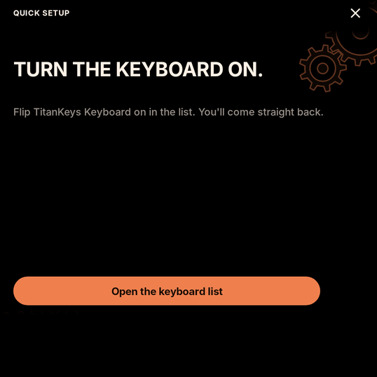
  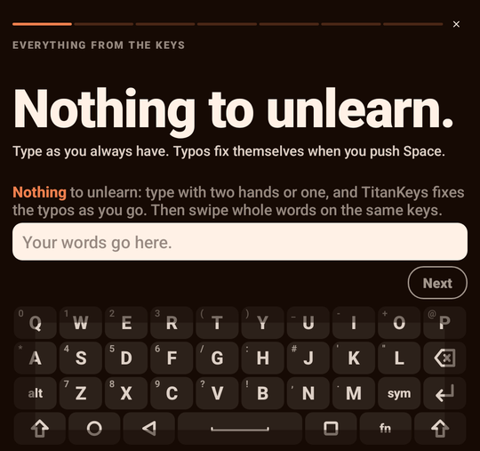
  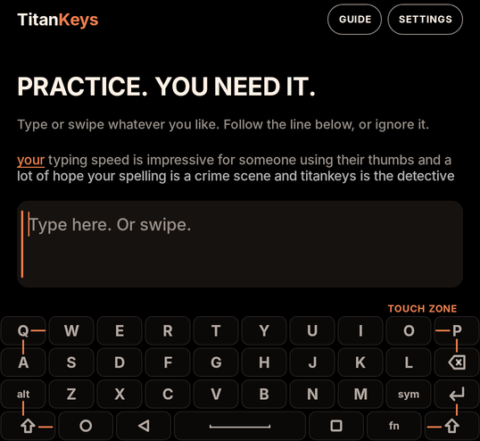
</p>

## Set up in a minute

The first slide of the guide is setup. It opens each Settings page for you, sees the switch go on, and comes back by itself, so each part takes a touch or two:

1. **Switch on the keyboard** in the list of keyboards.
2. **Make it your keyboard.**
3. **Allow it over other apps.** The Titan sends touchpad input to the window on top, so this keeps the touchpad on the keys when an app shows its own buttons.
4. **Turn on Scroll assistant,** the phone's own switch that the touchpad needs.
5. **Let TitanKeys handle Back** in Accessibility, so one push of Back closes the keyboard and goes back. TitanKeys never reads your screen.

Then the guide teaches everything below, one slide each, on the real keys. Each slide shows its gesture in grey as soon as it opens, then waits for you to do it on the keys. After the guide, the app opens on a playground with the same look, to try anything.

## Everything from the keys

### Nothing to unlearn

Type with two hands or one, as on any keyboard. When you push Space, TitanKeys fixes the typo in the word you just typed. A small language model helps it pick the fix that fits the sentence, and typing never waits for it.

### Now swipe on the same keys

The Titan's keys are a touchpad too. Slide across the letters of a word without pushing, then lift. A thumb that slips off the top of the sensor and comes back keeps the same word, and a resting thumb or a quick brush between key presses types nothing. TitanKeys knows its own name: swipe it and see.

### Missed? One touch fixes it

The strip above the keys shows the other words that a swipe could be. Touch one to put it in. Before you type, the strip suggests the next word.

Touch and hold a word on the strip to forget it, so it is not suggested or used as a fix again. Undo shows for a moment, and **Settings > Your words** gives the word back.

To pick without the screen, turn on **Flick up on the keys to pick a word** in Settings. A quick flick up on the left, middle or right third of the letter keys picks the word above it.

### Delete without reaching up

Flick left from Backspace to delete a word. Keep your finger down to delete more: the longer the flick, the faster it goes.

### Steer and select from Space

Touch Space two times, keep the second touch down, swipe up onto the letters, then lean left or right. The cursor moves slowly near the middle and quickly near the edge. You feel a tick for each letter and a stronger one at each space, so you can count words without looking. Touch Space three times to select words instead, and lean the other way to give them back one at a time.

### Every symbol within reach

Hold a letter for the symbol printed in its corner. Push Sym for every other symbol, in groups: swipe up or down for more, or rest a finger on the bottom row to pick a group.

### Emoji and settings, no screen

Push Sym two times for emoji. In the panel, Alt opens quick settings, with a letter for each setting, such as S for swiping and V for vibration, without leaving the app you are in.

## TitanKeys and Atlas

Atlas is a great keyboard, and TitanKeys only exists because Julian built it and shared it. The two projects just aim for slightly different things. Atlas stays simple and keeps swiping for typing only. TitanKeys takes on more complexity to get the most out of the Titan 2 Elite, one-handed swipes included. If you'd rather have something simpler, Atlas is an excellent choice.

## Under the hood

Every change below was measured on real swipes recorded on a Titan 2 Elite before it stayed.

### Swipe engine 2.0

A swipe goes through four stages:

1. **FUTO Swipe** reads the stroke, as Atlas does, plus a second reading stretched wider for a fast swipe and a third shifted to the right, where thumbs aim on this sensor. It keeps 48 words.
2. **A CleverKeys encoder, fine-tuned on the Titan's touchpad,** reads the same stroke, and a word search turns that reading into up to 80 more words.
3. **DistilGPT-2,** a small language model, gives each word its chance after the last 32 tokens of your text. It runs after the previous word, so a swipe never waits for it.
4. **A ranker** of 900 decision trees weighs the shape, the readings and the sentence together, and picks the three words on the strip.

If any of the new models can't load, the FUTO engine's own order is used, as before. The models add about 95 MB to the app and take about 70 ms per swipe on the phone. They load in the background a few seconds after the keyboard starts, and swiping works in the meantime.

The same language model drives the word suggestions: the next word before you type, then the words that start with the letters you have typed. It also gives typed autocorrect a small push towards the word the sentence expects. It is only used when its answer is already there, so typing never waits.

The first three rows were measured on the phone over 1,046 typed words, and the last two on typing held back from all tuning.

| Word suggestions | Before | Engine 2.0 |
| --- | --- | --- |
| Letters typed before the word is in the top 3 | 2.51 | 2.34 |
| Word in the top 3 after one letter, prompted text | 60.1% | 75.5% |
| Word in the top 3 after one letter, everyday text | 42.5% | 47.2% |
| Next word in the top 3 before any letter, prompted text | 24.0% | 37.9% |
| Next word in the top 3 before any letter, everyday text | 16.6% | 20.1% |

### How it compares

The same recorded touches, replayed through each keyboard on the phone. Atlas is at the commit this fork started from (`0981443`, November 2026), and Atlas is actively developed, so some of this may have changed since. TitanKeys 1.2 is the last version before swipe engine 2.0.

| Real recordings, same touches through each | Atlas | TitanKeys 1.2 | TitanKeys 2.0 |
| --- | --- | --- | --- |
| 126 words swiped in real sentences: right word first, first try | 86 (68%) | 106 (84%) | 115 (91%) |
| The same 126 words: right word in the top 3 | 108 (86%) | 111 (88%) | 121 (96%) |
| 300 swiped words: right word first \* | 171 (57%) | 229 (76%) | 275 (92%) |
| 300 swiped words: right word in the top 3 \* | 202 (67%) | 260 (87%) | 286 (95%) |
| 103 of them that broke into pieces: right word first \* | 39 (38%) | 72 (70%) | 86 (83%) |
| 197 of them in one touch: right word first \* | 132 (67%) | 157 (80%) | 189 (96%) |

The sentences were never used to tune anything, so that row is the fair comparison. \* Engine 2.0's ranker learned from the 300 recorded words, so its numbers on them are higher than on swipes it has never seen. On 540 other swipes, from prompted and everyday typing, held back from all of its tuning, engine 2.0 put the right word first 78.9% of the time against 72.6% for TitanKeys 1.2, and in the top 3 85.7% against 81.5%.

All of this is one person's swipes on one phone, so your results may differ. The recordings and replay tools are in [`android/debug/recorder`](android/debug/recorder), so anyone can check these numbers or reuse them.

#### A few real swipes

Recorded on the phone and replayed through each. The dotted line is the word that was meant.

| Recorded swipe | Atlas typed | TitanKeys typed |
| --- | --- | --- |
| 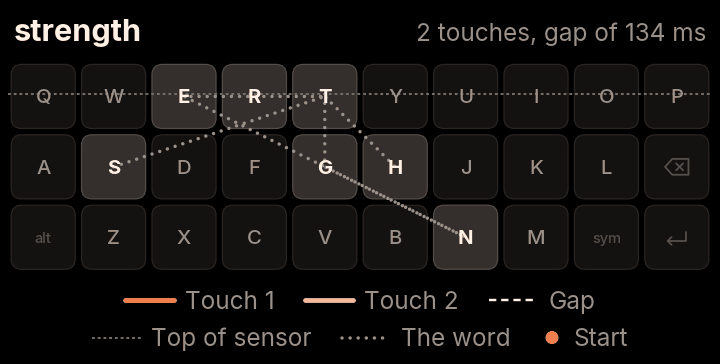 | set tenth | strength |
| 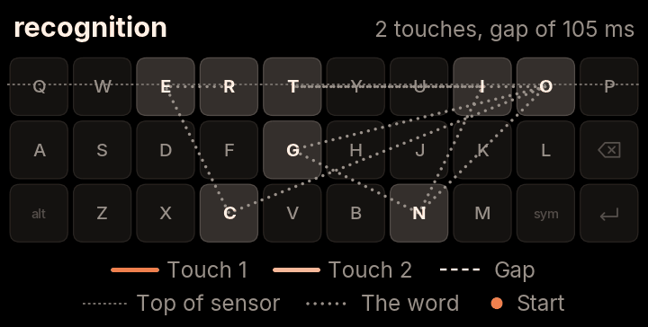 | trinity on | recognition |
| 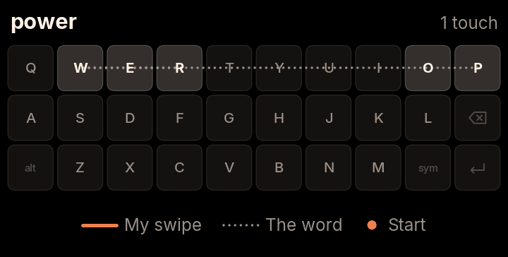 | pure | power |
| 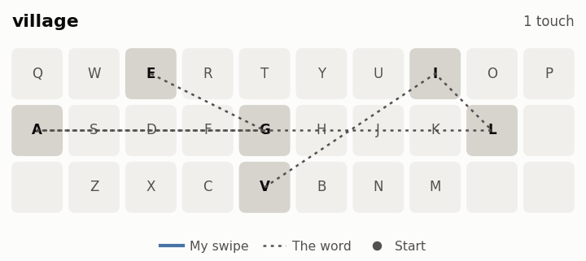 | collar | village |

### Keeping a broken swipe together

The sensor ends about halfway up the top row, so a thumb can slip off mid-word and come back. In the recordings, 103 of 300 swipes (34%) broke this way.

**Atlas** joins two touches when the second starts within 90 ms, which keeps the rule simple. **TitanKeys** also looks at where the touch comes back and which way it's heading, so it can allow a longer gap without merging separate words.

| | Atlas | TitanKeys |
| --- | --- | --- |
| Broken swipes joined (higher is better) | 56 of 96 (58%) | 86 of 96 (90%) |
| Separate words wrongly merged (lower is better) | 214 of 1,200 (18%) | 84 of 1,200 (7%) |

| Atlas | TitanKeys |
| --- | --- |
| 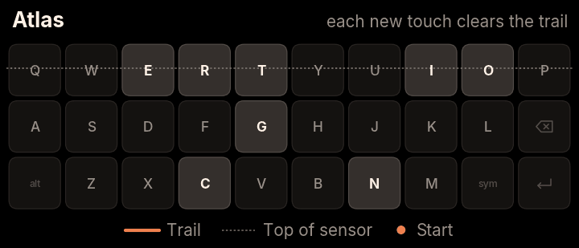 | 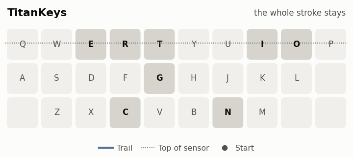 |

### Matching a swipe by its shape

TitanKeys also compares your swipe with the outlines of about 12,400 common words and your saved words. A swipe that stops short gets smaller but mostly keeps its shape. In 98 of the 127 swipes the FUTO engine got wrong (77%), the right word's outline fit better than the outline of the word the engine picked.

| Comparing outlines | Scaled to the same size |
| --- | --- |
| 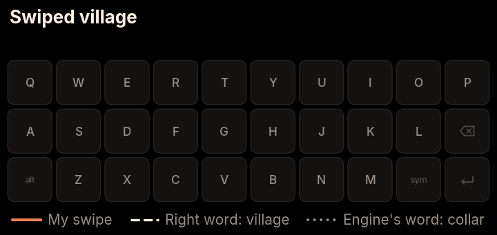 | 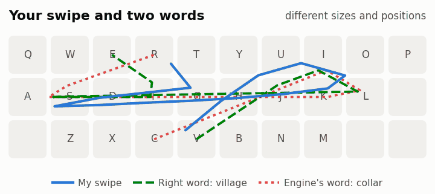 |

### Expecting a thumb to stop short

In the recordings, thumbs stopped short of corners by 0.74 keys going right, 0.44 up, 0.24 down and 0.20 left. So where a swipe turns says which key it was aiming for: a thumb that turns at I was probably heading for O. TitanKeys moves each corner of a word's outline back to where a thumb would really turn. The swipe itself isn't changed. Here's a simulated lazy swipe of "jason":

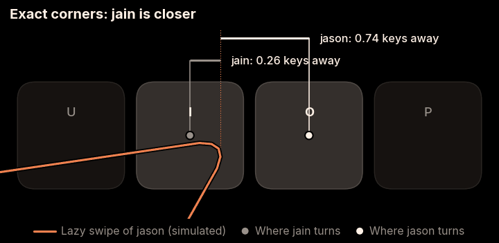

### The faster the swipe, the wider the second look

Quick swipes tend to come out narrower than the word they mean, so TitanKeys reads a fast swipe a second time, stretched wider. The stretch grows with speed: nothing below 10 keys per second, rising to 1.2 times at 16 and above. Slow, careful swipes are read exactly as they were made.

| Swipe speed | Swipes | No stretch: right word first | Gradual stretch: right word first |
| --- | --- | --- | --- |
| Under 11 keys per second | 78 | 57 | 58 |
| 11 to 14 | 105 | 76 | 77 |
| 14 to 17 | 119 | 95 | 99 |
| Over 17 | 73 | 55 | 60 |

| partner | perform |
| --- | --- |
| 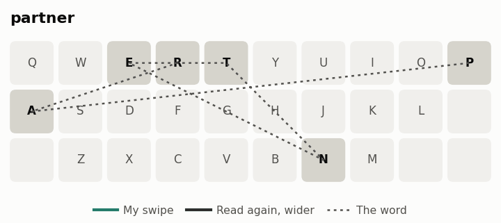 | 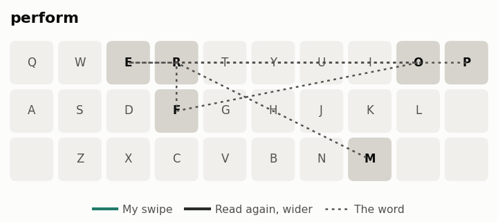 |

### Deleting a word with one thumb

The flick from Backspace is a quick, straight stroke left from around Backspace, at any length. Fitted to 68 real strokes, it catches 66 of them (97%), and it didn't trigger on any of 875 recorded word touches.

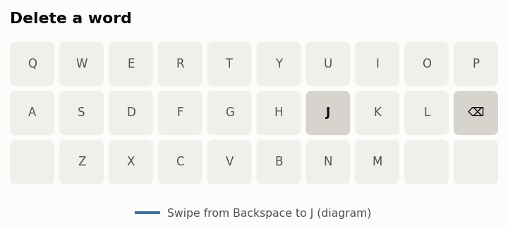

### Picking a word with a flick up

The flick up is short, quick and straight: it starts on a letter and goes up about one row. A word's swipe almost never does that, and "by" and "my", which go straight up two rows, stay swipes. It is off at first, because on 2,036 recorded strokes one short "my" read as a flick. A flick waits for the time a short lift may last, so a swipe that the top of the sensor breaks in two still joins up.

<details>
<summary><strong>Smaller changes for two-handed typing</strong></summary>

The pictures here are diagrams of the behaviour, not recordings, and the words in them are examples.

**Space types a space when your thumb is resting on it.** Across 25 sentences typed on the keys with two hands, accidental selections went from 5 to 0.

| Atlas | TitanKeys |
| --- | --- |
| 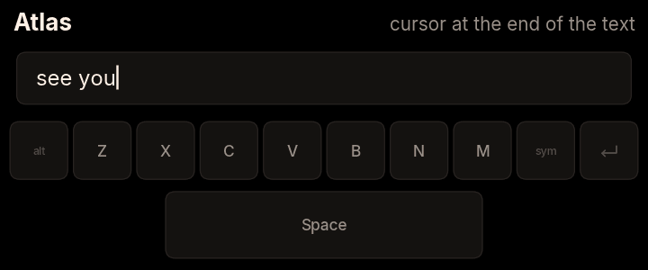 | 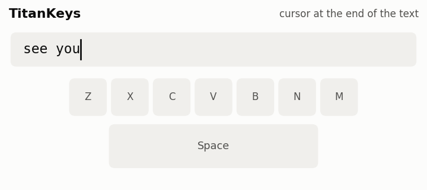 |

**Picking a swiped word moves on to next-word suggestions,** as Atlas does for typed words. To switch to another option afterwards, move the cursor back into the word.

| Atlas | TitanKeys |
| --- | --- |
| 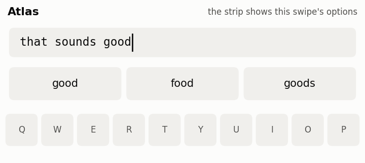 | 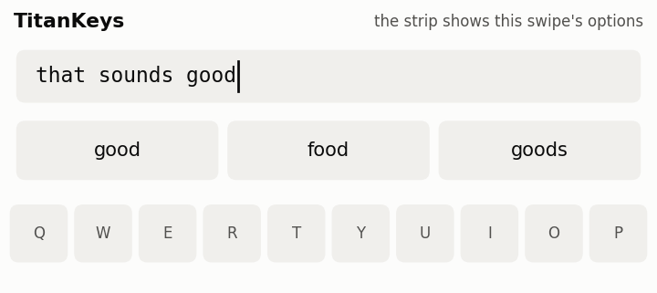 |

**A long stroke still counts right after a key press,** while short brushes are ignored for longer as you type. Across the same 25 typed sentences, accidental swipes went from 3 to 2, and accidental touches read as taps went from 27 to 16.

| Atlas | TitanKeys |
| --- | --- |
| 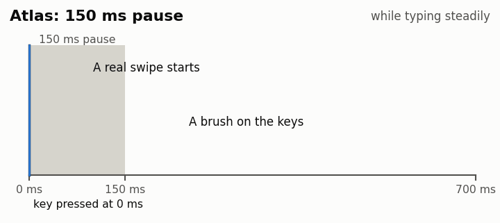 | 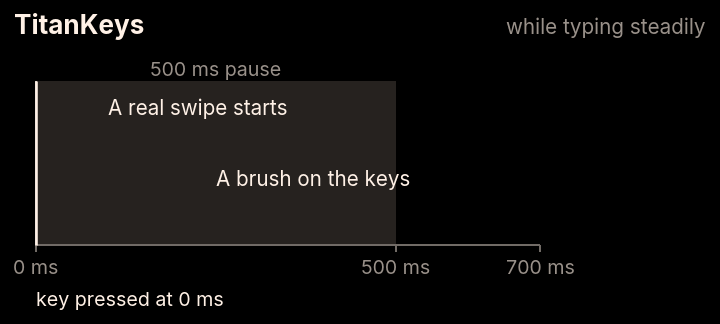 |

</details>

### What it costs

These changes aren't free, and Atlas's simpler approach avoids all of this:

- There's more code, and more settings that were tuned on one person's thumbs.
- The app is about 95 MB bigger, and the keyboard uses about 400 MB more memory while engine 2.0's models are loaded. The phone has 12 GB.
- Separate words swiped very quickly can merge. At gaps of 120 ms or more, 5 of 270 pairs merged (2%), where Atlas merged none. At 90 ms or less it's 28 of 90 (31%), where Atlas merged all 90.
- A swipe takes about 70 ms to read on the phone with engine 2.0, against about 15 ms with the FUTO engine alone.

## Privacy

Everything runs and is stored on your phone, including both language models. Nothing you type is sent anywhere, and no data is stored or monitored by me or any third party.

TitanKeys doesn't learn from fields marked as passwords, email addresses, URLs, or private by the app.

TitanKeys asks to display over other apps because of how the Titan 2 sends touchpad input. It never reads the screen. Android shows a silent "TitanKeys is displaying over other apps" notification while it's there, which you can turn off. Its Accessibility service only sends Back and, while the Sym panel is open or in a launcher search, reads the keys you push.

The typing log in Settings, which records touches and typed text to tune the keyboard, is off until you turn it on, and it stays on your phone.

## Install

Download the latest APK from [releases](https://github.com/jasonlok000/titankeys/releases) and install it, then open TitanKeys: the guide takes it from there. TitanKeys installs next to Atlas, so it doesn't replace it or touch Atlas's saved words.

To build it yourself, follow the setup in the [contributing guide](CONTRIBUTING.md), then run:

```bash
bash tools/debug.sh --install
```

This installs **TitanKeys Debug**, a separate test build.

## Feedback

Bugs and ideas are welcome in [issues](https://github.com/jasonlok000/titankeys/issues). If something also happens in Atlas, please report it [there](https://github.com/juleshall4/atlas/issues) too.

Work is shared in both directions. Anything here is free to use in Atlas, and improvements from Atlas are welcome here.

## Credits

TitanKeys is built on the work of these projects:

- [Atlas](https://github.com/juleshall4/atlas) by Julian Hall: the original project this is based on (GPL-3.0). Thank you for open sourcing it.
- [Ink](https://github.com/No-Scrolling/ink): the app framework (MIT)
- [FUTO Swipe](https://gitlab.futo.org/keyboard/swipe-library): swipe recognition (GPL-3.0)
- [FUTO Keyboard](https://github.com/futo-org/android-keyboard): contextual prediction (FUTO Source First)
- [FUTO Swipe models](https://huggingface.co/futo-org/futo-swipe): swipe typing models (FUTO Model Weights)
- [AOSP dictionaries](https://codeberg.org/Helium314/aosp-dictionaries/src/branch/main/dictionaries/main_en_gb.dict): English dictionary (Apache 2.0)
- [Pastiera](https://github.com/palsoftware/pastiera): the Enter key rules and list of chat apps, and the base of autocorrect and next-word learning (GPL-3.0)
- [Numen](https://github.com/jlo-aug/numen): autocorrect for typed words and next-word learning (GPL-3.0). Its word data has its own licences: see [`licences/Numen-autocorrect-data.md`](licences/Numen-autocorrect-data.md)
- [Inter](https://github.com/rsms/inter): typeface (SIL Open Font Licence)
- [CleverKeys](https://github.com/tribixbite/CleverKeys): the swipe encoder that swipe engine 2.0 fine-tunes for the Titan touchpad (GPL-3.0)
- [DistilGPT-2](https://huggingface.co/distilbert/distilgpt2): the next-word model (Apache 2.0)
- [ONNX Runtime](https://github.com/microsoft/onnxruntime): runs these two models on the phone (MIT). See [`licences/Swipe-engine-2-models.md`](licences/Swipe-engine-2-models.md)

TitanKeys is powered by FUTO Swipe. "Titan 2 Elite" is a product of Unihertz.

## License

TitanKeys is licensed under the GNU General Public License v3.0 (GPL-3.0-only), the same as Atlas. See the [LICENSE](LICENSE) file.

TitanKeys includes code under the FUTO Source First License, so it can only be modified and distributed for free, for non-commercial purposes. See the [licences](licences) folder for every licence.
