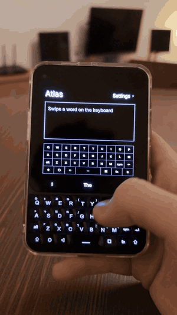
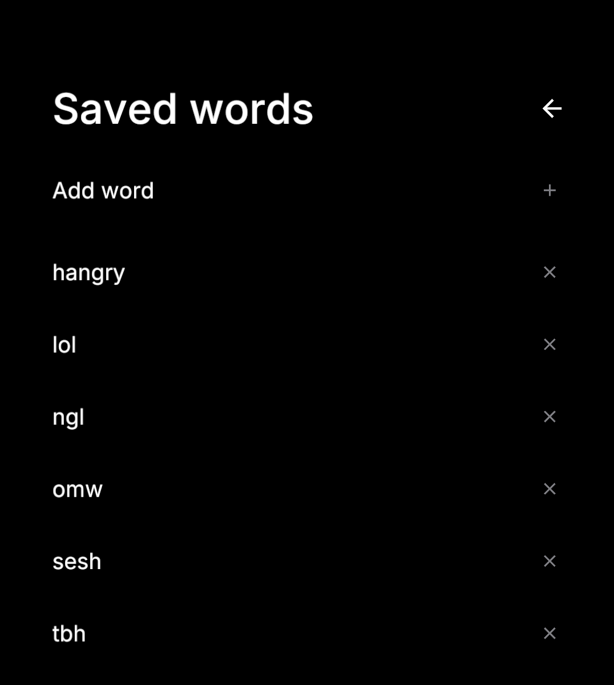

<div align="center">


### Atlas


**A toolkit to power up your Unihertz T2E!**

</div>

> **Update, November 2026:** Swipe typing is the first feature in Atlas, and it's ready to try on the Unihertz Titan 2 Elite. Slide across the physical keys without pressing them, and Atlas types the word. I'm now working on more features.

## Features

<h3 align="center">Swipe typing</h3>

<p align="center">
  
  
  
  
</p>

- Swipe across the physical keys to type.
- Rest your finger lightly on the space bar, then move it left or right to move the cursor.
- Get suggestions for both swiped and typed words.
- Lightly tap configured tap keys to type the letter and a space.
- Atlas learns new words the more you use them.

> **Languages:** Swiping typing supports only English. Each new language needs its own trained models and a lot of testing, which is a very large task. I will add a language only when it works as well as English.

## Install

The latest APK can be found here in [releases](https://github.com/juleshall4/atlas/releases).

I recommend installing through [Obtainium](https://github.com/ImranR98/Obtainium) so you can receive updates.

1. Install [Obtainium](https://github.com/ImranR98/Obtainium/releases).
2. In Obtainium, tap **Add App**.
3. Paste the following URL as the app source, then tap **Add**:

   ```text
   https://github.com/juleshall4/atlas
   ```

4. Tap **Install**.

## Privacy

Everything runs and stays on your device. No one, including me, gets your data.

Atlas doesn't learn from password, email, URL or private fields.

Atlas displays over other apps only to get touchpad input from the Titan 2. It never reads the screen. You can turn off the silent notification that Android shows for this.

## Contributing

Thank you for your interest in Atlas! All help is welcome. Before you write code, please read the [contributing guide](CONTRIBUTING.md).

1. **Open an issue.** Tell me about bugs, ideas and questions in an issue.
2. **Use a template.** Select **Bug** or **Feature**. The template adds the label for you.
3. **Wait for a reply.** I read each issue, approve it, and we agree who does the work.
4. **Test on a Titan 2 Elite.** Please test each pull request on a real device.
5. **Open a pull request.** Link it to the approved issue.

Not a developer? You can still help! Send a bug report or an idea from **Settings > Send feedback** in Atlas.

## Credits

Atlas is powered by and built with these projects:

- [Ink](https://github.com/No-Scrolling/ink): the app framework, an awesome tool built by my best friend, [vandamd](https://github.com/vandamd) (MIT)
- [FUTO Swipe](https://gitlab.futo.org/keyboard/swipe-library): swipe recognition (GPL-3.0)
- [FUTO Keyboard](https://github.com/futo-org/android-keyboard): contextual prediction (FUTO Source First)
- [FUTO Swipe models](https://huggingface.co/futo-org/futo-swipe): swipe typing models (FUTO Model Weights)
- [AOSP dictionaries](https://codeberg.org/Helium314/aosp-dictionaries/src/branch/main/dictionaries/main_en_gb.dict): British English dictionary (Apache 2.0)
- [Inter](https://github.com/rsms/inter): typeface (SIL Open Font Licence)

## License

This project is licensed under the GNU General Public License v3.0 (GPL-3.0-only). See the [LICENSE](LICENSE) file for details.
