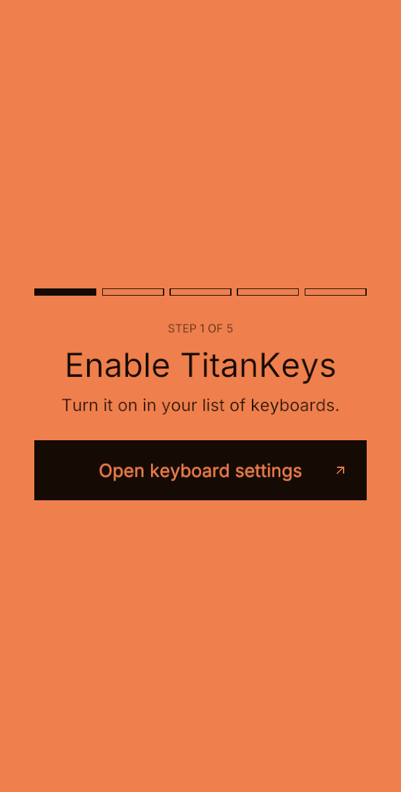
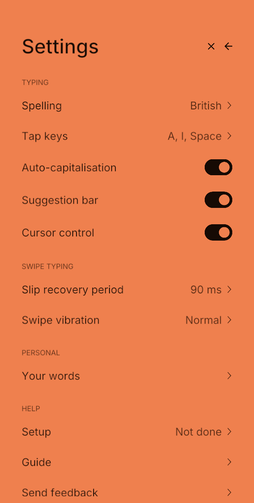
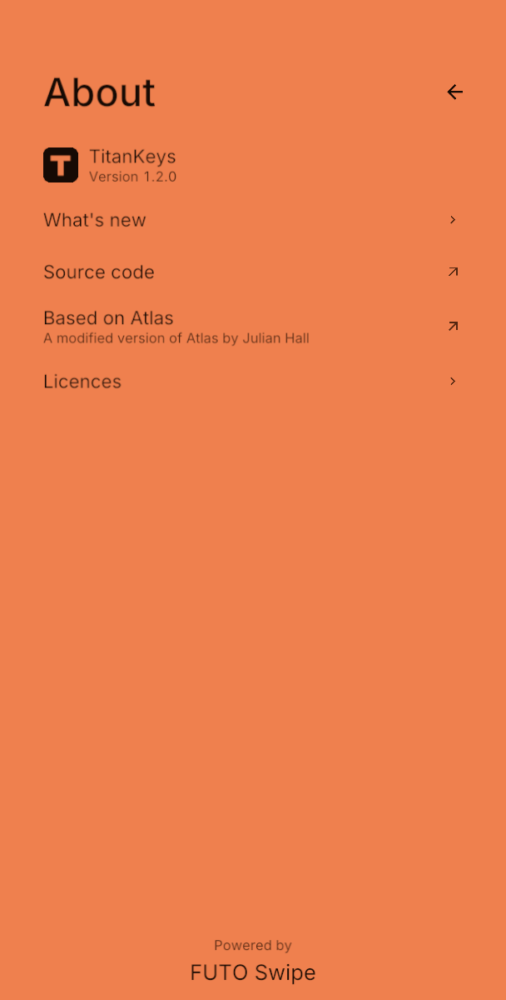

<div align="center">


### TitanKeys

**Better one-handed swiping for the Unihertz Titan 2 Elite, with two-handed typing kept great.**

</div>

> TitanKeys is an independent, modified version of [Atlas](https://github.com/juleshall4/atlas) by Julian Hall. Atlas is the original project and the base of everything here. This fork started in November 2026, and its changes are in the git history. It is not made by, affiliated with, or endorsed by Atlas, FUTO, or Unihertz.

<p align="center">
  
  
  
</p>

## Philosophy

The Titan 2 Elite is small enough to use with one hand, so swiping with one thumb should just work. Real thumbs take shortcuts: they cut corners, stop short of the far keys, and slide off the top of the sensor.

TitanKeys tries to understand the swipe you meant, not only the path you drew. It does that without making two-handed typing worse, so a resting thumb or a quick brush between key presses shouldn't type anything.

Every change is measured on real recorded swipes before it stays.

## TitanKeys and Atlas

Atlas is a great keyboard, and TitanKeys only exists because Julian built it and shared it. The two projects just aim for slightly different things. Atlas stays simple and keeps swiping for typing only. TitanKeys takes on more complexity to get more out of quick, one-handed swipes. If you'd rather have something simpler, Atlas is an excellent choice.

The comparisons below use Atlas at the commit this fork started from (`0981443`, November 2026). Atlas is actively developed, so some of this may have changed since.

| Real recordings, same touches through both | Atlas | TitanKeys |
| --- | --- | --- |
| 300 swiped words: right word first | 171 (57%) | 229 (76%) |
| 300 swiped words: right word in top 3 | 202 (67%) | 260 (87%) |
| 100 of those words, held back from tuning: right word first | 62 (62%) | 80 (80%) |
| 103 swipes that broke into pieces: right word first | 39 (38%) | 72 (70%) |
| 197 single-touch swipes: right word first | 132 (67%) | 157 (80%) |
| 126 words swiped in real sentences: right word first, first try | 86 (68%) | 106 (84%) |

All of this is one person's swipes on one phone, and TitanKeys was tuned on those same hands, so your results may differ. A third of the 300 words were held back from tuning so the numbers aren't only fitted to those samples, and the sentences were recorded after tuning. The recordings and replay tools are in [`android/debug/recorder`](android/debug/recorder), so anyone can check these numbers or reuse them.

### A few real swipes

Recorded on the phone and replayed through both. The dotted line is the word that was meant. These are picked to show the difference, and not every word improves: of the 300, 65 got better and 7 got worse.

| Recorded swipe | Atlas typed | TitanKeys typed |
| --- | --- | --- |
|  | set tenth | strength |
|  | trinity on | recognition |
|  | pure | power |
|  | collar | village |

## What's different

### Keeping a broken swipe together

The sensor ends about halfway up the top row, so a thumb can slip off mid-word and come back. In the recordings, 103 of 300 swipes (34%) broke this way.

**Atlas** joins two touches when the second starts within 90 ms, which keeps the rule simple. **TitanKeys** also looks at where the touch comes back and which way it's heading, so it can allow a longer gap without merging separate words.

| | Atlas | TitanKeys |
| --- | --- | --- |
| Broken swipes joined (higher is better) | 56 of 96 (58%) | 86 of 96 (90%) |
| Separate words wrongly merged (lower is better) | 214 of 1,200 (18%) | 84 of 1,200 (7%) |

| Atlas | TitanKeys |
| --- | --- |
|  |  |

### Matching a swipe by its shape

**Atlas** lets the FUTO swipe engine choose the words. **TitanKeys** also compares your swipe with the outlines of about 12,400 common words and your saved words, then blends those answers with the engine's list. A swipe that stops short gets smaller but mostly keeps its shape. In 98 of the 127 swipes the engine got wrong (77%), the right word's outline fit better than the outline of the word the engine picked.

| Comparing outlines | Scaled to the same size |
| --- | --- |
|  |  |

### Expecting a thumb to stop short

In the recordings, thumbs stopped short of corners by 0.74 keys going right, 0.44 up, 0.24 down and 0.20 left. So where a swipe turns says which key it was aiming for: a thumb that turns at I was probably heading for O.

TitanKeys moves each corner of a word's outline back to where a thumb would really turn. The swipe itself isn't changed. Here's a simulated lazy swipe of "jason":


### The faster the swipe, the wider the second look

Quick swipes tend to come out narrower than the word they mean. **TitanKeys** reads a swipe a second time stretched wider, and each word keeps its better score. The stretch grows with speed: nothing below 10 keys per second, rising to the full 1.2 times at 16 and above. Slow, careful swipes are read exactly as they were made.

| Swipe speed | Swipes | No stretch: right word first | Gradual stretch: right word first |
| --- | --- | --- | --- |
| Under 11 keys per second | 78 | 57 | 58 |
| 11 to 14 | 105 | 76 | 77 |
| 14 to 17 | 119 | 95 | 99 |
| Over 17 | 73 | 55 | 60 |

| partner | perform |
| --- | --- |
|  |  |

### Letting the sentence help

The FUTO engine already uses context natively. **TitanKeys** adds a boost for a word the sentence expects, but only when the path fits it closely, so a likely word can't win on being likely alone. On 126 real swiped words, the boost made 7 better and none worse. A few words from those sentences, with all of the changes on this page together:

| In the sentence | Atlas | TitanKeys |
| --- | --- | --- |
| sorry that took so **long** | on | long |
| call me **back** after lunch | ban | back |
| good luck with **your** exam | you | your |
| let me check and **get** back to you | her | get |
| twelve candles melted **near** the window | beard | near |

### Deleting a word with one thumb

Atlas keeps swiping for typing only, and deletes a word with Alt + Backspace or Ctrl + Backspace, which both still work here. Those are awkward with one hand, so **TitanKeys** adds a quick, straight flick left from around Backspace, at any length. Fitted to 68 real strokes, it catches 66 of them (97%), and it didn't trigger on any of 875 recorded word touches.


### Suggestions in launcher search

Atlas hides the suggestion bar in launcher search, which keeps the home screen clean. **TitanKeys** keeps it hidden while the search is empty and shows it once you start typing, which helps in launchers like Smart Launcher.

<details>
<summary><strong>Three smaller changes</strong></summary>

The pictures here are diagrams of the behaviour, not recordings, and the words in them are examples.

**Space types a space when your thumb is resting on it.** Across 25 sentences typed on the keys with two hands, accidental selections went from 5 to 0.

| Atlas | TitanKeys |
| --- | --- |
|  |  |

**Picking a swiped word moves on to next-word suggestions,** as Atlas does for typed words. To switch to another option afterwards, move the cursor back into the word.

| Atlas | TitanKeys |
| --- | --- |
|  |  |

**A long stroke still counts right after a key press,** while short brushes are ignored for longer as you type. Across the same 25 typed sentences, accidental swipes went from 3 to 2, and accidental touches read as taps went from 27 to 16.

| Atlas | TitanKeys |
| --- | --- |
|  |  |

</details>

### What it costs

These changes aren't free, and Atlas's simpler approach avoids all of this:

- There's more code, and more settings that were tuned on one person's thumbs.
- 7 of the 300 words got worse, for example has → had and but → by.
- Separate words swiped very quickly can merge. At gaps of 120 ms or more, 5 of 270 pairs merged (2%), where Atlas merged none. At 90 ms or less it's 28 of 90 (31%), where Atlas merged all 90.
- Recognition takes a little longer, about 4 ms in testing (13 ms to 17 ms).

## Privacy

Everything runs and is stored locally on your device. No data is stored or monitored by me or any third party.

TitanKeys doesn't learn from fields marked as passwords, email addresses, URLs, or private by the app.

TitanKeys asks to display over other apps because of how the Titan 2 sends touchpad input. It never reads the screen. Android shows a silent "TitanKeys is displaying over other apps" notification while it's there, which you can turn off.

## Install

Download the latest APK from [releases](https://github.com/jasonlok000/titankeys/releases) and install it. TitanKeys installs next to Atlas, so it doesn't replace it or touch Atlas's saved words.

To build it yourself, follow the setup in the [contributing guide](CONTRIBUTING.md), then run:

```bash
bash tools/debug.sh --install
```

This installs **TitanKeys Debug**, a separate test build.

## Feedback

Bugs and ideas are welcome in [issues](https://github.com/jasonlok000/titankeys/issues). If something also happens in Atlas, please report it [there](https://github.com/juleshall4/atlas/issues) too.

Work is shared in both directions. Anything here is free to use in Atlas, and improvements from Atlas are welcome here.

## Credits

TitanKeys is built on the work of these projects:

- [Atlas](https://github.com/juleshall4/atlas) by Julian Hall: the original project this is based on (GPL-3.0). Thank you for open sourcing it.
- [Ink](https://github.com/No-Scrolling/ink): the app framework (MIT)
- [FUTO Swipe](https://gitlab.futo.org/keyboard/swipe-library): swipe recognition (GPL-3.0)
- [FUTO Keyboard](https://github.com/futo-org/android-keyboard): contextual prediction (FUTO Source First)
- [FUTO Swipe models](https://huggingface.co/futo-org/futo-swipe): swipe typing models (FUTO Model Weights)
- [AOSP dictionaries](https://codeberg.org/Helium314/aosp-dictionaries/src/branch/main/dictionaries/main_en_gb.dict): British English dictionary (Apache 2.0)
- [Pastiera](https://github.com/palsoftware/pastiera): the Enter key rules and list of chat apps, and the base of autocorrect and next-word learning (GPL-3.0)
- [Numen](https://github.com/jlo-aug/numen): autocorrect for typed words and next-word learning (GPL-3.0). Its word data has its own licences: see [`licences/Numen-autocorrect-data.md`](licences/Numen-autocorrect-data.md)
- [Inter](https://github.com/rsms/inter): typeface (SIL Open Font Licence)

TitanKeys is powered by FUTO Swipe. "Titan 2 Elite" is a product of Unihertz.

## License

TitanKeys is licensed under the GNU General Public License v3.0 (GPL-3.0-only), the same as Atlas. See the [LICENSE](LICENSE) file.

TitanKeys includes code under the FUTO Source First License, so it can only be modified and distributed for free, for non-commercial purposes. See the [licences](licences) folder for every licence.
