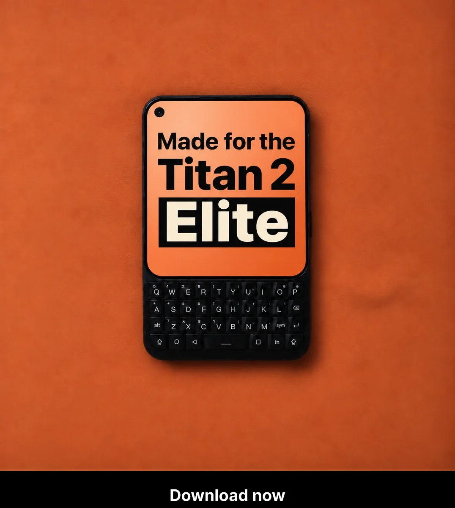
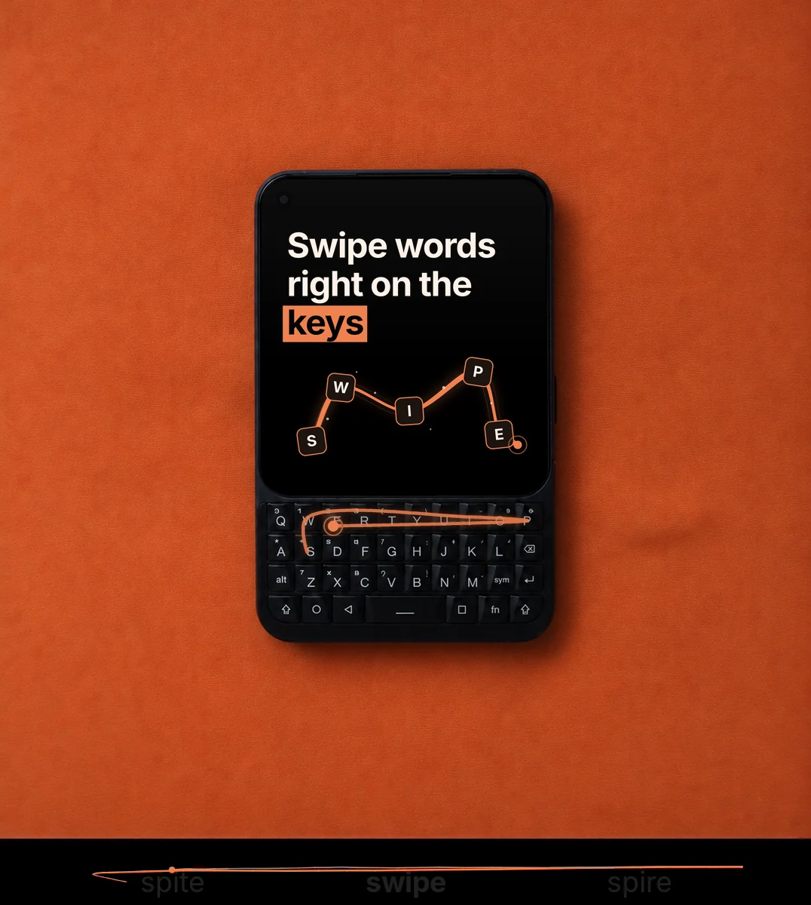
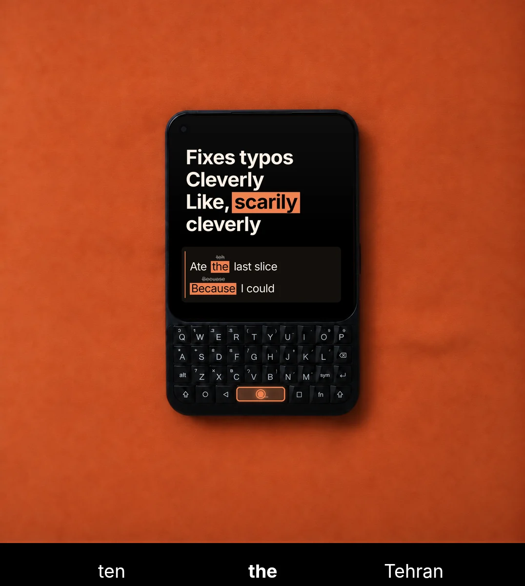
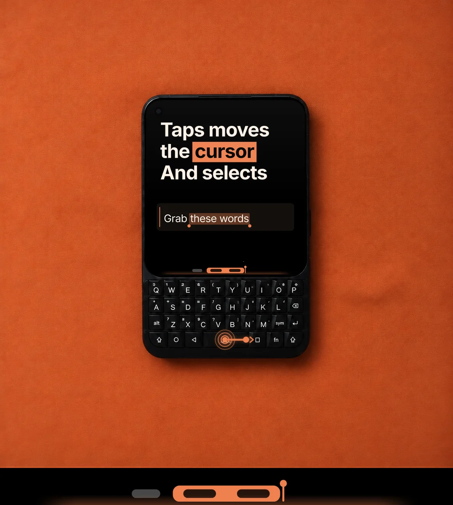
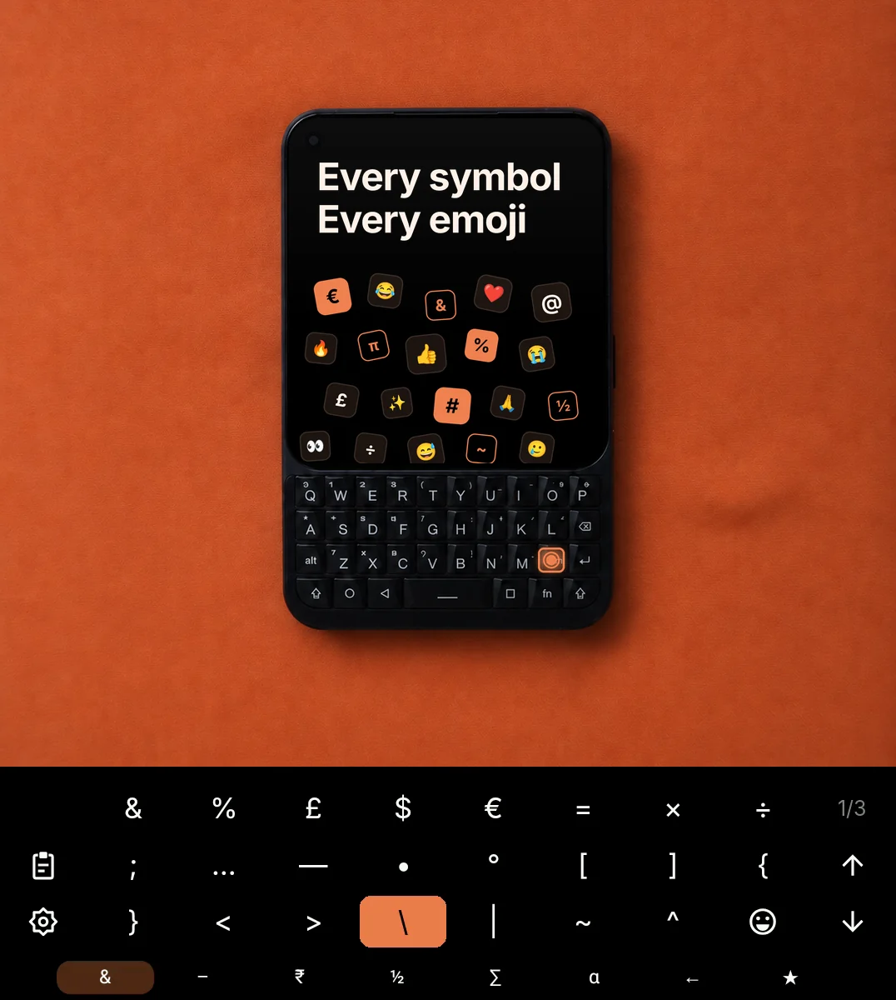
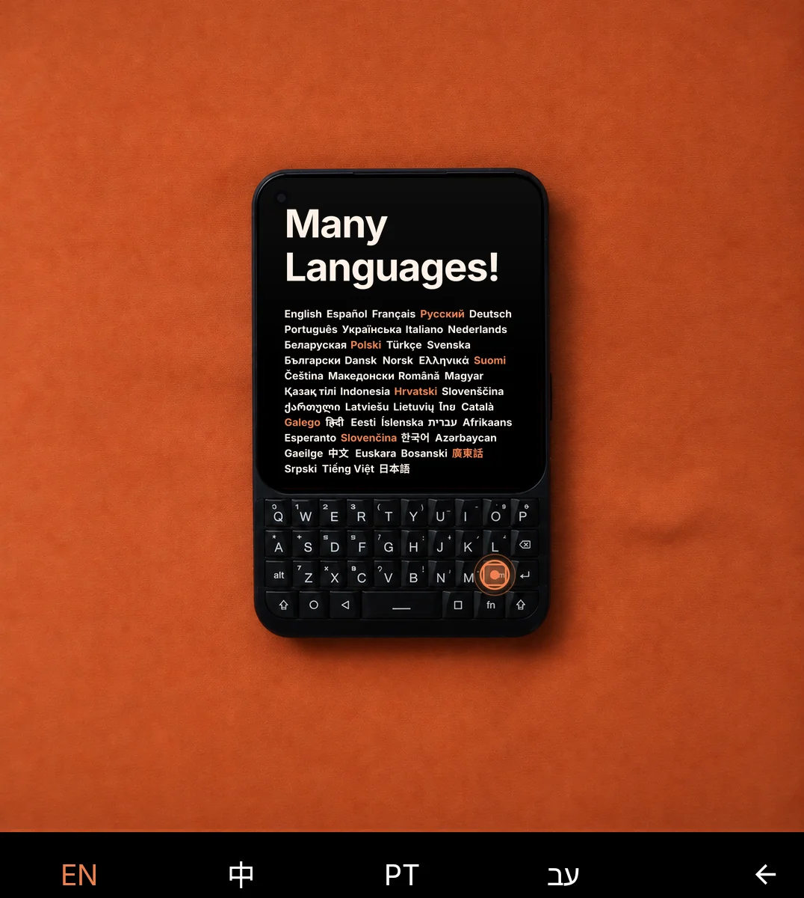
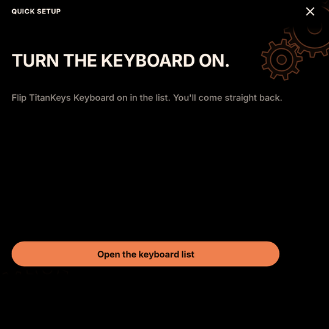
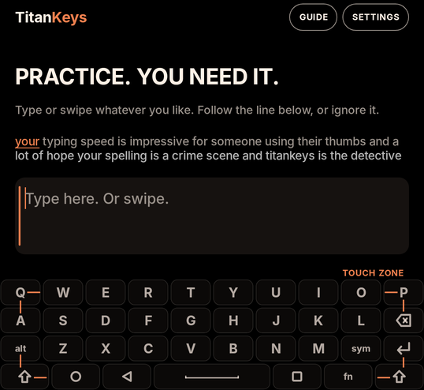
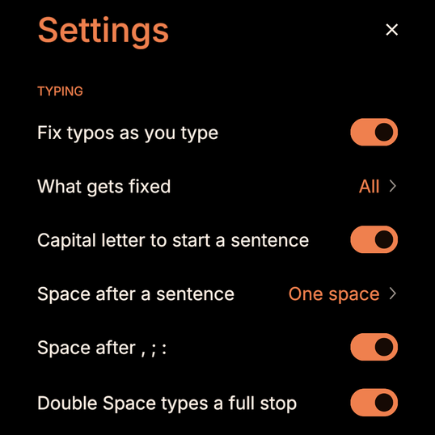

<div align="center">


### TitanKeys

A keyboard made for the Unihertz Titan 2 Elite. This phone is pretty unique, so it gets a keyboard of its own.

Swipe whole words on the same keys you press. Type one-handed with ease. Let it fix your typos as you go, in English or 48 other languages.

**[Download it](https://github.com/jasonlok000/titankeys/releases)**



</div>

## See it in action

Two minutes of TitanKeys on a real Titan 2 Elite, keys and all.

<!-- TRAILER: paste the GitHub video link here -->

> TitanKeys is an independent, modified version of [Atlas](https://github.com/juleshall4/atlas) by Julian Hall. Atlas is the original project and the base of everything here. This fork started in November 2026, and its changes are in the git history. It is not made by, affiliated with, or endorsed by Atlas, FUTO, or Unihertz.

## Why it exists

The Titan 2 Elite has physical keys, and the stock keyboard and the big glass keyboards were never built around them. Seeing Atlas swipe words on those keys started it: what would a keyboard look like if it was made just for this phone? The answer took weeks of very intense work and grew into TitanKeys.

It works right out of the box, and a friendly guide sets it up. If you like tweaking, nearly every behaviour has its own switch in Settings.

## What it does

### Swiping



- **Swipe whole words on the same keys you press.** Slide across a word's letters without pressing, then lift. Press short words, swipe long ones, in the same sentence.
- **One thumb is enough,** so one-handed typing really works.
- **Trained for this phone.** The swipe model is fine-tuned on recorded swipes from this phone's keys, so it lands the word you meant. Numbers are in [How it works](#how-it-works).
- **Stray touches type nothing.** A resting thumb or a brush between presses is ignored.
- **One touch fixes a miss.** The bar shows the other words a swipe could have been. Touch one and it goes in.
- **A swipe trail** on the bar shows what the keys felt.
- **Swiping is English only** for now. Other languages type and correct as their own pages say.
- **It knows its own name.** Swipe TitanKeys. Go on.

<br clear="right">

### Autocorrect



- **Typos fixed on Space.** It picks the fix that fits your whole sentence, with a small language model on the phone helping. Typing never waits for it. Built on [Numen](https://github.com/jlo-aug/numen)'s autocorrect, with a lot more on top.
- **Fix earlier words: Off or On.** When the next word shows the one before was wrong, TitanKeys goes back and fixes it: "get dome food" becomes "get some food", and "their going" becomes "they're going". It's on to start. With **Only fix when sure**, it sticks to apostrophes and one-key slips. English only.
- **Apostrophes.** dont, whats and cant get theirs. its, lets, your and friends wait for the next two words, then get an apostrophe only if it clearly fits. It never takes one out.
- **The small slips too.** Missing spaces (hellohow), a last letter twice (yeahh), Shift held too long (THe), a lone i, and names like monday and iphone get their capitals.
- **Words from this chat.** Once a word has come up twice in the conversation, a slip on it gets fixed to that spelling.
- **Names from your contacts,** if you turn it on.
- **Your shorthand is left alone.** shd, sth, idk, cuz and friends never get "fixed". Want them spelled out? Turn on Spell out shorthand, switch off the ones you hate and add your own.
- **British, American or Canadian spelling.**
- **Pick your fixes.** Settings > Typing > What gets fixed has a switch for every kind of fix, plus Only fix when sure for fewer, safer ones.
- **Changed your mind?** Backspace right after a fix puts your word back, typo and all.
- **A capital to start each sentence.** Shift turns on by itself. Press Shift once if you want lowercase.

<br clear="right">

### Space: cursor and selecting



- **Move the cursor.** Tap Space twice, quickly, keep the second tap down, and slide. Slow near the middle, fast near the edge, and it stops when you come back to the middle.
- **Count words by feel.** A tick for each letter and a stronger one at each space, so you can move without looking.
- **Select with three taps.** Tap Space three times and slide to grab words. Slide back to let them go one at a time. Three taps and no slide selects the word you're on.
- **Taps count on Space itself,** not the keys beside it.
- **Double Space types a full stop.** Switch it off if you hate it.
- No more poking the screen to fix one letter. Give it a day.

<br clear="right">

### Symbols, emoji and clipboard



- **Hold a letter for its symbol.** Hold V for ?, and so on for the symbol printed on each key. You pick how long the hold is. Great one-handed.
- **Or press Alt, then the key,** the old-fashioned way.
- **Sym has every other symbol,** in pages and groups. Swipe up or down for more, or rest a finger on the bottom row to pick a group.
- **Press Sym twice for emoji.** A third press closes the panel.
- **Emoji by name.** Type `:smile:` and you get 😄. The bar shows matches as you type.
- **Clipboard history.** In the panel, A opens your recent clips, then your pinned ones. Press the key under a clip to paste it.
- **Pin what you want to keep.** Clips go after an hour unless you pin them. Backspace twice clears all but the pinned ones.
- **Nothing sensitive is kept.** No text an app marks as sensitive, nothing from a password field, and nothing leaves the phone.
- **Quick settings without leaving your app.** In the panel, Alt opens quick settings, a letter each: S for swiping, V for haptics, F for fixes and more.

<br clear="right">

### Languages



- **49 languages.** Pick them in Settings > Languages. Keep up to four on at once, and hold Sym to switch.
- **Chinese, six ways.** Yale or Jyutping for Cantonese, Pinyin or Zhuyin for Mandarin, Cangjie or Quick by shape, in traditional or simplified characters. Japanese and Korean type on the keys too.
- **Gestures work by character in Chinese.** Flick to delete takes one character, not the whole phrase.
- **Enter and Sym know about codes.** With a code half typed, Enter types the code as it is and never sends. Sym clears it first.
- **Each language speaks for itself.** Its settings, key maps and practice text are in its own language.
- **Type in yours and tell us how it goes.** Native speakers and developers can help in [issue #56](https://github.com/jasonlok000/titankeys/issues/56).

<br clear="right">

### Deleting

- **Hold Backspace to keep deleting,** like on a computer. A half-typed code loses its letters first.
- **Flick a word away.** Flick left, fast, from Backspace or the keys next to it, and the word lifts off and dissolves. A flick never leaves two spaces behind.
- **Hold the flick to delete a lot.** Keep your finger down and it eats a word at a time, with a firm hit for each. Slide further out to go faster.
- **Pause.** Slide back onto Backspace and it stops. The caret blinks so you know.
- **Shift + Backspace** deletes a word. **Alt + Backspace** deletes forward, like Delete on a PC, and keeps going if you hold it.

### The bar and the word menu

- **The middle word is what Space types.** Tap it or press Space, same thing. The likeliest one is in bold.
- **The next word before you type it,** then the word you're typing after each letter.
- **Three spots that never move,** all the same size.
- **Your clip, ready to paste** right after you copy something.
- **Hide it** in apps you pick. Keys, holds, Alt and the Sym panel keep working.
- **Hold a word on the bar for its menu.** I moves it up a step and O moves it down: Blocked, Not saved, Saved, Favourite. Favourite puts it first among similar words, in suggestions, swipes and fixes. P or Backspace closes the menu.
- **Fix the word you selected.** Select one word in your text and the bar shows it underlined, ready for the same menu.
- **Settings > Your words** lists your saved and blocked words, with export and import.
- **Idle games.** Leave the bar alone for three minutes and it may start playing with your words. Touch anything and it all goes back.

### Power stuff

- **Snippets.** Set one up like `/addr`, type it, press Space, and there's your address. The `/` is Alt+G, or hold G. Snippets never fire in password fields, and you can import and export them.
- **fn works as Ctrl,** with Ctrl's shortcuts: fn+C, X and V copy, cut and paste.
- **Alt + Sym** switches to your next keyboard.
- **The modifier bar.** Shift, Alt and Ctrl show as chips: filled while held, outlined once set. Press twice to lock.
- **See it before you type it.** Rest a finger on a letter and the bar shows what it types with Shift or Alt. With Ctrl down, it lists Ctrl's shortcuts.
- **Key Mapper can take a break.** All of this is in TitanKeys itself, each shortcut with its own switch in Settings > Shortcuts.

### Exact typing, for terminals and remote computers

- Still experimental. In terminals, remote desktops and game streaming, every key goes straight to the app exactly as you press it, with Shift, Alt and Ctrl (fn too). No fixes, no suggestions.
- The bar shows Shift, Alt, Ctrl, Esc, Tab and More. More has the arrows, Home, End, PgUp, PgDn and F1 to F12.
- Termux, ConnectBot, Termius, AnyDesk, TeamViewer, Windows App, Chrome Remote Desktop, RustDesk, RealVNC Viewer, bVNC, aRDP, Moonlight and Parsec are on the list already. Add or remove any app in Settings.

### This phone's quirks, handled

- **Back does one thing at a time.** With the keyboard up, Back hides it. With the keyboard gone, Back goes back in the app. With a code half typed, it clears the code. Optional, through an Accessibility service the app explains first.
- **The keys stay yours.** A notification popping up at the top no longer steals the keys while you type.
- **Smart Launcher's search works,** fixes and all, with the Back service on.
- **Scroll assistant.** Outside text fields the keys scroll your apps, the way your phone's own Scroll assistant is set, or TitanKeys can block it.
- **Microsoft Teams works properly.** Yes, that needed fixing.

### Looks and feel

- **Always dark,** so the keyboard blends into the black border under the screen.
- **Clear of the rounded corners.** Words, chips, menus and idle games stay inside the screen's curve.
- **Same size at any setting.** The phone's font and display size don't blow it up.
- **Every buzz means one thing.** Moving, a step, done, locked, gone and "nope" each feel different. The haptics on flick to delete got a lot of care.
- **Settings > Haptics** has one switch for all of it and one for every single haptic.

### The rest

- **The fun guide** teaches everything on the keys, one small hands-on step at a time. It's mean on purpose.
- **The boring guide** has every feature in words. Pick your guide in Settings > Guide.
- **The playground** gives you about an hour of text to type along to, and comments on your speed.
- **Two resets.** Reset most things keeps your words, snippets and lists. Reset literally everything is a fresh install.
- **Record a bug** records up to three minutes, shows you what's in it, and you share it where you want.
- **Support page** at the very bottom of Settings. Nothing is locked behind it.

## How it works

Everything runs on your phone:

- **Swipe engine 2.0.** [FUTO Swipe](https://gitlab.futo.org/keyboard/swipe-library) reads your stroke as you made it, again stretched wider for a fast swipe, and again shifted right, where thumbs aim on this sensor. A [CleverKeys](https://github.com/tribixbite/CleverKeys) encoder, fine-tuned on the Titan's touchpad, adds its own guesses. A ranker of 900 decision trees weighs the shape, the readings and your sentence, and picks the three words on the bar. About 70 ms a swipe, and swiping works while the models load.
- **Next words.** DistilGPT-2 reads the last 32 tokens of your text and guesses the next word, then the word you're typing after each letter. It runs after the previous word, so you never wait for it. Before any letter, the right next word is in the top 3 on 37.9% of prompted text, up from 24.0%.
- **Autocorrect.** Typed words are fixed on Space, starting from Numen's autocorrect, and the same model nudges each fix towards the word the sentence expects. Apostrophes like its and it's are decided from the words before them and the two after.
- **Chinese and Japanese.** Chinese runs on [Rime](https://github.com/rime/librime) with OpenCC, and Japanese on Mozc, both on the phone.

**Size.** TitanKeys is about 290 MB, because the models and dictionaries ship inside the app, so nothing you type has to leave the phone. Downloading languages and models only when you need them is planned in [#104](https://github.com/jasonlok000/titankeys/issues/104).

### Swipe accuracy

The same recorded touches, replayed through each keyboard on the phone. Atlas is at the commit this fork started from (`0981443`, November 2026), and Atlas is actively developed, so some of this may have changed since. TitanKeys 1.2 is the last version before swipe engine 2.0.

| 126 words swiped in real sentences | Atlas | TitanKeys 1.2 | TitanKeys, swipe engine 2.0 (2.0 and later) |
| --- | --- | --- | --- |
| Right word first, first try | 86 (68%) | 106 (84%) | 115 (91%) |
| Right word in the top 3 | 108 (86%) | 111 (88%) | 121 (96%) |

These sentences were never used to tune anything, so that's the row to trust. On 540 other swipes, held back from all of engine 2.0's tuning, the right word came first 78.9% of the time (72.6% before engine 2.0) and in the top 3 85.7% (81.5% before). A set of 300 recorded words scores higher still, but the ranker learned from them, so they carry an asterisk in [the technical paper](docs/paper.md).

It's one person's swipes on one phone, so yours may differ. Every number, the trade-offs and the replay tools are in [the paper](docs/paper.md).

### Keyboards for the Titan 2 Elite

As of November 2026, from each project's public pages. This is what each one does, not a ranking.

| | TitanKeys | Atlas | Pastiera / Plektra | Kika (stock) | Gboard |
| --- | --- | --- | --- | --- | --- |
| Swipe words on the keys | ✓ English | ✓ English | ✗ | ✗ (flick up only) | ✗ |
| Space gestures: cursor and select | ✓ both | Cursor only | Cursor via swipe pad / Nav Mode | The phone's Cursor Assistant | ✗ |
| Chinese, Japanese, Korean on the keys | ✓ Chinese (6 methods), Japanese, Korean | ✗ | ✗ | ? | ? |
| Languages | 49 | English | Latin, Greek, Arabic, Cyrillic layouts | Several | Many |
| Hold a letter for its symbol | ✓ | ✗ | ✓ | ✗ | ✗ |
| Open source | GPL-3.0 | GPL-3.0 | GPL-3.0 | ✗ | ✗ |
| Size | About 290 MB (on-device models, [#104](https://github.com/jasonlok000/titankeys/issues/104)) | Small | Small | Comes with the phone | ? |

## Setup

<p align="center">
  
  
  
</p>

The first slide of the guide is setup. It opens each Settings page for you, sees the switch go on and comes back by itself, so each part takes a touch or two:

1. **Turn the keyboard on** in the list of keyboards.
2. **Make it your keyboard.**
3. **Let it sit over other apps.** If Android opens its whole list, find TitanKeys Keyboard in it. The Titan sends touchpad input to the window on top, so this keeps the touchpad on the keys when an app shows its own buttons.
4. **Turn on Scroll assistant, Sliding Mode 1,** the phone's own switch that the touchpad needs, with your apps on Sliding Mode 1.
5. **Let TitanKeys handle the Back key** in Accessibility. It's optional: it makes Back work in one press, keeps the touchpad on the keys when a notification pops up, and lets TitanKeys type in Smart Launcher's search. TitanKeys never reads your screen.

Then the guide teaches you the rest on the keys, and the app opens on the playground so you can show off.

## TitanKeys and Atlas

Atlas is a great keyboard, and TitanKeys only exists because Julian built it and shared it. They just want different things. Atlas stays simple and keeps swiping for typing only. TitanKeys piles on more to squeeze everything out of the Titan 2 Elite, one-handed swipes included. If you'd rather have something simpler, Atlas is an excellent choice.

## Privacy

What you type stays on your phone. The swipe engine and both language models run on the phone, and nothing you type is ever sent.

TitanKeys uses the internet for four things only, and each is strictly limited:

- **News:** at most once a day, it downloads a short signed list of news from the TitanKeys website, such as a new version. It sends nothing about you or your phone. It shows as a silent notification, never while you type, and you can turn it off in **Settings > News**.
- **Sharing, only if you agree:** one switch in **Settings > Sharing** sends examples of your swipes on Wi-Fi, and a day's totals of how TitanKeys' features worked. It's off until you agree on a screen that says exactly what is sent. Never the text you type. It's encrypted on your phone, the totals use an ID that changes every 30 days, and **Delete what I've sent** removes it from the server.
- **Bug reports, only when you press Send:** **Settings > Send feedback**, **Record a bug** and the crash offer open a form. It sends what you wrote, the versions and your phone's model, and a recording or crash report if one is attached, encrypted on your phone so only we can read it. If it can't be sent, you can email it instead.
- **The Support page:** while it's open, it downloads the supporters board. If you buy a coffee, Google Play handles the payment. Only if you join the board does TitanKeys send your purchase proofs and the name and message you chose. **Remove me** deletes it all.

The [privacy policy](https://everyones-niche.com/titankeys/privacy/) says exactly what is sent, why, how it's protected, how long it's kept and how to delete it.

TitanKeys doesn't learn from fields marked as passwords, email addresses, URLs, or private by the app.

TitanKeys asks to display over other apps because of how the Titan 2 sends touchpad input. It never reads the screen. Android shows a silent "TitanKeys is displaying over other apps" notification while it's there, which you can turn off. Its Accessibility service handles Back and hears the keys you press only at set times: while the Sym panel is open, while you're typing a code in a language such as Chinese, Japanese or Korean, and in Smart Launcher's search field. While you type, it also keeps a 1-pixel window above the notification shade, so that a notification can't take the touchpad.

**Settings > Record a bug** records your touches, keys and what the keyboard did, only while you ask it to and for 3 minutes at most, never in password or private fields. You see what's in the file before you share it, and TitanKeys never uploads it: you send it where you like.

## Install

Download the latest APK from [releases](https://github.com/jasonlok000/titankeys/releases) and install it, then open TitanKeys: the guide takes it from there. TitanKeys installs next to Atlas, so it doesn't replace it or touch Atlas's saved words.

When a new version is out, TitanKeys tells you with a short, silent notification, never while you type. The same news is in **Settings > News**, where you can turn it off.

To build it yourself, follow the setup in the [contributing guide](CONTRIBUTING.md), then run:

```bash
bash tools/debug.sh --install
```

This installs **TitanKeys Debug**, a separate test build.

## Questions

**Does it work on other phones?** Nope. It needs the Titan 2 Elite's keys and touchpad. Got another keyboard phone? The [contributing guide](CONTRIBUTING.md#bring-titankeys-to-another-device) says how to bring TitanKeys to it.

**Is it free?** Yes. It's free and open source, under the GPL-3.0, with no ads and nothing locked. You can buy the project a coffee on the Support page if you want to; it changes nothing in the keyboard. Some parts use the FUTO Source First License, so it can only be shared for free, for non-commercial use.

**Does it need the internet?** Not to type. It only goes online for news, the Support page's board, bug reports you send and, if you agree, Sharing. The [privacy policy](https://everyones-niche.com/titankeys/privacy/) says exactly what's sent.

**Other languages?** 49 of them, Chinese included. Swiping is English only for now. Native speakers can help make their language better in [issue #56](https://github.com/jasonlok000/titankeys/issues/56).

**How is it different from Atlas?** See [TitanKeys and Atlas](#titankeys-and-atlas). Short version: Atlas stays simple, and TitanKeys goes further on this one phone.

**Something broke. Where do I complain?** Open an [issue](https://github.com/jasonlok000/titankeys/issues), use Settings > Send feedback in the app, or record it with Settings > Record a bug.

## Feedback

Bugs and ideas are welcome in [issues](https://github.com/jasonlok000/titankeys/issues). If something also happens in Atlas, please report it [there](https://github.com/juleshall4/atlas/issues) too.

You can also help TitanKeys get better for every Titan 2 Elite: **Settings > Sharing** sends examples of your swipes and daily totals, only if you agree. The guide asks on a screen of its own at the end. See [Privacy](#privacy) for what is sent.

Work goes both ways. Anything here is free to use in Atlas, and improvements from Atlas are welcome here.

## Credits

TitanKeys is built on the work of these projects:

- [Atlas](https://github.com/juleshall4/atlas) by Julian Hall: the original project this is based on (GPL-3.0). Thank you for open sourcing it.
- [Ink](https://github.com/No-Scrolling/ink): the app framework (MIT)
- [FUTO Swipe](https://gitlab.futo.org/keyboard/swipe-library): swipe recognition (GPL-3.0)
- [FUTO Keyboard](https://github.com/futo-org/android-keyboard): contextual prediction (FUTO Source First)
- [FUTO Swipe models](https://huggingface.co/futo-org/futo-swipe): swipe typing models (FUTO Model Weights)
- [AOSP dictionaries](https://codeberg.org/Helium314/aosp-dictionaries/src/branch/main/dictionaries/main_en_gb.dict): English dictionary (Apache 2.0)
- [Pastiera](https://github.com/palsoftware/pastiera): the Enter key rules and list of chat apps, and the base of autocorrect and next-word learning (GPL-3.0)
- [Numen](https://github.com/jlo-aug/numen): autocorrect for typed words and next-word learning (GPL-3.0). Its word data has its own licences: see [`licences/Numen-autocorrect-data.md`](licences/Numen-autocorrect-data.md)
- [Inter](https://github.com/rsms/inter): typeface (SIL Open Font Licence)
- [CleverKeys](https://github.com/tribixbite/CleverKeys): the swipe encoder that swipe engine 2.0 fine-tunes for the Titan touchpad (GPL-3.0)
- [DistilGPT-2](https://huggingface.co/distilbert/distilgpt2): the next-word model (Apache 2.0)
- [ONNX Runtime](https://github.com/microsoft/onnxruntime): runs these two models on the phone (MIT). See [`licences/Swipe-engine-2-models.md`](licences/Swipe-engine-2-models.md)
- [gemoji](https://github.com/github/gemoji): the emoji names for shortcodes such as `:smile:` (MIT). See [`licences/gemoji-MIT.txt`](licences/gemoji-MIT.txt)
- [Rime](https://github.com/rime/librime) with [OpenCC](https://github.com/BYVoid/OpenCC): Chinese typing, in Simplified, Hong Kong or Taiwan characters (BSD-3-Clause and Apache 2.0). Their versions, libraries and build: [`native/rime/SOURCES.md`](native/rime/SOURCES.md)
- [rime-cantonese](https://github.com/rime/rime-cantonese): the Cantonese words for Yale and Jyutping (CC BY 4.0, place names ODbL 1.0)
- [rime-jyutping](https://github.com/rime/rime-jyutping), [rime-luna-pinyin](https://github.com/rime/rime-luna-pinyin), [rime-essay](https://github.com/rime/rime-essay) and [rime-prelude](https://github.com/rime/rime-prelude): the Yale spelling rules by 幸延, the Pinyin words and Rime's shared files (LGPL-3.0). See [`licences/Rime-data-LGPL-3.0.txt`](licences/Rime-data-LGPL-3.0.txt)

TitanKeys is powered by FUTO Swipe. "Titan 2 Elite" is a product of Unihertz.

## License

TitanKeys is licensed under the GNU General Public License v3.0 (GPL-3.0-only), the same as Atlas. See the [LICENSE](LICENSE) file.

TitanKeys includes code under the FUTO Source First License, so it can only be modified and distributed for free, for non-commercial purposes. See the [licences](licences) folder for every licence.
