# Under the hood

The full story of how TitanKeys reads your swipes and picks your words, with every number behind it. The short version is in the [README](../README.md#how-its-smart).

Every change below was measured on real swipes recorded on a Titan 2 Elite before it stayed.

## Swipe engine 2.0

A swipe goes through four stages:

1. **FUTO Swipe** reads the stroke, as Atlas does, plus a second reading stretched wider for a fast swipe and a third shifted to the right, where thumbs aim on this sensor. It keeps 48 words.
2. **A CleverKeys encoder, fine-tuned on the Titan's touchpad,** reads the same stroke, and a word search turns that reading into up to 80 more words.
3. **DistilGPT-2,** a small language model, gives each word its chance after the last 32 tokens of your text. It runs after the previous word, so a swipe never waits for it.
4. **A ranker** of 900 decision trees weighs the shape, the readings and the sentence together, and picks the three words on the strip.

If any of the new models can't load, the FUTO engine's own order is used, as before. The models add about 95 MB to the app and take about 70 ms per swipe on the phone. They load in the background a few seconds after the keyboard starts, and swiping works in the meantime.

The same language model drives the word suggestions: the next word before you type, then the words that start with the letters you have typed. It also gives typed autocorrect a small push towards the word the sentence expects. It is only used when its answer is already there, so typing never waits.

The first three rows were measured on the phone over 1,046 typed words, and the last two on typing held back from all tuning.

| Word suggestions | Before | Engine 2.0 |
| --- | --- | --- |
| Letters typed before the word is in the top 3 | 2.51 | 2.34 |
| Word in the top 3 after one letter, prompted text | 60.1% | 75.5% |
| Word in the top 3 after one letter, everyday text | 42.5% | 47.2% |
| Next word in the top 3 before any letter, prompted text | 24.0% | 37.9% |
| Next word in the top 3 before any letter, everyday text | 16.6% | 20.1% |

## How it compares

The same recorded touches, replayed through each keyboard on the phone. Atlas is at the commit this fork started from (`0981443`, November 2026), and Atlas is actively developed, so some of this may have changed since. TitanKeys 1.2 is the last version before swipe engine 2.0.

| Real recordings, same touches through each | Atlas | TitanKeys 1.2 | TitanKeys 2.0 |
| --- | --- | --- | --- |
| 126 words swiped in real sentences: right word first, first try | 86 (68%) | 106 (84%) | 115 (91%) |
| The same 126 words: right word in the top 3 | 108 (86%) | 111 (88%) | 121 (96%) |
| 300 swiped words: right word first \* | 171 (57%) | 229 (76%) | 275 (92%) |
| 300 swiped words: right word in the top 3 \* | 202 (67%) | 260 (87%) | 286 (95%) |
| 103 of them that broke into pieces: right word first \* | 39 (38%) | 72 (70%) | 86 (83%) |
| 197 of them in one touch: right word first \* | 132 (67%) | 157 (80%) | 189 (96%) |

The sentences were never used to tune anything, so that row is the fair comparison. \* Engine 2.0's ranker learned from the 300 recorded words, so its numbers on them are higher than on swipes it has never seen. On 540 other swipes, from prompted and everyday typing, held back from all of its tuning, engine 2.0 put the right word first 78.9% of the time against 72.6% for TitanKeys 1.2, and in the top 3 85.7% against 81.5%.

All of this is one person's swipes on one phone, so your results may differ. The recordings and replay tools are in [`android/debug/recorder`](../android/debug/recorder), so anyone can check these numbers or reuse them.

### A few real swipes

Recorded on the phone and replayed through each. The dotted line is the word that was meant.

| Recorded swipe | Atlas typed | TitanKeys typed |
| --- | --- | --- |
| 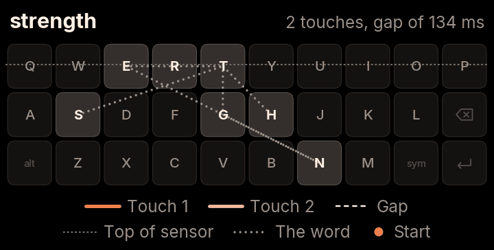 | set tenth | strength |
| 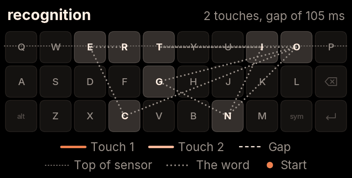 | trinity on | recognition |
| 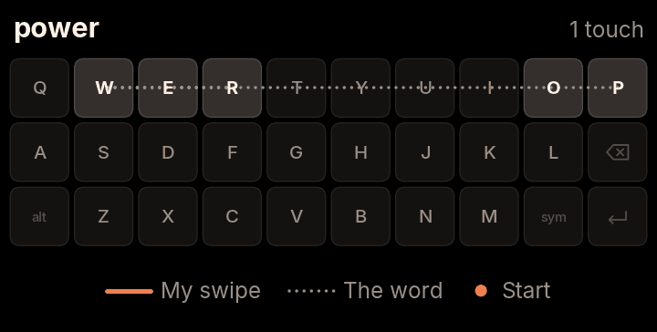 | pure | power |
| 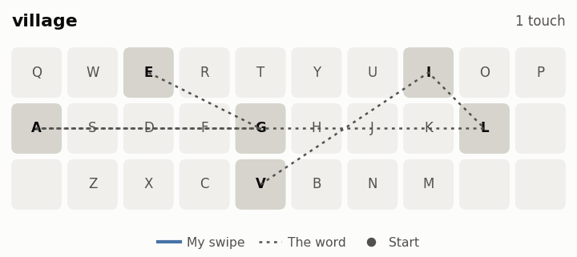 | collar | village |

## Keeping a broken swipe together

The sensor ends about halfway up the top row, so a thumb can slip off mid-word and come back. In the recordings, 103 of 300 swipes (34%) broke this way.

**Atlas** joins two touches when the second starts within 90 ms, which keeps the rule simple. **TitanKeys** also looks at where the touch comes back and which way it's heading, so it can allow a longer gap without merging separate words.

| | Atlas | TitanKeys |
| --- | --- | --- |
| Broken swipes joined (higher is better) | 56 of 96 (58%) | 86 of 96 (90%) |
| Separate words wrongly merged (lower is better) | 214 of 1,200 (18%) | 84 of 1,200 (7%) |

| Atlas | TitanKeys |
| --- | --- |
| 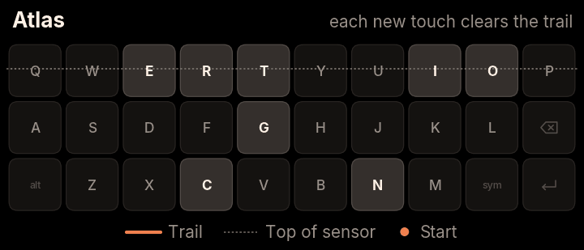 | 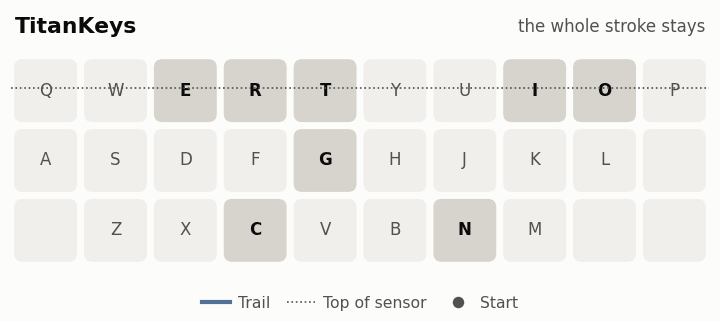 |

## Matching a swipe by its shape

TitanKeys also compares your swipe with the outlines of about 12,400 common words and your saved words. A swipe that stops short gets smaller but mostly keeps its shape. In 98 of the 127 swipes the FUTO engine got wrong (77%), the right word's outline fit better than the outline of the word the engine picked.

| Comparing outlines | Scaled to the same size |
| --- | --- |
| 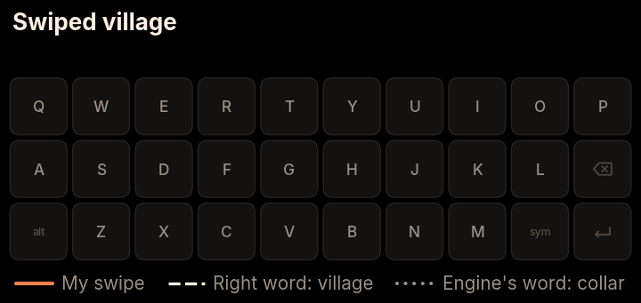 | 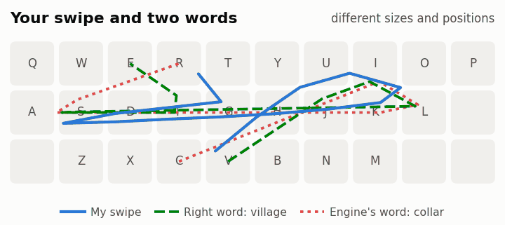 |

## Expecting a thumb to stop short

In the recordings, thumbs stopped short of corners by 0.74 keys going right, 0.44 up, 0.24 down and 0.20 left. So where a swipe turns says which key it was aiming for: a thumb that turns at I was probably heading for O. TitanKeys moves each corner of a word's outline back to where a thumb would really turn. The swipe itself isn't changed. Here's a simulated lazy swipe of "jason":

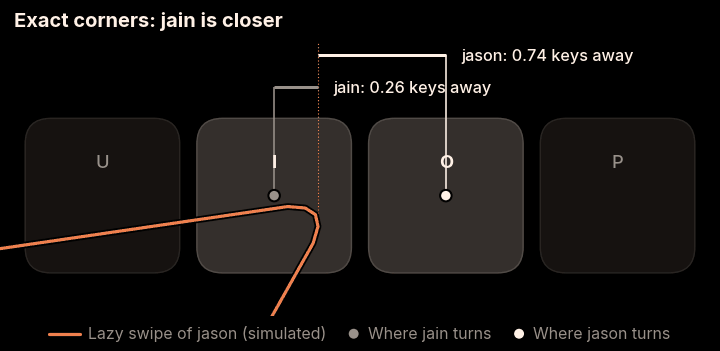

## The faster the swipe, the wider the second look

Quick swipes tend to come out narrower than the word they mean, so TitanKeys reads a fast swipe a second time, stretched wider. The stretch grows with speed: nothing below 10 keys per second, rising to 1.2 times at 16 and above. Slow, careful swipes are read exactly as they were made.

| Swipe speed | Swipes | No stretch: right word first | Gradual stretch: right word first |
| --- | --- | --- | --- |
| Under 11 keys per second | 78 | 57 | 58 |
| 11 to 14 | 105 | 76 | 77 |
| 14 to 17 | 119 | 95 | 99 |
| Over 17 | 73 | 55 | 60 |

| partner | perform |
| --- | --- |
| 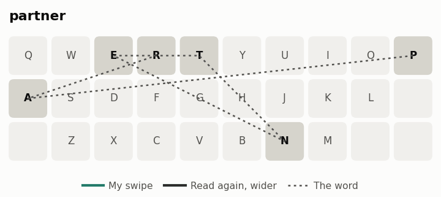 | 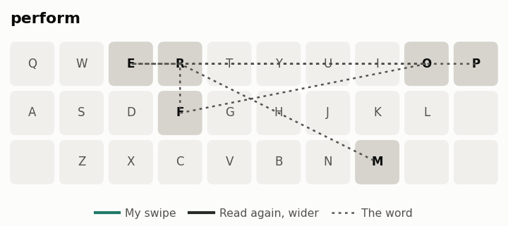 |

## Deleting a word with one thumb

The flick from Backspace is a quick, straight stroke left from around Backspace, at any length. Fitted to 68 real strokes, it catches 66 of them (97%), and it didn't trigger on any of 875 recorded word touches.

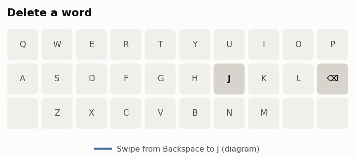

<strong>Smaller changes for two-handed typing</strong>

The pictures here are diagrams of the behaviour, not recordings, and the words in them are examples.

**Space types a space when your thumb is resting on it.** Across 25 sentences typed on the keys with two hands, accidental selections went from 5 to 0.

| Atlas | TitanKeys |
| --- | --- |
| 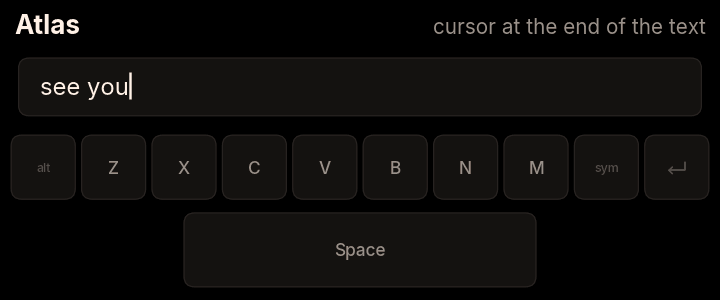 | 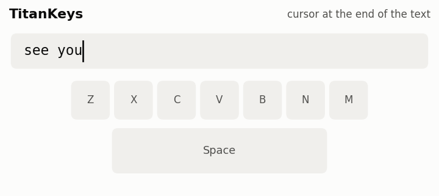 |

**Picking a swiped word moves on to next-word suggestions,** as Atlas does for typed words. To switch to another option afterwards, move the cursor back into the word.

| Atlas | TitanKeys |
| --- | --- |
| 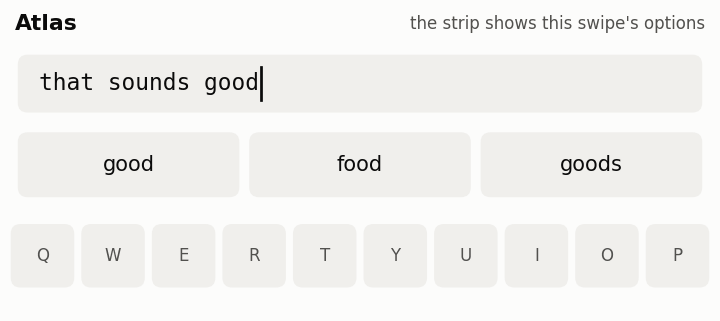 | 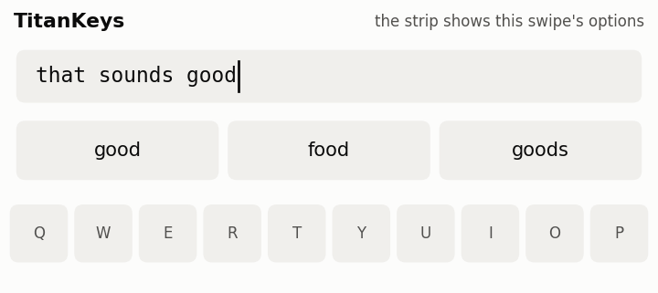 |

**A long stroke still counts right after a key press,** while short brushes are ignored for longer as you type. Across the same 25 typed sentences, accidental swipes went from 3 to 2, and accidental touches read as taps went from 27 to 16.

| Atlas | TitanKeys |
| --- | --- |
| 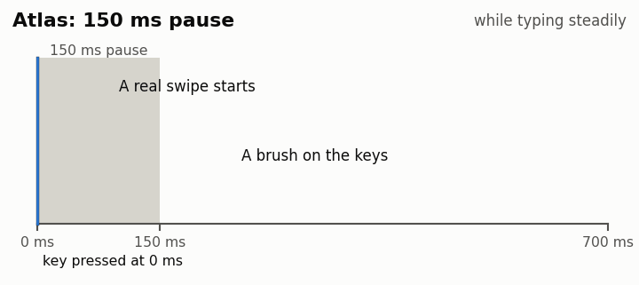 | 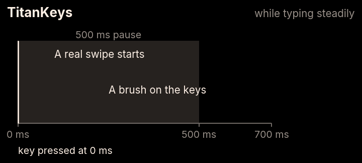 |

## What it costs

These changes aren't free, and Atlas's simpler approach avoids all of this:

- There's more code, and more settings that were tuned on one person's thumbs.
- The app is about 95 MB bigger, and the keyboard uses about 400 MB more memory while engine 2.0's models are loaded. The phone has 12 GB.
- Separate words swiped very quickly can merge. At gaps of 120 ms or more, 5 of 270 pairs merged (2%), where Atlas merged none. At 90 ms or less it's 28 of 90 (31%), where Atlas merged all 90.
- A swipe takes about 70 ms to read on the phone with engine 2.0, against about 15 ms with the FUTO engine alone.
