# TitanKeys: one keyboard, one phone

**A technical paper on TitanKeys 2.1 for the Unihertz Titan 2 Elite.** Written November 2026.

This is for developers, reviewers and anyone else who makes keyboards. It says what TitanKeys does, how we measured it, how each part works and what each part costs. Every number has a source in [Appendix A](#appendix-a-sources-for-every-number). Anything experimental, held back or measured only once says so.

If you just want to type, the [README](../README.md) is shorter and ruder.

## Contents

1. [Abstract](#1-abstract)
2. [The problem](#2-the-problem)
3. [System overview](#3-system-overview)
4. [Swipe engine 2.0](#4-swipe-engine-20)
5. [Next-word prediction](#5-next-word-prediction)
6. [Autocorrect](#6-autocorrect)
7. [Evaluation method](#7-evaluation-method)
8. [Interface engineering for this phone](#8-interface-engineering-for-this-phone)
9. [Haptics as a language](#9-haptics-as-a-language)
10. [The guide and the playground as teaching design](#10-the-guide-and-the-playground-as-teaching-design)
11. [Privacy and security architecture](#11-privacy-and-security-architecture)
12. [Limitations and what's next](#12-limitations-and-whats-next)
13. [Credits and licences](#13-credits-and-licences)
- [Appendix A: sources for every number](#appendix-a-sources-for-every-number)
- [Appendix B: terms](#appendix-b-terms)

### How to read the numbers

- **First / top 3:** how often the right word was the keyboard's first choice, and how often it was anywhere among the three words on the bar. "78.9 / 85.7" means 78.9% first and 85.7% in the top 3.
- **First try:** only the first attempt at each word counts. Retries would flatter the score, so they're out.
- **Held back:** one third of the word positions (`slot % 3 == 2`) was never used to tune anything. Results on it are the honest ones.
- **Prompted text** was typed from passages shown on screen, so we know the intended word. **Everyday text** is real use, labelled by the word left in the field after any hand correction.
- **The 300-word recording** and **the 126-word sentences** are two public sessions recorded on the phone. They ship in [`android/debug/recorder/samples`](../android/debug/recorder/samples).

All of it is one person typing on one phone. Section 7 says what that does and doesn't prove.

## 1. Abstract

TitanKeys is an Android keyboard for exactly one device, the Unihertz Titan 2 Elite. The phone's keys are also a capacitive touchpad. TitanKeys lets you type on the keys, swipe whole words across them, steer the cursor and delete by flick without leaving them. It is a fork of [Atlas](https://github.com/juleshall4/atlas) and keeps Atlas's base. Everything that reads your typing runs on the phone, offline.

What we claim, with the numbers:

1. **Swiping is more accurate than on the keyboards it came from.** On 126 words swiped in real sentences, never used for tuning, the right word came first 91% of the time, against 68% for Atlas and 84% for TitanKeys 1.2. It was in the top 3 96% of the time, against 86% and 88%. On 540 held-back swipes from other sessions, engine 2.0 is at 78.9 / 85.7, against 72.6 / 81.5 for TitanKeys 1.2.
2. **The engine learned from this sensor.** Thumbs slip off the top of the sensor, stop short of corners, and aim to the left of the keys at its right edge. TitanKeys keeps 90% of broken swipes together (Atlas: 58%), and wrongly glues 7% of separate words (Atlas: 18%). Its swipe encoder is a CleverKeys model fine-tuned on Titan strokes.
3. **A small language model runs on the phone, and you never wait for it.** DistilGPT-2, 8-bit per channel, reads the last 32 tokens. Before any letter, the right next word is in the top 3 37.9% of the time on prompted text, up from 24.0%.
4. **Autocorrect fixes more without breaking more.** With the model's push, slips fixed went from 65.6% to 69.5% on everyday text and 71.4% to 78.4% on prompted text, while wrong fixes stayed flat (4.6% to 4.6%, 2.2% to 1.9%). Missing apostrophes on words like "its" are decided from the sentence: in a study judged by meaning, 93% came out right against 73% before, with no wrong changes on 277 judged cases.
5. **The interface is fitted to this screen.** The bar is centred on the black you see, the bar plus the black border under the screen, not on its own maths middle. Nothing it draws goes into the rounded corners. Its size ignores the phone's font and display size.
6. **It's private because of how it's put together, not because we promise.** Typing never leaves the phone. The only network uses are a signed news feed, at most once a day, and swipe contributions, off until you agree, sealed on the phone with X25519 and AES-256-GCM.

None of this is free: about 95 MB more app, about 400 MB more memory while the models are loaded, and about 70 ms per swipe against about 15 ms for the FUTO engine alone. Section 4.13 has the bill.

## 2. The problem

### 2.1 The phone

The Titan 2 Elite has a QWERTY keyboard under its screen, with keys you press. The same keys are also a touchpad: you can slide a finger across them without pressing anything. A keyboard for this phone has to deal with both at once.

What the touchpad reports, read from the phone's `getevent` and `dumpsys input` and its calibration profile:

| Fact | Value |
| --- | --- |
| Sensor | `touchPad`, one finger, 1080 x 600 raw steps |
| Reports | One point at a time: X, Y and `TOUCH_MAJOR` 0-255 (contact size). No pressure and no minor axis |
| Horizontal coverage | Q centre to P centre: 8.9 of 10 key widths, about 120 raw steps a key |
| Vertical coverage | Top-row centre to Space-row centre: 3.1 of 4 rows, about 190 raw steps a row |
| Observed reach | x 0.056-0.949, y 0.116-0.885 of the full pad |
| Sampling | 10 ms steady, delivered in events of 1-2 points. 653 of 63,065 intervals exceed 40 ms, the longest 3.5 s |

What that means for anyone typing on it:

- **The top half of the top row and the outer halves of the edge columns aren't sensed at all.** A finger on those keys reads as sitting on the edge. 2.6% of samples are at the top edge, and most broken swipes break on the top row.
- **The sensor stops at about P's centre.** Only 18 of 41 strokes that start on P land nearest P, and 3 of 18 that end on it. Words with a P are right first 54.9% of the time, against 71.9% for words with none of Q, A or P. P has a hard life.
- **The touchpad also sends firmware key events** (436 lines in one log, all presses with code 404). Recognition ignores them and uses only the points.
- **Touchpad input goes to the window on top.** So TitanKeys asks to display over other apps, to keep the touchpad on the keys when an app shows its own buttons, and needs the phone's own Scroll assistant on, with apps on Sliding Mode 1.

The rest of the phone gets a vote too:

- **The screen has rounded corners.** It reports a radius of 100 px at each bottom corner. The keyboard's 88 px bar sits entirely inside the curve's height.
- **There is a black border under the screen,** about 22 dp, measured with a ruler on the phone. A black bar runs straight into it.
- **The screen is 1076 px wide.** TitanKeys fixes its unit at 1.5625 px (section 8.1).
- **The vibration motor has no strength control.** Every pulse is full strength. Only length and gaps can change (section 9).

### 2.2 What thumbs do on this sensor

From first tries on prompted text, in key widths (`dx` positive to the right):

- **Speed:** median 15.6 keys a second, 486 ms a word. The stroke is 0.88 times the ideal length at the median, and 0.69 at the 10th percentile. Thumbs cut corners, every time.
- **Reach:** 85.5% of letters are passed within one key. The last letter is missed by over a key 18.3% of the time, a middle letter 16.8% and the first letter 5.9%. The worst letters: P 34%, I 33%, U 29%, O 28%, L 22%.
- **Top-right keys read to the left:** at the start of a stroke, P -1.02, I -0.84, O -0.53 keys. At the end, P -1.20 and O -0.79. Those are the keys at the sensor's edge.
- **Hands differ.** In the block typed with the left thumb, start offsets by row are -0.62, -0.36 and -0.98 keys, against about zero for the others. It's also the weakest block (70.1% first, against 77.7-79.9%). One calibration has to fit two hands, and doesn't quite.
- **Breaks:** 188 strokes broke and were rejoined, 156 of them (83%) where the finger left on the top row, most often in the Y, U and I columns. The pieces sit a median 67 ms apart (90th percentile 146 ms). New words start a median 848 ms apart (10th percentile 248 ms). The two ranges barely overlap, and that gap is what joining relies on (section 4.7).

### 2.3 Where the old engine lost words

The baseline is the TitanKeys build of 9 November 2026 (`4f75dcb`): the FUTO engine with a hand-written rerank layer on top. We replayed it on the recorded strokes. The replay matched what the phone had shown on 393 of 404 prompted first tries, with no word switching between right and wrong, so the replay can be trusted.

| Set | Words | Right word first | Right word in top 3 | Decoder found it at all |
| --- | --- | --- | --- | --- |
| Prompted passages | 404 | 76.5% | 82.9% | 87.9% |
| Held-back third of those | 136 | 76.5% | 81.6% | 86.0% |
| Hand-corrected everyday text | 323 | 64.7% | 76.8% | 82.4% |
| Recorder session (isolated words) | 300 | 67.3% | 75.0% | 80.0% |

Each miss was sorted by what its stroke looked like, checked in this order: label doubt, cut short, broken, start, end, middle.

| Stroke | Prompted: misses / strokes (first-try rate) | Hand-corrected misses |
| --- | --- | --- |
| Clean: reached every letter | 20 / 199 (89.9%) | 21 |
| Cut short: under half the word's length | 18 / 18 (0%) | 15 |
| Start over 1 key from the first letter | 18 / 27 (33.3%) | 25 |
| End over 1 key from the last letter | 16 / 60 (73.3%) | 24 |
| Broken into pieces and rejoined | 11 / 48 (77.1%) | 13 |
| Passes over 1 key from a middle letter | 9 / 48 (81.2%) | 11 |
| Stroke over 2.2 times the word's length (label in doubt) | 3 / 4 | 4 |

**Three in four prompted misses come from strokes that are off-target, broken or cut short.** On clean strokes the engine was right first 90% of the time, and in the top 3 98%. The ranking wasn't the problem. The gain had to come from how strokes are captured and read, before anything gets ranked.

Two more findings decided the plan:

- **The decoder often never lists the right word.** On 48 of 95 prompted misses it wasn't in the decoder's list at all, and only 1 of 49 unlisted words still came out right. You can't rank a word you never found.
- **The hand-written rerank layer barely earned its keep.** It changed 66 of 404 first words: fixed 18, broke 14 and changed 34 that stayed wrong. A net gain of 4.

Meanwhile the engine's own confidence was a strong signal nobody used. The gap between its first and second word, on prompted first tries:

| Score gap | Words | First-try right |
| --- | --- | --- |
| Under 2 | 48 | 43.8% |
| 2-5 | 42 | 40.5% |
| 5-10 | 58 | 62.1% |
| 10-20 | 89 | 83.1% |
| 20+ | 167 | 96.4% |

Accuracy also fell with rarity: 92.8% first for words of frequency 200 and up, 77.1% at 150-199, 67.6% at 100-149 and 55.6% below 100 (n = 9). When a first try failed on prompted text, it took 1.25 attempts per word, a retry was right 71% of the time, and the final text was 99.3% right. With corrections, the swipe-only blocks ran at 25-30 words a minute.

### 2.4 Stray touches

Thumbs rest on the keys while you type, and every resting thumb is a touch on the sensor. In one log of 3,845 touches:

| What it became | Touches |
| --- | --- |
| Swipe | 1,438 |
| Tap (types nothing) | 685 |
| Delete flick | 401 |
| Short touch, no effect | 934 |
| Moved up to 1.5 keys, no effect | 174 |
| Moved over 1.5 keys, no effect | 213 |

- There were 78 touches per 100 key presses outside the prompted blocks, and 505 of 2,530 overlapped a key press.
- Up to 86 of 1,084 swipes (7.9%) made a word that was later deleted with nothing in its place. That's an upper bound on accidental swipes, since a deletion can also be a change of mind.
- 20 of 181 labelled delete flicks (11%) removed a word that was right.
- 6.9% of 2,324 typed letters were backspaced within 1.5 s.

So a keyboard here has to tell a word from a brush, a rest and a flick, from position and timing alone. Section 4.12 says how far contact size got as an extra signal.

### 2.5 Why a generic keyboard falls short

A generic Android keyboard assumes a touch screen. On this phone the letters are hardware keys, and the touchpad's input goes to the window on top, so a keyboard that doesn't plan for that never sees a swipe. The keyboard the phone shipped with does little with its keys, touchpad and rounded corners.

Atlas solved the first part. It's a keyboard for the Titan 2 Elite with swipe typing through FUTO Swipe, and TitanKeys starts from it. Atlas keeps its rules simple and keeps swiping for typing. TitanKeys takes on more complexity to fit this sensor and one-handed use, and measures each step. Where Atlas's simpler choice avoids a cost, this paper says so.

## 3. System overview

### 3.1 The pieces

Everything below runs in the keyboard's process on the phone. Typing never touches the network.

| Piece | What it does | Where |
| --- | --- | --- |
| Touchpad and overlay | Reads the sensor, keeps it on the keys, and turns touches into swipes, taps, flicks and Space gestures | `android/kotlin/com/atlas/keyboard` (`Touchpad.kt`, `TouchpadOverlay.kt`, `DeleteSwipe.kt`, `CursorGesture.kt`) |
| Stroke joining | Decides whether a new touch carries on a broken swipe | `engine/Swipe.java` |
| FUTO Swipe | Native swipe decoder with its own models and dictionary: three readings of each stroke | `engine/SwipeRecognizer.java`, `swipe/` assets |
| Shape matcher | Compares the swipe with about 12,400 word outlines | `engine/SwipeShapes.java` |
| Engine 2.0 | CleverKeys encoder and word search, DistilGPT-2, LightGBM ranker | `engine/SwipeModels.java`, `CtcReader.java`, `CtcWords.java`, `NextWordModel.java`, `ByteBpe.java`, `SwipeRanker.java` |
| Suggestions | Next words before a letter, completions after letters | `engine/TypedPredictions.java`, `NextWordPredictor.java` |
| Autocorrect | Typed corrections, the second look, apostrophes, shorthand | `android/kotlin/com/atlas/autocorrect` |
| The bar | Three words, the word menu, the modifier bar, idle games | `keyboard/Strip.kt`, `StripFit.kt`, `Corners.kt`, `ModifierBar.kt`, `IdleGames.kt` |
| Haptics | One rulebook and one gate for every vibration | `keyboard/Haptics.kt`, `HapticGate` |
| Connected | The signed news feed and consented swipe contributions | `android/kotlin/com/atlas/connected` |

### 3.2 A swipe, end to end

```
finger on the keys
  -> touch handling: swipe, tap, flick, rest or Space gesture?
  -> stroke joining: does this touch carry on the last swipe?
  -> FUTO Swipe: the stroke as made, stretched if fast, shifted right    (48 words each)
  -> shape matcher: outlines, with corners pulled back where thumbs stop short
  -> CleverKeys encoder on the same stroke, then a dictionary beam search (up to 80 words)
  -> DistilGPT-2 chances for every candidate, worked out after the previous word
  -> ranker: 900 trees over 18 numbers per candidate
  -> the bar: three words, the best in the middle, which Space types
```

If any engine 2.0 model fails to load or run, the FUTO engine's own order goes to the bar, as it used to. The ranker's numbers for the last swipe stay only in memory, for a contribution if you agreed to share (section 11.3).

### 3.3 A key press, end to end

```
key press
  -> the letter goes in; the bar shows completions of the letters so far
  -> Space
  -> autocorrect on the finished word: shorthand, apostrophes, typos (noisy channel + model push)
  -> the word waits for the next words: the second look, and "its" / "it's" after two more words
  -> Backspace right after a fix puts your word back
```

### 3.4 Scheduling: nothing waits for a model

The models take seconds to load and tens of milliseconds to run. Typing doesn't wait for any of it.

- **Loading.** The FUTO engine loads first, and swiping works from then on. Engine 2.0's models load afterwards on their own thread at the lowest priority (`SwipeTyping.loadModels`). Until they're in, the FUTO order is used and nobody notices.
- **The next-word model runs after the previous word,** not during the swipe. The text before the cursor doesn't change while a word is swiped or typed, so its answer is kept and reused (`NextWordModel.after` keeps the last answer).
- **Typed autocorrect reads the model only if the answer is ready** (`NextWordModel.ifReady` takes no lock). If it isn't, the fix is decided without it.
- **Apostrophes that need context** wait for two more words, then the model scores the sentence off the keyboard's thread (section 6.4).
- **Latency is logged as totals only.** `InferenceTiming` keeps counts, means and maxima over windows of 64 runs. No text, candidates or points.

## 4. Swipe engine 2.0

Nothing below stayed in unless it was measured first, on real swipes recorded on a Titan 2 Elite.

A swipe goes through four stages:

1. **FUTO Swipe** reads the stroke, as Atlas does, plus a second reading stretched wider for a fast swipe and a third shifted to the right, where thumbs aim on this sensor. It keeps 48 words.
2. **A CleverKeys encoder, fine-tuned on the Titan's touchpad,** reads the same stroke, and a word search turns that reading into up to 80 more words.
3. **DistilGPT-2,** a small language model, gives each word its chance after the last 32 tokens of your text. It runs after the previous word, so a swipe never waits for it.
4. **A ranker** of 900 decision trees weighs the shape, the readings and the sentence together, and picks the three words on the strip.

If any of the new models can't load, the FUTO engine's own order is used, as before. The models add about 95 MB to the app and take about 70 ms per swipe on the phone. They load in the background a few seconds after the keyboard starts, and swiping works in the meantime.

Before any of that, the touch handling keeps broken swipes together (4.7), and the shape matcher adds its own evidence (4.8, 4.9).

### 4.1 The results

**What it does:** the right word first on 91% of words swiped in real sentences, against 68% for Atlas and 84% for TitanKeys 1.2. On held-back swipes from other sessions, 78.9% first and 85.7% in the top 3, against 72.6% and 81.5% for TitanKeys 1.2.

The same recorded touches, replayed through each keyboard on the phone. Atlas is at the commit this fork started from (`0981443`, November 2026), and Atlas is actively developed, so some of this may have changed since. TitanKeys 1.2 is the last version before swipe engine 2.0.

| Real recordings, same touches through each | Atlas | TitanKeys 1.2 | TitanKeys 2.0 |
| --- | --- | --- | --- |
| 126 words swiped in real sentences: right word first, first try | 86 (68%) | 106 (84%) | 115 (91%) |
| The same 126 words: right word in the top 3 | 108 (86%) | 111 (88%) | 121 (96%) |
| 300 swiped words: right word first \* | 171 (57%) | 229 (76%) | 275 (92%) |
| 300 swiped words: right word in the top 3 \* | 202 (67%) | 260 (87%) | 286 (95%) |
| 103 of them that broke into pieces: right word first \* | 39 (38%) | 72 (70%) | 86 (83%) |
| 197 of them in one touch: right word first \* | 132 (67%) | 157 (80%) | 189 (96%) |

The sentences were never used to tune anything, so that's the row to trust. \* Engine 2.0's ranker learned from the 300 recorded words, so it does better on them than on swipes it has never seen, which is why they get an asterisk. On 540 other swipes, from prompted and everyday typing, held back from all of its tuning, engine 2.0 put the right word first 78.9% of the time against 72.6% for TitanKeys 1.2, and in the top 3 85.7% against 81.5%.

All of this is one person's swipes on one phone, so yours may differ. The recordings and replay tools are in [`android/debug/recorder`](../android/debug/recorder), so anyone can check these numbers or use them for their own work.

The held-back result by set:

| Held back (first / top 3) | All (540) | Prompted (136) | Everyday (304) | Recording (100) | Right word anywhere in the candidates |
| --- | --- | --- | --- | --- | --- |
| Engine before this work | 72.6 / 81.5 | 76.5 / 81.6 | 71.1 / 81.6 | 72.0 / 81.0 | |
| FUTO order in the engine 2.0 build | 71.7 / 81.5 | 75.7 / 81.6 | 69.7 / 81.2 | 72.0 / 82.0 | 89.6 |
| **Engine 2.0** | **78.9 / 85.7** | **86.0 / 89.7** | **76.3 / 84.2** | **77.0 / 85.0** | 89.6 |

Top 3 can't beat the last column: in about 1 stroke in 10, no source offers the right word at all. That's the next ceiling to lift (section 12).

These numbers were measured on TitanKeys 2.0. The 2.1 release notes list no change to the swipe models.

#### A few real swipes

Recorded on the phone and replayed through each. The dotted line is the word that was meant.

| Recorded swipe | Atlas typed | TitanKeys typed |
| --- | --- | --- |
| 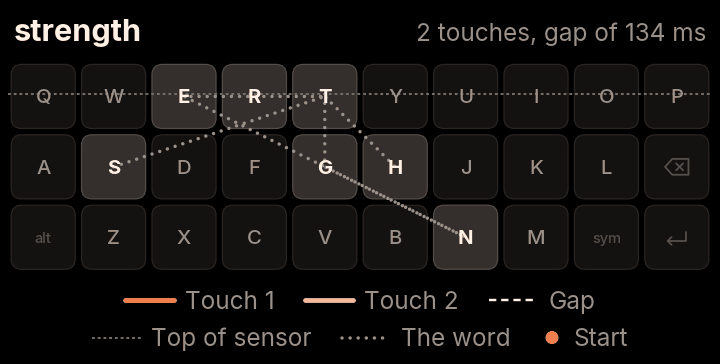 | set tenth | strength |
| 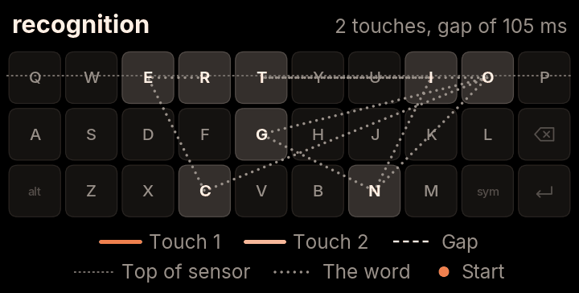 | trinity on | recognition |
| 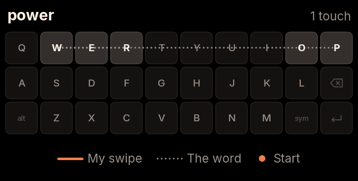 | pure | power |
| 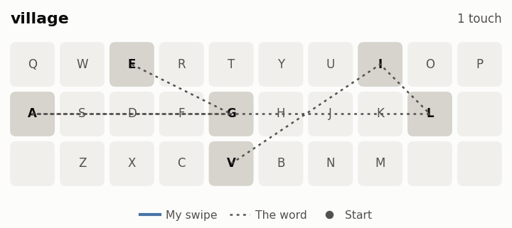 | collar | village |

### 4.2 Why this design: the retrieval ceiling

Before building anything, each lever was measured on its own. The first question was whether the right word can be found at all, since no ranker can pick a word no source offers.

| Source | Prompted | Everyday (all 344) | The 300-word recording |
| --- | --- | --- | --- |
| Current decoder | 87.9% | 82.0% | 80.0% |
| CleverKeys' open model, same dictionary | 87.1% | 77.9% | 74.7% |
| Current decoder, 2 readings of the stroke | 90.1% | 84.0% | 81.7% |
| Current decoder, 3 readings | 91.1% | 84.3% | 82.3% |
| Current decoder, 12 readings | 92.1% | 86.0% | 83.3% |
| **Everything combined** | **93.3%** | **87.8%** | **85.0%** |

Two independent models stop at nearly the same place. So the limit is mostly the strokes themselves, as the touchpad reports them, not the models reading them. The most useful second reading shifts the stroke 0.6 keys to the right, which matches the leftward bias in section 2.2.

Each lever alone (first / top 3):

| Lever | Result | Verdict |
| --- | --- | --- |
| Join a stroke to the next, gap 150 ms or less | Fixes 10 of 13 wrong words. Would cost 10 right words their first place if always joined | Build, with a check that compares both readings |
| Join over gaps of 151-400 ms, or join backwards | Breaks far more than it fixes | Drop. The shipped join (4.7) allows up to 400 ms only with position and direction clues |
| Learned ranker, tested on words it never trained on | Prompted 78.2 / 87.4, everyday 67.4 / 79.9 | Promising but unstable |
| Same ranker, trained on other sets | Prompted 79.2 / 85.9, everyday 62.8 / 74.4, worse than before | Not then |
| Same ranker, trained only on earlier text | Later everyday text 66.7 / 79.0 against 71.0 / 80.4 | Needed far more data |
| Personal words and past corrections in that ranker | +2.1 / +0.7 points, 138 words | Small but real |
| Next word corrects the previous word, given the true next word | +0.8 points at most, none on held-back words | Not with that model |
| Swap engines to CleverKeys | Prompted 70.8 / 82.4 against FUTO's raw decoder at 75.5 / 83.7 | No swap |
| Whole-dictionary shape matcher alone | 53.7 / 67.8 | Only as an extra source |

The plan that fell out of this: keep FUTO's decoder, read each stroke more than once, add a second recogniser trained on this touchpad, add a decent language model, and learn the ranking instead of hand-writing it. The rest of this section takes the stages in order.

### 4.3 Stage 1: FUTO Swipe's three readings

**What it does:** more right words make it onto the candidate list. Two extra readings raise the ceiling from 87.9% to 91.1% on prompted text.

FUTO Swipe reads the stroke, as Atlas does, plus a second reading stretched wider for a fast swipe and a third shifted to the right, where thumbs aim on this sensor. It keeps 48 words for each (`CANDIDATES = 48`), because the ranker learned from 48-word lists.

**The shifted reading** moves the stroke 0.6 of a key to the right (`SHIFT_RIGHT = .06` of the pad's width). On its own it adds words to the bar but doesn't move first choice: before engine 2.0 it filled only the 2nd and 3rd places, taking top 3 from 82.9% to 84.2% on prompted text, 76.7% to 77.6% on everyday text and 75.0% to 77.0% on the 300 words. In engine 2.0 the ranker uses its list as evidence.

#### The faster the swipe, the wider the second look

Quick swipes tend to come out narrower than the word they mean, so TitanKeys reads a fast swipe a second time, stretched wider. The stretch grows with speed: nothing below 10 keys per second, rising to 1.2 times at 16 and above. Slow, careful swipes are read exactly as they were made.

| Swipe speed | Swipes | No stretch: right word first | Gradual stretch: right word first |
| --- | --- | --- | --- |
| Under 11 keys per second | 78 | 57 | 58 |
| 11 to 14 | 105 | 76 | 77 |
| 14 to 17 | 119 | 95 | 99 |
| Over 17 | 73 | 55 | 60 |

| partner | perform |
| --- | --- |
| 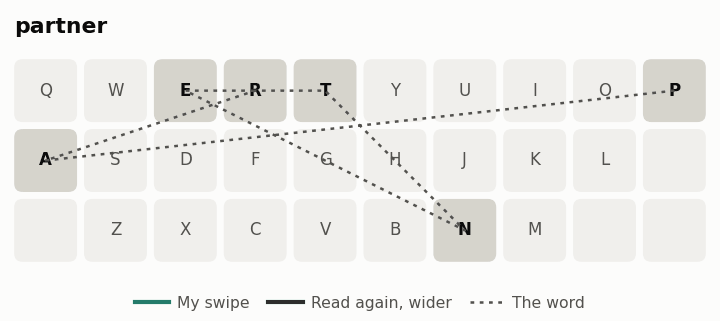 | 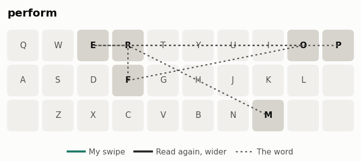 |

A stretch towards the sensor's edges, meant to fix P, gained nothing: 0 words better, 5 worse. P is still unsolved (section 12).

### 4.4 Stage 2: the CleverKeys encoder, fine-tuned on the Titan touchpad

**What it does:** a second, independent reading of the stroke, from a model that has learned this touchpad. Fine-tuning raised CleverKeys' first-choice accuracy on words it never saw in tuning by 6.1 points (62.3% to 68.4%).

#### The model

[CleverKeys](https://github.com/tribixbite/CleverKeys) ships a CTC swipe encoder under GPL-3.0. TitanKeys runs a copy whose weights are fine-tuned on Titan strokes and which gives only the letter outputs (`ck-titan.onnx`, 6 MB).

- **Input:** the stroke resampled to 64 points, as a 2 x 64 feature tensor, plus the 26 key centres of the Titan grid as a layout input with a letter mask (`CtcReader.java`).
- **Output:** for each frame, log chances over 26 letters and a blank.
- **Word search:** a pruned Viterbi beam over a dictionary trie (`CtcWords.java`): beam 100, up to 80 words kept. Words are ordered by path score per letter, a bonus per letter, and how common the word is. The Java search matches the Python version (`ck_core.py`) exactly on 300 strokes, which matters because the ranker learned from the Python output.
- **Runtime:** ONNX Runtime 1.23.2 on the CPU, 2 threads, full graph optimisation.

#### First pilot: train our own model

We trained a model of about 490,000 parameters, close to FUTO's encoder, on 43,000 of FUTO's phone swipes, on a desktop CPU. All results are on held-back Titan strokes, with no language model or ranking.

| Model (first / top 3) | Prompted (136) | Everyday (110) | 300-word set (100) |
| --- | --- | --- | --- |
| The full engine at the time | 76.5 / 81.6 | 70.9 / 79.1 | 72.0 / 81.0 |
| CleverKeys, phone-trained | 69.9 / 80.9 | 54.5 / 69.1 | 71.0 / 81.0 |
| A: trained on phone swipes as recorded | 66.9 / 77.2 | 56.4 / 67.3 | 62.0 / 73.0 |
| B: trained with simulated touchpad damage | 55.1 / 69.1 | 48.2 / 60.0 | 42.0 / 59.0 |
| A, then fine-tuned on 695 real Titan strokes | 71.0 / 80.1 | 61.4 / 74.5 | 65.0 / 76.0 |

What we learned:

- **Phone swipes alone don't cut it.** The same open model scores 95.4% first on phone strokes and 69.9% on Titan strokes.
- **The simulator lied.** Simulated damage on phone strokes reproduced Titan accuracy (95.4% fell to 64.8%, mostly from shortened strokes). But a model trained on that damage got worse on real Titan strokes. It learned the simulator, not the touchpad.
- **Real strokes help, but at first mostly for words already seen.** After fine-tuning on 695 strokes, seen words went from 66.5% to 75.5% first. Unseen words stayed at 58.6%.
- **A little real data is worse than none.** On prompted text: 66.9% with no fine-tuning, then 57.0% at 100 strokes, 61.0% at 200, 65.8% at 400 and 71.0% at 695.

#### Second pilot: fine-tune CleverKeys' pre-trained model

CleverKeys' ONNX model was converted to PyTorch, after fixing two converter bugs. The converted model matched the original to 0.00003 on CPU. It was fine-tuned on 1,303 Titan strokes and judged on 535 held-back first tries. Encoder and dictionary only, no language model. First / top 3:

| Model | Prompted (136) | Everyday (299) | 300-word set (100) | **Words never seen in fine-tuning (231)** | Words seen (304) |
| --- | --- | --- | --- | --- | --- |
| CleverKeys as shipped | 69.9 / 80.9 | 59.9 / 74.9 | 71.0 / 81.0 | 62.3 / 77.1 | 66.1 / 78.0 |
| Fine-tuned, rate 3e-5 | 72.8 / 83.8 | 66.9 / 80.9 | 77.0 / 85.0 | 67.1 / 80.5 | 72.7 / 83.9 |
| **Fine-tuned, rate 1e-4** | **75.0 / 83.8** | **70.9 / 80.6** | 75.0 / 83.0 | **68.4 / 80.1** | 76.0 / 83.2 |
| Fine-tuned, rate 3e-4 | 73.5 / 82.4 | 69.6 / 80.3 | 71.0 / 83.0 | 64.5 / 77.9 | 75.7 / 83.9 |
| Our pilot model, fine-tuned, rate 4e-4 | 65.4 / 78.7 | 66.6 / 78.9 | 71.0 / 79.0 | 61.5 / 73.6 | 71.4 / 82.9 |

- **Fine-tuning a strong pre-trained model works, new words included.** Unseen words rose 6.1 points first (62.3% to 68.4%), past the gate of 5 points set before the run. The gentler rate, which these results didn't pick, still gave 4.8.
- Fine-tuning took about 2 minutes on one RTX 3090 GPU.
- The rate was picked from three on these same strokes, so about a point of the gain is optimistic.

#### Choices made for the shipped encoder

| Choice | Options measured | Picked | Evidence |
| --- | --- | --- | --- |
| Base model | Fine-tuned CleverKeys; our model trained from scratch on FUTO's 783,000 swipes, then fine-tuned; both together | Fine-tuned CleverKeys | Full stack: 78.9 / 85.7, from scratch 78.0 / 86.7, both 79.1 / 86.9. A tie within noise, so the smallest (6 MB, one encoder) wins. From scratch is kept as the upgrade path: 94.9 / 98.4 on FUTO's held-out phone swipes, and better on unseen words (68.4 against about 66 first) |
| Fine-tuning length | 250, 500, 1,000 steps | 250 | 71.0 / 82.2 against 70.1 / 81.5 and 66.1 / 77.4, two seeds each. Longer overfits |
| More Titan strokes? | 25, 50, 75, 100% of them | Keep collecting | 66.5, 70.1, 70.0, 71.0 first. Still rising at 100% |

The training machine gets strokes and their words, never sentences.

### 4.5 Stage 3: the sentence, from DistilGPT-2

**What it does:** the ranker knows which candidate the sentence expects. On written prose this is the biggest single gain we measured.

DistilGPT-2 gives each candidate its log chance after the last 32 tokens of the text. A word is scored by its first token, as the training script scores it. Section 5 describes the model. Here's what it does for swiping, measured in time order (the latest 40% of first tries, learning only from earlier strokes):

| Approach (first / top 3) | Prompted | Everyday |
| --- | --- | --- |
| The engine at the time | 75.3 / 82.2 | 69.7 / 80.0 |
| Learned ranker | 78.2 / 87.3 | 68.3 / 77.9 |
| Ranker + GPT-2 Medium (1.5 GB, PC only) | **86.2 / 90.5** | 70.3 / 80.0 |
| Ranker + past swipe shapes and use counts | 78.9 / 86.9 | 67.6 / 78.6 |
| All three | 86.5 / 90.9 | 69.0 / 80.7 |

- A strong language model on top of shape is worth about 11 points at first choice on prose. On everyday text it barely moves.
- GPT-2 Medium is far too big for a phone. The phone-sized DistilGPT-2 (82 million parameters, about 85 MB compressed) keeps about half the first-choice gain: prompted 81.8 / 90.5, everyday 69.0 / 78.6.
- Everyday text gives any model very little to go on: 41 characters of context on average, against 270 for prompted text, and 16.6% of words have none at all. There, the model ranks the right word first among the candidates 24.7% of the time, against 55.2% on prompted text. Short messages arrive without the message they're answering, and no model can read that.

### 4.6 Stage 4: the ranker

**What it does:** one learned decision over every source. It replaced a hand-written rerank layer that changed 66 first words for a net gain of 4.

A ranker of 900 LightGBM decision trees (`swipe-ranker.txt`, read by `SwipeRanker.java`; LightGBM itself is not in the app) scores each candidate from 18 numbers:

| Group | Features |
| --- | --- |
| FUTO, as made | `final`, `p_rank`, `p_ctc`, `p_score`, `lm` |
| FUTO, shifted reading | `s_rank`, `s_score` |
| CleverKeys | `ck_rank`, `ck_path`, `ck_final` |
| DistilGPT-2 | `lm_logp`, `lm_gap` |
| The word | `freq`, `len` |
| The stroke and context | `stroke_len`, `time`, `words_before`, `has_context` |

The details that matter:

- **Parity.** The Java features and scores match the training script to 1e-13 on 300 strokes. A feature computed even slightly differently would have the trees reading nonsense, so the file states its feature names and the loader refuses a mismatch.
- **Training data.** The engine evidence the ranker reads is recorded on the phone by the app's own code (CPU only). The CleverKeys readings it trains on are cross-fitted: each stroke's reading comes from an encoder fine-tuned without that stroke.
- **Use counts left out.** On the later 40% of everyday strokes: 76.0 / 84.0 without, 75.8 / 84.4 with. The ranker already has whatever they gave.
- **Saved and built-in words.** A saved word the dictionary lacks takes its saved frequency, and a built-in word such as "TitanKeys" takes the built-in frequency, so neither ranks as rarer than it is.
- **Blocked words** never reach the bar, whatever their score.

### 4.7 Keeping a broken swipe together

**What it does:** joins 90% of broken swipes, against 58% for Atlas, and wrongly glues 7% of separate words together against 18%.

The sensor ends about halfway up the top row, so a thumb can slip off mid-word and come back. In the recordings, 103 of 300 swipes (34%) broke this way. That's a third of them.

**Atlas** joins two touches when the second starts within 90 ms, which keeps the rule simple. **TitanKeys** also looks at where the touch comes back and which way it's heading, so it can allow a longer gap without gluing separate words together.

| | Atlas | TitanKeys |
| --- | --- | --- |
| Broken swipes joined (higher is better) | 56 of 96 (58%) | 86 of 96 (90%) |
| Separate words wrongly merged (lower is better) | 214 of 1,200 (18%) | 84 of 1,200 (7%) |

| Atlas | TitanKeys |
| --- | --- |
| 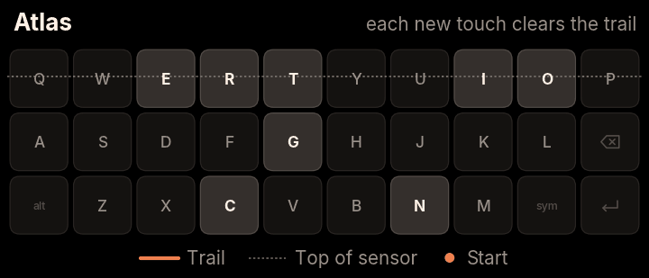 | 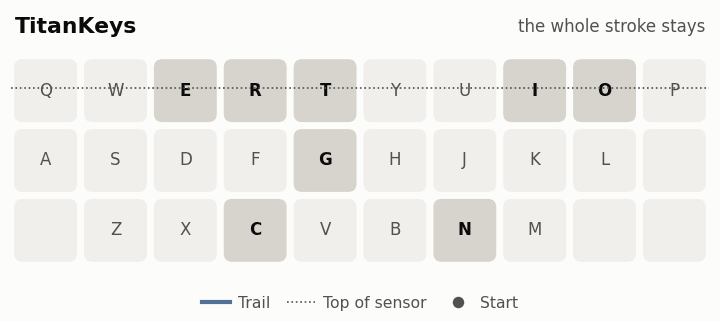 |

How the rule works (`Swipe.sameStroke`). Time alone can't tell, because quick words follow each other just as closely. A new touch can carry on the last swipe only if:

- the gap is at most 400 ms,
- the finger left on the top row,
- it comes back at the sensor's top edge (y under 0.267 of the letter rows), and
- it lands within 3.5 keys of where it left.

Then it has to carry on or turn back (`carriesOn`: the jump points the way the finger was going, cosine at least 0.7; or `reverses`: cosine at most -0.3), and show at least two of four clues: carries on, reverses, still moving as it lands, and a quick first sample (20 ms or less). A finger coming back is usually still moving, while a new word lands still. A brief flicker within 1.5 keys also joins.

How long a finger may leave the keys is also a setting: **Keep swiping after a short lift**, Short, Medium or Long.

A later check with touch sizes on 109 labelled pairs found the keyboard made 100 right joins, 6 right separates and 3 wrong joins, and missed no break (section 4.12).

### 4.8 Matching a swipe by its shape

TitanKeys also compares your swipe with the outlines of about 12,400 common words and your saved words. A swipe that stops short gets smaller but mostly keeps its shape. In 98 of the 127 swipes the FUTO engine got wrong (77%), the right word's outline fit better than the outline of the word the engine picked.

| Comparing outlines | Scaled to the same size |
| --- | --- |
| 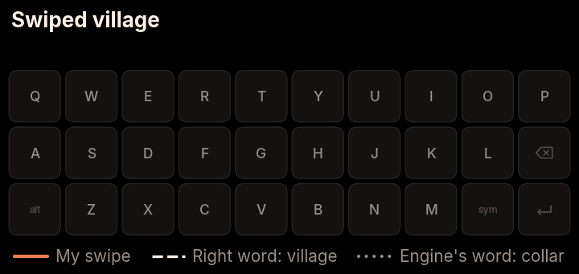 | 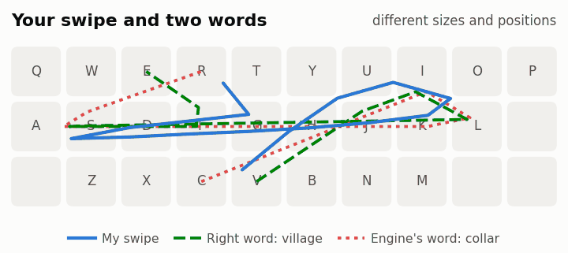 |

How it works (`SwipeShapes.java`):

- Each outline is 16 points spaced evenly along the word's key path. Words below frequency 100, and words flagged offensive or not words, get no outline.
- A swipe is compared by place and by shape: the shape after scaling to the same size, with place at half weight.
- A word's ends may be up to 3 keys from the swipe's ends.
- The 30 best outlines feed the recogniser, at a weight of 32, and an outline can only push a word down by a limited gap, since an outline misjudges a swipe that lost tracking part way.

Alone, a whole-dictionary shape matcher scores only 53.7 / 67.8. So it's an extra source, never the decision.

### 4.9 Expecting a thumb to stop short

In the recordings, thumbs stopped short of corners by 0.74 keys going right, 0.44 up, 0.24 down and 0.20 left. So where a swipe turns tells you which key it was aiming for: a thumb that turns at I was probably heading for O. TitanKeys moves each corner of a word's outline back to where a thumb would actually turn. A letter counts as a corner only where the path really turns there, with the cosine between its two legs below 0.5. The swipe itself isn't touched. Here's a simulated lazy swipe of "jason":

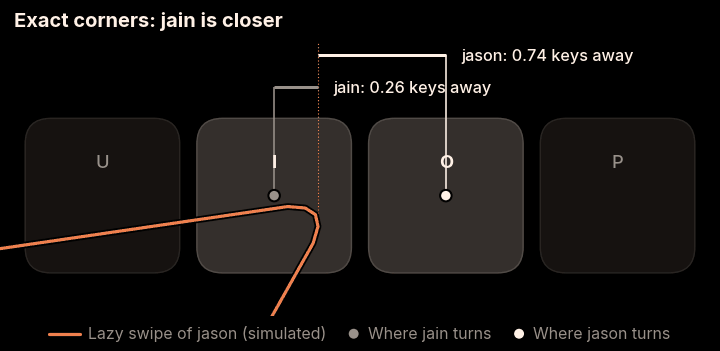

In the code, each leg's pull-back is weighted by direction: 0.55 going right, 0.33 up, 0.18 down and 0.15 left (`SHORT_RIGHT`, `SHORT_UP`, `SHORT_DOWN`, `SHORT_LEFT`). These are smaller than the measured averages above, and in the same order: right, up, down, left. It scales with the leg's length, from half at short legs to 1.25 times at long ones (full at 4 keys), and legs under 1.2 keys aren't moved, since strokes between neighbouring keys are too short to fall short by much.

### 4.10 Deleting a word with one thumb

**What it does:** a flick catches 97% of real delete strokes and fired on none of 875 word touches.

The flick from Backspace is a quick, straight stroke left from around Backspace: at least 1 key across, at most 5.5 keys of path, and within 600 ms. A longer or slower stroke is read as a word (`DeleteSwipe.kt`, `MIN_TRAVEL`, `MAX_PATH_KEYS`). Fitted to 68 real strokes, it catches 66 of them (97%), and it didn't fire on any of 875 recorded word touches.

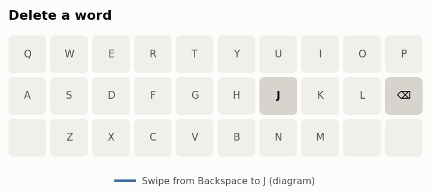

Holding the flick deletes in bulk: one word every 350 ms at first, speeding up to one every 80 ms as you slide further out. Coming back within 0.8 keys of the start pauses it, and 5.5 keys out is its top speed (section 9.5).

**Should the zone be bigger?** A study asked whether flicks should also start over I, O, M and Sym. It sorted 20,977 swipes from every log by what came after them. The current rule reads 4,921 delete flicks and wrongly deletes 19 kept words.

| Rule | Real flicks lost | Kept words hit | Possible missed flicks gained |
| --- | --- | --- | --- |
| A: move the zone | 2,085 of 4,921 (42%) | +206 | +64 |
| B: add the new zone | 0 | +206 | +64 |
| C: B, level strokes only | 0 | +69 | +27 |
| D: C, no starts on I or O | 0 | +22 | +17 |
| E: D, at most 6 keys and 400 ms | 0 | +22 | +10 |

Even the safest variant costs about one wrongly deleted word per recovered flick, and plenty of common words ("in", "it", "on", "of", "my") start on I, O or M and run left. Deleting someone's "in" to save them a flick is a bad trade. The zone stayed as it was.

**When a stroke becomes a flick.** A stroke becomes a flick candidate once it is 1.5 keys from where it started, inside the delete zone, no higher than the middle row, there within 60 ms, and passing every flick rule checked so far. From the logs: of 1,226 real flicks that went 1.5 keys, 80% got there within 60 ms. Of 165 word swipes from the delete zone, 20 did, all from the edge by L and Backspace. They crunch briefly, then break (section 9.5).

### 4.11 Smaller changes for two-handed typing

The pictures here are diagrams of the behaviour, not recordings, and the words in them are examples.

**Space types a space when your thumb is resting on it.** Across 25 sentences typed on the keys with two hands, accidental selections went from 5 to 0.

| Atlas | TitanKeys |
| --- | --- |
| 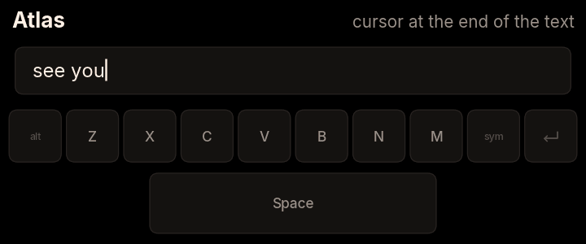 | 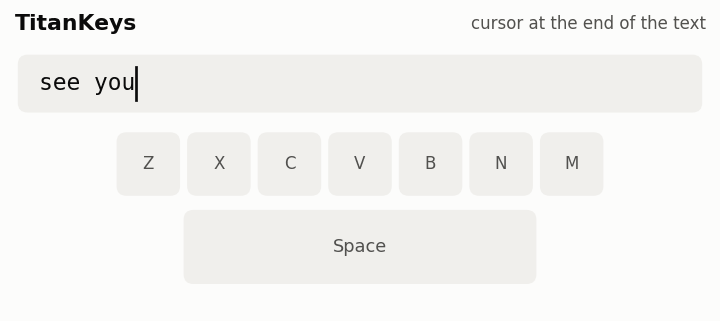 |

**Picking a swiped word moves on to next-word suggestions,** as Atlas does for typed words. To switch to another option afterwards, move the cursor back into the word.

| Atlas | TitanKeys |
| --- | --- |
| 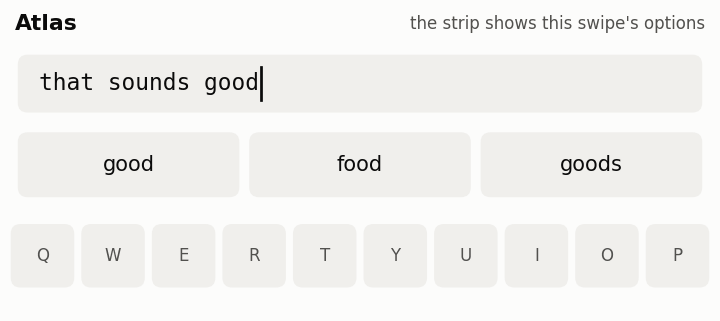 | 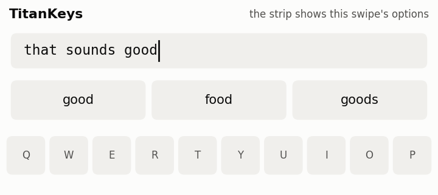 |

**A long stroke still counts right after a key press,** while short brushes are ignored for longer as you type. Across the same 25 typed sentences, accidental swipes went from 3 to 2, and accidental touches read as taps went from 27 to 16.

| Atlas | TitanKeys |
| --- | --- |
| 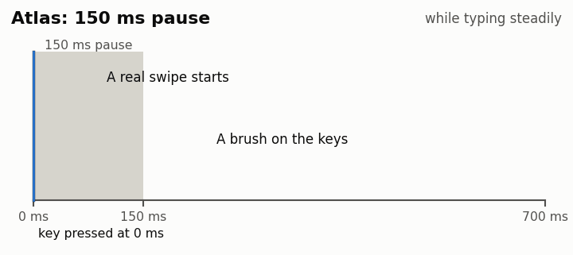 | 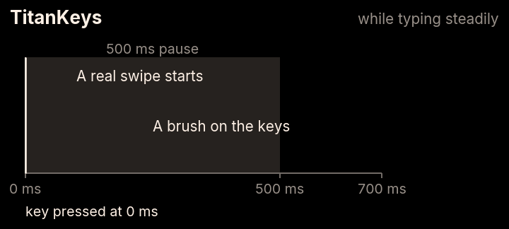 |

**Space gestures count on Space itself,** not on the keys beside it, and the first tap counts sooner, at 150 ms, so fewer steers go missing.

### 4.12 What didn't work

Failures are evidence too, and we'd rather show them than pretend. Each of these was measured and then dropped or held back.

- **Simulated touchpad damage** made a model worse on real strokes (4.4).
- **Giving the model the real, skewed key positions:** 68.6 / 80.9 on prompted text, against 70.8 / 82.4 with the standard calibration. Fitting key positions to the strokes was worse too. Calibration isn't the bottleneck.
- **A memory of past swipe shapes and use counts** didn't help (78.9 / 86.9 against 78.2 / 87.3 for the ranker alone, prompted). The fine-tuned model did help words it had seen, so shape learning seems to need a learned model, not a drawer of stored outlines.
- **The next word correcting the previous word:** +0.8 points at most, none on held-back words.
- **A mistouch filter.** A trained classifier on stroke features reaches AUC 0.77. Catching 95% of accidents would flag 65% of real words, which is worse than the accidents. The best simple rule (under 150 ms and under 2.5 keys) catches 16% and costs 2% of real words. Nothing shipped.
- **Contact size,** studied on 829 swipes (440 of them kept words no model trained on). The sensor step is `round(getSize() * 255)`, mostly 1 to 4. Size depends on where the finger is: mean step 1.5-1.9 on the top row, 1.9-2.8 in the middle and 2.4-3.1 at the bottom. Pressure fades before a finger is lost: in the last 50 ms, -0.37 steps for broken swipes against -0.24 for whole ones. It looked promising. None of seven uses raised accuracy on unseen swipes:
  - mistouches: AUC 0.50-0.57, 0% caught at 1% cost to real words;
  - reshaping strokes by pressure before the encoder: all worse (plain 67.5 / 75.2; best variant 64.8-65.2 / 73.0-73.6);
  - pressure in the ranker: 69.1 to 69.3 first, 7 wins and 6 losses;
  - correcting the "flat finger" offset (a larger touch on the top row aims about 0.1 row higher): the best fit lost on later data, 70.5 to 69.1;
  - joining by the end fade: no separation (rho -0.09).

  Nothing from contact size ships. It's still logged for contributions, so it can be tried again on more data.
- **Fine-tuning the predictor on conversations** (SODA, 8,000 and 20,000 steps) and on personal messages: no gain (section 5.4).
- **The sensor edge at P.** No way of reading it fixed it (4.3).

### 4.13 What it costs

None of this is free, and Atlas's simpler approach avoids all of it:

- There's more code, and more settings tuned on one person's thumbs.
- The app is about 95 MB bigger, and the keyboard uses about 400 MB more memory while engine 2.0's models are loaded. The phone has 12 GB.
- Separate words swiped very quickly can merge. At gaps of 120 ms or more, 5 of 270 pairs merged (2%), where Atlas merged none. At 90 ms or less it's 28 of 90 (31%), where Atlas merged all 90.
- A swipe takes about 70 ms to read on the phone with engine 2.0, against about 15 ms with the FUTO engine alone.

The measurements behind those lines, run with the app's own code on the phone (CPU only, nothing installed):

| Measure | Value |
| --- | --- |
| Whole swipe, all 1,608 first tries | 69 ms on average: FUTO engine 53, CleverKeys 8, ranker 8 |
| Whole swipe, a later run (median / slowest tenth from) | 77.3 / 84.8 ms: FUTO engine 61.7, CleverKeys 8.3, ranker 8.3 |
| Next-word model, after the word before | 35-52 ms (median 36.1 ms in the later run) |
| Recognition before engine 2.0 | 42 ms median, 61 ms worst |
| Memory added on load | about 390 MB. The process then holds 700-900 MB, and the Java heap stays flat at about 55 MB over 1,608 swipes |
| Memory before engine 2.0 | about 506 MB, of 11.7 GB on the phone |
| The predictor's share | +175 MB loaded, up to +339 MB after long contexts |
| ONNX Runtime's memory arena off | saves about 200 MB but doubles the predictor's time, so it stays on |
| App size | about 95 MB more, mostly the 83 MB predictor |

The two timing runs disagree: the first is an average over the full set, the second a median from a later run. Both put a swipe at roughly 70-80 ms.

The 2.1 release APK is 116.0 MB (151 MB unpacked). Unpacked, engine 2.0 is 112 MB of it: the predictor 83 MB, the encoder 6 MB, the ranker and vocabulary 4 MB, and ONNX Runtime 19 MB. The FUTO engine is 21 MB, autocorrect's word lists 11 MB, and the app itself 8 MB.

## 5. Next-word prediction

### 5.1 The results

**What it does:** the bar guesses the next word before you type, and the word you're typing after each letter, better than the model it replaced, and typing never waits for it.

The same language model drives the word suggestions: the next word before you type, then words that start with the letters you've typed. It also gives typed autocorrect a small push towards the word the sentence expects. It's only used when its answer is already there, so typing never waits.

The first three rows were measured on the phone over 1,046 typed words, and the last two on typing held back from all tuning.

| Word suggestions | Before | Engine 2.0 |
| --- | --- | --- |
| Letters typed before the word is in the top 3 | 2.51 | 2.34 |
| Word in the top 3 after one letter, prompted text | 60.1% | 75.5% |
| Word in the top 3 after one letter, everyday text | 42.5% | 47.2% |
| Next word in the top 3 before any letter, prompted text | 24.0% | 37.9% |
| Next word in the top 3 before any letter, everyday text | 16.6% | 20.1% |

More from the same runs:

- Letters saved rose from 46.8% to 50.4%. Letters typed before the word is in the top 3: prompted 1.72 to 1.37, everyday 2.09 to 2.08.
- **A trade-off:** after 3 letters, everyday words in the top 3 fell from 78.3% to 73.3%. Blends of the old and new models, by place, gained under a point on everyday text and lost 2-3 on prompted text, so the predictor ships alone.
- A completion costs 0.6 ms a keystroke, because the model's answer for the text before the word is already worked out.

### 5.2 The model on the phone

| Property | Value |
| --- | --- |
| Model | DistilGPT-2, 82 million parameters, Apache 2.0 |
| Format | ONNX, weights 8-bit per channel, exported to give only the next token's chances (`model-int8pc.onnx`, 83 MB) |
| Tokeniser | GPT-2 byte-level BPE, reimplemented in Java (`ByteBpe.java`) with the model's own vocabulary and merges |
| Context | the last 500 characters before the cursor, trailing spaces trimmed, then the last 32 tokens |
| Threads | 4 |
| Time | 42-52 ms on 4 threads in the format study; 35-52 ms in the phone run |

Format choices, measured in the full swipe stack:

| Format | First / top 3 | Note |
| --- | --- | --- |
| Full precision | 79.1 / 86.5 | |
| 8-bit | about a point lower | |
| **8-bit per channel, 32 tokens** | **79.8 / 85.6** | shipped |
| 16 and 64 tokens | measured, not picked | |

### 5.3 How it fits around typing

- **One run per word.** `NextWordModel.after` keeps the last answer. While a word is swiped, typed or completed, the text before the cursor stays the same, so one run serves the swipe, the completions and autocorrect.
- **Ready before you need it.** After each word, the keyboard asks for the chances for the new text, so the next swipe finds them waiting.
- **Never blocks.** `ifReady` reads the kept answer without a lock. If the model is still busy, typing carries on without it.
- **Before any letter,** your learned word pairs come first, then the model's likeliest words.
- **After letters,** the model's whole words come first. A word the model splits into several tokens is placed by its frequency.
- **Your kept words get a lift** in completions: min(3, 0.5 x ln(1 + times kept)) on top of their log chance. A kept word the model doesn't hold whole gets its first token's chance, less 2 for each further token. In the pilot this cut the letters typed before an everyday word reached the top 3 from 1.96 to 1.89 on held-back words and 2.12 to 2.04 on new ones, with no cost on prompted text.

### 5.4 What else was tried

| Option | Result | Verdict |
| --- | --- | --- |
| GPT-2 Medium | Next word in the top 3: 53.7% prompted, 23.8% everyday | Best measured, but 1.5 GB: too large for the phone |
| DistilGPT-2 fine-tuned on SODA conversations, 8,000 steps | Everyday next word 19.8% against 20.1%; full stack 0.6 below | No |
| The same, 20,000 steps | Everyday next word 18.3%; full stack 77.6 / 85.7 | No |
| A light fine-tune on one person's own messages (153 messages, 996 words, the earliest 60%) | 19.8% against 18.9% on the later 354 words | Noise. A personal model must never go in a public build |

Of the words a swipe got wrong, GPT-2 Medium had 37.9% (prompted) and 12.5% (everyday) in its top 3 before the swipe. Adding the stroke's start and end raised those to 41.1% and 22.5%. Prediction helps alongside swiping, mostly for common words, but it can't carry accuracy on its own. Everyday text is just hard to predict. People don't text in complete thoughts.

## 6. Autocorrect

### 6.1 The results

**What it does:** fixes more typos on Space without making more wrong fixes, adds missing apostrophes only where the sentence calls for one, and leaves your shorthand alone.

The model's weight in typed autocorrect was tuned on 816 Titan-style slips in real sentences, each also typed right:

| Weight 0.3 against none | Before | After |
| --- | --- | --- |
| Everyday slips fixed | 65.6% | 69.5% |
| Prompted slips fixed | 71.4% | 78.4% |
| Wrong fixes, everyday | 4.6% | 4.6% |
| Wrong fixes, prompted | 2.2% | 1.9% |
| Right words changed, everyday | 0.2% | 0.2% |
| Right words changed, prompted | 0 | 0 |

At 0.5 and up, wrong fixes rose, so 0.3 ships.

### 6.2 The typed corrector: a noisy channel

TitanKeys' typed autocorrect comes from [Numen](https://github.com/jlo-aug/numen), itself a modified version of [Pastiera](https://github.com/palsoftware/pastiera), both GPL-3.0. It picks the word you most likely meant from two things: how likely the typed letters are as a slip of it on the Titan's keys, and how well it fits the words around it. The weights were fitted on real typing (the Aalto 136M keystrokes physical-keyboard data and the Aalto ITE phone typing data), with held-out data checked separately.

**The score** of a candidate (`NoisyChannel.score`):

```
score = -7.578 x cost
      + 0.568 x ln(1 + count(previous, word))
      + 0.533 x ln(1 + count(before previous, previous, word))
      + 0.777 x ln(1 + count(word, next))
      + 0.3 x max(-12, model log chance - best model log chance)
```

The last term is the model's push. It's relative to the best candidate, so the best fit adds nothing, and it can't push a word down by more than 12 nats. It's only used when the chances are ready.

**The cost** is a keyboard-weighted edit distance, with the Titan's neighbouring keys, diagonals included:

| Slip | Cost |
| --- | --- |
| A neighbouring key | 0.5 |
| A vowel for a vowel | 0.6 |
| A far key | 1.2 |
| A missed letter | 0.7 |
| A missed vowel ("defalt") | 0.55 |
| A missed double letter | 0.4 |
| A missed apostrophe (it needs Alt on the Titan) | 0.2 |
| An extra letter | 0.9 |
| An extra letter a finger could have added beside its neighbour | 0.5 |
| A vowel typed again just after itself ("receieve") | 0.6 |
| Two letters swapped | 0.5 |

Candidates are dictionary words within two edits, with a cost of at most 1.4.

**When it fixes:**

- **A made-up word** is fixed if the best candidate scores over -8.0 and leads the next by at least 2.0.
- **A real word** is changed only if the candidate beats the typed word by 3.0 more, and still leads the next by 2.0. A real word is never swapped for a contraction ("were" never becomes "we're").
- **Words with no vowel** ("lmk", "smh") are shorthand and never a slip.
- **A favourite wins a tie:** within 2.0 of the best, a favourite goes first.
- **Only fix when sure** raises the lead to 3.0 and the real-word margin by 1.0 more.
- **Changing its mind:** once the next word is known, an earlier fix can switch if another candidate beats it by 3.5 ("ths" to "the", then "ths is" to "this").

Plenty of smaller rules cover the long tail, each with its own threshold in `TypedCorrector.kt`: long, badly mangled words (7 letters or more), two-letter non-words ("si" to "is"), sentence starts, names, missed spaces and a doubled last letter.

### 6.3 The second look

"get dome food" becomes "get some food" once the next word makes it obvious. The second look (`ContextCorrector.kt`, from Numen) reviews a real word after the next one is typed.

A wrong change costs far more than a missed fix, because nobody forgives a keyboard that rewrites a word they typed correctly. So it's narrow on purpose:

- Only rare words with no known pair on either side are reviewed (frequency up to 160).
- A replacement must be a one-key slip, clearly more common (at least 140, and 25 more than the typed word), and seen next to both neighbours.
- A single letter is always meant as typed.
- Words you protect (your words, slang) and fixes you undid are left alone.
- A list of real words often typed for another ("he" for "the") adds a second route, with its own strict odds.

### 6.4 Apostrophes

On the Titan, the apostrophe needs Alt, so people skip it. TitanKeys sorts the missing ones into three groups.

**1. Always fixed.** The form without the apostrophe is no word anyone means: "dont", "doesnt", "isnt", "youre", "im" and 36 others. "cant", "wont", "whats", "hes" and "shes" are in the word lists, but in the logged typing they were always meant with one, so they're in this group too.

**2. The 's family.** "todays" becomes "today's", "whats" becomes "what's". This came out of a typo audit, which found the typo step dropping the extra s before anything tried an apostrophe: "todays plan" became "today plan". The rule: a typed word ending in s, which the word list lacks, whose `X's` spelling the full list has, becomes `X's`, before any other fix. Plurals that are words ("days") stay as typed.

**3. Decided by the sentence.** "its", "lets", "your", "their", "there", "ill", "well", "id", "hell", "shed", "wed" and "shell" are real words. Only the words around them can tell you which one was meant. TitanKeys waits for the next two words, then asks the model.

How the third group works (`ApostropheContext.kt`):

1. The window is the text back to the last `.`, `!`, `?` or line break, or the start of the field, at most 10 words, plus the next 2 words as written, with any mark stuck to the last one.
2. If the window holds fewer than 2 other words, the word stays as typed.
3. The model scores the typed form and each apostrophe form, as the sum of each token's log chance, in nats (`NextWordModel.continuations`).
4. An apostrophe form wins only if it beats the typed form by more than 1.0 nat (2.0 with Only fix when sure).
5. It only ever adds an apostrophe. It never takes one out, and never turns "were" into "we're", since the model can't tell those two apart.

**The apostrophe study.** Before this was built, a study read the logged typing for every case. It judged the right form by reading the context, not by what was kept, because wrong apostrophes usually get left in place.

| What was measured | Result |
| --- | --- |
| The keyboard before the study | 73% right, no wrong changes, many misses |
| The study's policy: 5 words before, 2 after, margin 1.0 nats, firing 2 words back | 93% right, no wrong changes |
| A boundary variant: back to the last sentence mark, at most 10 words, plus 2 after | still no wrong changes, and the fewest misses |
| Commas as boundaries | no better |
| Wrong changes with the policy, over all judged cases | 0 of 277 |

**What shipped isn't exactly the 93% policy.** The shipped window is the boundary variant (back to the last sentence mark, up to 10 words), not the fixed 5 words. The study reports it with no wrong changes and the fewest misses, but this paper has no separate percentage for it. The always-fix list was also widened, as above. One known gap is filed for 3.0 (#73): "its" or "it's" settles at any punctuation, with the other form left in the bar's second place.

### 6.5 Shorthand

**Your shorthand stays yours.** In the logs, a chat shorthand like "shd" got turned into a different word ("I shd go" became "I she go"). Now a list of shorthand (shd, sth, idk, cuz and others, with no real words in it) is never corrected and never a fix target. The list ships as `en_shorthand.txt`.

**Spell out shorthand** is a setting, off by default. When it's on, a listed shorthand becomes its full word ("shd" to "should"). You can switch any one off and add your own. Yours are saved in lowercase, so a capital from the start of a sentence can't sneak in.

### 6.6 The fix kinds and their switches

Every kind of fix has its own switch in **Settings > What gets fixed** (`FixKind.kt`). All are on by default.

| Switch | Example |
| --- | --- |
| Typos | "teh" to "the" |
| Apostrophes | "dont" to "don't", "todays" to "today's" |
| Context apostrophes | "its going" to "it's going" |
| Spaced apostrophes | "don t" to "don't" |
| Capital I | "i" to "I", "i'm" to "I'm" |
| Name capitals | "monday" to "Monday", "iphone" to "iPhone" |
| Shift held | "THe" to "The" |
| Double letters | "yeahh" to "yeah" |
| Missing spaces | "hellohow" to "hello how" |
| Name slips | "Sudnay" to "Sunday" |
| Recent words | a slip on a word that has come up twice in this conversation |
| Second look | "get dome food" to "get some food" |

Two global controls sit with them: **Only fix when sure** (larger margins, section 6.2) and the English spelling (British, American or Canadian). Backspace right after any fix puts your word back.

### 6.7 Names, capitals and learning

- **Name capitals.** A word whose only spelling has capitals gets them. A name has to be common enough (frequency 95) to take its capitals by itself, so a rare name that might be a slip for another word stays as typed. Your saved words and TitanKeys' own name always qualify.
- **Names on this phone.** App names on the home screen count as words, with their capitals. Contact names count only with **Names from my contacts** on: first and last names, in memory only, never saved, learned or sent (section 11).
- **Learning.** A word missing from the dictionary is learned on its 2nd use (it used to be the 3rd), and up to 1,000 words are kept (it used to be 256). In the logs, few missing words came up three times. Saved words fade after 30 days unused, except ones you added.

## 7. Evaluation method

### 7.1 Data

| Set | What it is | Size | Labels |
| --- | --- | --- | --- |
| Prompted passages | Passages shown on screen, in four blocks: swipe only, index finger, mixed with keys, left thumb | 404 words (456 of 459 aligned exactly) | The prompt |
| Everyday text | Real use, from the raw log | 323 words with confirmed tests removed (344 with them) | The word left in the field after hand correction |
| The 300-word recording | 200 normal and 100 rushed swiped words, plus 25 typed sentences | 300 words | The prompt |
| The 126-word sentences | 24 sentences swiped one word at a time | 126 words | The prompt |
| Later raw logs | Everyday use on 1.2.0 and 2.0.0 | 20,977 swipes (delete study) | By what followed each swipe |

The two recordings are public in [`android/debug/recorder/samples`](../android/debug/recorder/samples). Everyday text is personal and never gets published. Only totals from it appear here.

### 7.2 Method

- **Replay.** The recorded touches run through the real touch handling, text logic and swipe engine, with no keyboard window (`ReplayRunner`, and the baseline's `replay.sh` and `Engine2Runner`). The replay ran on the phone, so the native FUTO engine and ONNX Runtime ran exactly as they do in use.
- **Trust.** The replay's top 3 matched what the phone had shown live on 393 of 404 prompted first tries, with no word switching between right and wrong.
- **Each keyboard on the same touches.** Atlas at `0981443`, TitanKeys 1.2 and TitanKeys 2.0 each replayed the same recordings.
- **Held back.** Every word position with `slot % 3 == 2` was kept out of all tuning. Choices were made on the other two thirds and judged on this one.
- **First tries only,** so retries don't flatter the score.
- **Time-ordered tests** for anything that learns: only earlier strokes train, and later ones judge.
- **Apostrophes and slips** were judged by meaning: what the context says was meant, not what was left in the field.
- **Parity tests.** Where Java reimplements a Python training step (the CleverKeys word search, the ranker's features), it was checked against the Python output on 300 strokes before any number was trusted.

### 7.3 Limits

Here's what this evidence can't tell you.

- **One person, one phone.** About 1,050 labelled first tries for the baseline, from one person's thumbs. The ranker experiments show how badly a small set can mislead.
- **The margin is wide.** With 404 word positions, a 76.5% result carries roughly 4 points either way. Changes were judged by which words flip on the same strokes, and confirmed on the held-back third.
- **Everyday labels run high.** A wrong word nobody noticed counts as right. Three prompted final words stayed wrong, so the leak is small.
- **Some everyday windows were testing.** Confirmed tests were removed, but not every window could be sorted.
- **Accident labels are upper bounds.** A deleted word can be a change of mind.
- **The 300 recorded words trained the ranker,** so the table rows marked \* in 4.1 flatter engine 2.0. The 126-word sentences and the 540 held-back swipes are the fair measures.
- **Atlas moves.** Atlas is compared at the commit this fork started from, and it's had commits since.

## 8. Interface engineering for this phone

### 8.1 Fixed scale

**What it does:** TitanKeys looks the same at any font size and display size, so a huge system font doesn't blow up the bar.

Every TitanKeys window works in one unit: a dp is the screen's width ÷ 688.6, which is 1.5625 px on the Titan 2 Elite's 1076 px. The system font size never scales the fonts. One helper (`FixedScale`) wraps each window's context with `fontScale = 1` and a `densityDpi` from the screen width: 250 dpi on this phone. The shorter side counts, so a turned screen keeps the same sizes.

**Bar text size** grows only what's in the bar: Smaller 1.0, Normal 1.2 (everyone's default), Bigger 1.4. The bar keeps its height of 56 dp at every size. Everything else, Settings included, stays at 1.0.

On top of that sits the design system: a spacing scale of 4, 8, 12, 16, 24, 32 and 48 dp, and one typeface, Inter, in five roles (Display 36, Title 24, Body 19, Field 24, Label 14). Real text is never under 13 dp.

### 8.2 The bar's optical line

**What it does:** everything on the bar sits in the middle of the black you see, not the bar's maths middle.

The keyboard is always black. The bar's black runs into the black border under the screen, so you can't see its bottom edge, and its middle looks higher than it is. The eye reads one band: the bar's 56 dp plus about 22 dp of border.

- **The measurement.** The border was measured with a ruler on the phone, about 22 dp (`StripFit.BORDER_DP`). Then a phone preview page moved the bar's text in 1 dp steps, at all three bar text sizes, with guides for the bar's middle, the letters' middle, the small letters' top and the baseline. The first try was 8 dp lower. The pick was 11 dp lower, which centres the letters on the visible band.
- **A rule, not a magic number.** The line is the band's middle: (56 + 22) / 2 = 39 dp from the bar's top, which is 11 dp under the bar's own middle (`StripFit.LINE_DP`). It is 17 dp over the screen's bottom edge. Every item with text in the bar sits on it: the words, the menu word, pills, icons, chips, hints, the clip offer. Exact typing's bar and the Sym panel's bottom row use the same line.
- **The letters' middle, not the font box.** A text's baseline is placed so the middle of Inter's x-height (1118 of 2048 units) is on the line. Centring the font's box instead sets the letters about 3 px low, because Inter's box reaches far above its capitals to make room for accents.
- **What stays the same:** the bar's height, the touch areas, the keys and the guide's slides.

The lower line costs room at the bottom. At 11 dp lower, the line is 26.6 px over the bottom edge, against 43.8 before. Px over the edge at Smaller, Normal and Bigger:

| Item | Smaller | Normal | Bigger |
| --- | --- | --- | --- |
| Letter tails | 11.3 | 8.2 | 5.1 |
| The guide's underline | 10.2 | 8.5 | 6.8 |
| Shift, Alt and Ctrl chips | 8.7 | 5.1 | 1.5 |
| The notice | 6.2 | 2.1 | -2.0 |
| The 42 dp menu pill | -6.2 | -6.2 | -6.2 |

How it gets away with that: boxes stay at least 1 dp inside the bar (`INSIDE_DP`), so the menu pill slims from 42 to about 32 dp and the notice rises 2 dp at Bigger. Anything that shows clearly keeps 2.56 dp (4 px) from the screen's outline (`EDGE_DP`). Side items take their margin from the curve (8.3). A text whose tails would cross that floor rises just enough to clear it (`StripFit.baseline(line, size, floor)`).

Other items were placed on the phone the same way: the automatic capital's arrow sits 3 dp over the words' line at Normal, scaling with the bar text size, so its middle is level with the capitals' middle. The swipe trail's three rows are 12 dp apart, the middle row 3 dp over the line.

### 8.3 Staying clear of the rounded corners

**What it does:** words, chips, menu effects and idle games never get cut by the screen's curve.

The screen reports a 100 px radius at each bottom corner. The keyboard's window doesn't always get it in its insets, so `Corners.of` takes the larger of the insets' and the display's values.

- **How far in to keep:** content `above` px over the bottom edge keeps `radius - sqrt(radius² - (radius - above)²)` px from each side (`Corners.inset`).
- **Whether a point shows whole:** `Corners.clear` checks the point is at least `gap` px from the bottom edge, the sides, and the curve itself, measured straight to it.
- **A tighter inset where the curve is flat:** `clearInset` measures straight to the curve, so content near the bottom, where it's nearly flat, may come closer.

With the lower line, the side margin the curve needs grew from 40 px to 60, 67 and 75 px for the side words' tails at the three sizes, and 66, 75 and 89 px for the chips. The back arrow at P clears the curve by 5.3, 3.0 and 0.6 px. That last one is close.

**Checked by render.** Every effect and idle game was rendered at all three sizes with the curve and the border drawn, and run through `tools/corner_check.py` (radius 100, margin 4 px). A first round reviewed only still frames, and the phone then showed chips cut by the edge and effects off the line, so still frames aren't enough. The second round sent keyframe strips of every motion through the same check, then the phone, before any build went out. None of these renders ship in the APK (section 11.6).

### 8.4 Fitting long words

Three spots that never move: the middle word lives in your muscle memory, and it's exactly what Space types. A long word in a spot (`StripFit`):

1. shrinks to fit, down to 70% of its size;
2. then, outside the three word spots only, borrows room from shorter neighbours;
3. last, is cut with "…" where it's the same as another word on the bar. A word that starts like another keeps its end ("…mendations"), and any other keeps its start, so the part where the words differ shows.

### 8.5 The modifier bar and word colours

- **The modifier bar.** Press Shift, Alt or Ctrl and the bar shows a chip for each one that's on: filled while you hold it, outlined once it's set. Rest a finger on a letter and the bar shows what it will type with Shift or Alt. With Ctrl down, it lists Ctrl's shortcuts.
- **Word colours.** The colour says where a word stands on the word menu's ladder: orange for a favourite, white for saved, grey for not saved, and grey struck through for blocked. A selected word in a field shows alone in the middle of the bar, underlined in the accent, until its menu opens.
- **Orange means one thing:** what to do now, or what just happened. It's never decoration. With Orange accents off, nothing TitanKeys draws is orange.

### 8.6 The idle games and their floor

Leave the bar alone and, now and then, it plays with your words: Bowling, Race, Firework, Pong, Jump rope, Juggle or Drift. Touch anything and the words go back.

- **The rule.** Exactly 3 minutes after your last input, one roll with a 1 in 4 chance, and none after it in that idle period. The period after a game can't play, and the same game never plays twice running. The once-only games (Bowling, Race, Firework) are common, and the looping ones rare.
- **Why it changed.** An earlier rule (a wait of 3 to 4.5 minutes, then 25%, again and again) averaged about 15 untouched minutes before the first game, so nobody ever saw one. A simulation of the rules compared it with a 60-90 s, 50% proposal (about 2.5 minutes). The chosen rule is a single roll at 3 minutes instead.
- **The floor.** The screen's edge blends into the border, so a figure standing on it looked like it was standing on nothing. Games that use a floor show a 1 dp line in the text's cream at 55%, 80% of the room between the corners, centred, with hard ends. It sits at 2.56 dp over the screen's edge (`Idle.FLOOR`), the same margin the bar's text keeps, and everything that stands, lands, rolls or runs stays over it. Only the idle games get a visible line. Everything else keeps the invisible optical line.

### 8.7 The keyboard window

The keyboard's window is the full height of the screen and never resizes. The keyboard sits on its bottom edge, and only its top is reported to apps. Before, the window grew and shrank with the panel, and for one frame the bar floated about 200 px up while Android caught up. Taps above the keyboard still reach the app. Opening Sym, emoji or the clipboard no longer moves anything, not even for a frame.

## 9. Haptics as a language

**What it does:** you can tell what happened without looking. Moving, a step, done, locked, gone and "nope" each feel different, and a fast run of buzzes never turns into a rattle.

The full rules are in [haptics.md](haptics.md), and every control in the app's own screens is in [haptics-audit.md](haptics-audit.md). This section explains why they look the way they do.

### 9.1 The constraint

The Titan 2 Elite's motor has no strength control. Every pulse is full strength, and only its length and the gaps between pulses can change. The phone also has five ready-made effects, tuned by the maker, but every one felt generic in testing, and "can't save" didn't feel like an error at all. So TitanKeys builds a language from rhythm and length alone, with its own waveforms (`VibrationEffect.createWaveform`), and no ready-made effect anywhere.

**Haptics are only for what your thumb can't feel or see.** A key you press already clicks, so it never buzzes. A buzz is for the touchpad, which has no click of its own, and for things that change where you aren't looking.

### 9.2 The rulebook

1. **Two kinds.** Texture is fast and repeating: one pulse of about 17 ms, never a pattern. A message says something happened: two pulses or more, or one long pulse, each about 25 ms or more.
2. **Rhythm carries the meaning, the same everywhere.** Rising (short then long) means confirm or done. Falling means undo or back. Two equal firm pulses mean lock. A quiet swell, light, fuller, light, means it changed by itself. One long pulse means gone. Three quick hard pulses mean no: nothing happened at all. A hit that bounces and settles means a wall: the gesture reached its end.
3. **Strength is length only.** More important or more destructive means longer.
4. **Gaps of at least 35 ms,** so each pulse reads on its own. The one exception is the crunch, whose two pulses are meant to feel like one gritty tick.
5. **No prebaked effects.**
6. **A message can't repeat within 300 ms.** Texture can.
7. **Boundaries** (a space, a word grabbed by a selection) get one stronger pulse of about 30 ms.

### 9.3 The families

Patterns are on and off in ms, starting with on.

| Family | Pattern | Plays for (examples) |
| --- | --- | --- |
| Texture | 17 | Keys crossed in a swipe, cursor letters, a light touch typing a key, any plain press in the app |
| Crunch | 9, 12, 9 | Keys crossed once a stroke is clearly a delete flick |
| Boundary | 30 | The cursor passing a space, a selection growing by a word, a new Sym page |
| Confirm | 15, 40, 35 | A word tapped on the bar, the word menu opening, steering starting, a paste |
| Change | 12, 35, 22, 35, 12 | The quiet swell: autocorrect, shorthand, a snippet, a held letter becoming its symbol |
| Lock | 30, 50, 30 | Selecting starts, Shift or Alt locked, a clip pinned, a switch turned on |
| Release | 40 | Shift or Alt unlocked, a clip unpinned, a switch turned off |
| Gone flick | 50, 35, 20 | A delete flick, timed to its dots |
| Hit | 50 | Each word a held delete takes, shorter as it speeds up |
| Gone | 60 | The clipboard cleared, a confirmed delete |
| Back | 35, 40, 15 | Backspace undoing a change |
| No | 25, 40, 25, 40, 25 | A gesture that finds nothing: a flick with nothing to delete, a word that can't be saved |
| Wall | 40, 35, 20, 35, 12 | Steering, selecting or a held delete running out of text |
| Celebrate | 15, 40, 22, 40, 35 | The guide's celebrations |
| Saved | 20, 40, 20, 40, 50 | Save in the word menu |
| Removed | 50, 40, 20, 40, 20 | Block in the word menu |
| Favourite | 20, 40, 20, 40, 80 | Favourite in the word menu |
| Unfavourite | 30, 40, 20, 40, 12 | Unfavourite |
| Unsaved | 40, 40, 20, 40, 15 | Unsave |
| Unblocked | 15, 40, 15, 40, 30 | Unblock |

The rising and falling patterns start or end on a short pulse on purpose: the short pulse is what makes it a rise or a fall.

**The word menu is a ladder,** Blocked, Not saved, Saved, Favourite, and its haptics work as one system. Going up rises: each pattern ends on its strongest pulse, and Favourite's 80 ms is the strongest of the menu. Going down falls: each starts on its strongest pulse, and the further down, the more it weighs in total (62, 75 and 90 ms of pulses). The press itself ticks at once, because the step's haptic lands with its animation, up to 760 ms later (the book's clap for a save). A press only gets that tick when its step lands more than 80 ms after it.

**No against wall** follows one rule in every gesture: no when a gesture finds nothing at all, and wall only when it moved or did something and then ran out. A flick with nothing to delete says no. A held delete that took the last word hits the wall.

### 9.4 The gate

One gate (`HapticGate`, with no Android parts, so tests can run it) decides what plays:

1. Nothing cuts a playing message. The next message waits 35 ms more.
2. A message of the same family doesn't play within 300 ms of the last.
3. Texture, boundaries and the quiet swell keep their own pace and never block a message.
4. Messages beat texture.
5. No texture plays for 100 ms after a wall.

Some firm haptics count as texture for the gate on purpose. A held delete's words can come every 80 ms, and the repeat rule would drop them, so Hit is texture.

### 9.5 Timing details

- **The flick's dots.** A flick shows a dot for each letter that went. The dots pop in over 120 ms, and the flick's 20 ms tail plays once the last dot is in. Then the dots go into the caret, each ticking as it lands, at least 30 ms apart so each tick reads on its own on this motor. The way in takes max(450, 202.5 + 30 x dots) ms, times Android's animation speed. Up to eight dots keep 450 ms. Thirty land over about 900 ms.
- **A held delete's hit** is 50 - 20 x pace ms, rounded: 50 ms at the start, 30 ms at top pace. It's never longer than the time between words less 35 ms, and never under 30 ms, the shortest pulse that still reads as a message. At top pace a hold plays 30 ms on, 50 ms off.
- **The crunch** starts once a stroke is clearly a flick (section 4.10). If it stops being one, one boundary tick plays, and the rest ticks as a swipe.
- **Zones.** A held delete pauses within 0.8 keys of where the flick started, measured across only, and 5.5 keys out is its top-speed line. Entering either plays one boundary tick.
- **A held delete's wall** waits until 100 ms after the last crunch, hit or tick, cuts the dots' ticks still to come, and nothing light plays for 100 ms after it.

### 9.6 Every press in the app, and what plays nothing

Android's own click is a prebaked effect, so TitanKeys turns it off. Every press on TitanKeys' own screens plays something: a control that changes something says what changed (a switch locks or releases, a stepper ticks, a pick confirms, a delete is gone, a refusal says no), and every other press plays Press, one 17 ms texture tick. Every press goes through one place (`onPress` on the native screens, `appPressHaptic` in Ink's pages), and a check fails the build on a press set any other way, so nobody can add a silent control by accident.

What plays nothing is just as deliberate: presses on the keys, Shift or Alt once, a swiped word landing (its ticks already played), shortcuts on the keys, the touchpad's scroll and Back, and the idle games.

**Settings > Haptics** has one switch for all of it and one for every haptic. There's no strength setting, because the phone can't make a vibration stronger. TitanKeys Debug has a Haptics lab: a 5 s timeline of every haptic played, hollow when the gate or a switch dropped it, with an editor for each family. Release builds can't open it (section 11.6).

## 10. The guide and the playground as teaching design

**What it does:** you learn every gesture on the keys, about one small hands-on step each, and no mistake leaves you stuck.

The rules are in [design-v2.md](design-v2.md) and every failure case is in [guide-failures.md](guide-failures.md).

### 10.1 Structure

Slide zero is setup. It opens each Settings page, sees the switch go on, and comes back by itself: turn the keyboard on, make it your keyboard, let it sit over other apps, turn on Scroll assistant on Sliding Mode 1, and let TitanKeys handle Back.

Then 15 lesson slides in five chapters, and an end:

| Chapter | Slides |
| --- | --- |
| Typing | Make a typo, swipe it, make TitanKeys your favourite (the word menu) |
| Delete | Backspace, flick, hold the flick |
| Steering | Steer to a word, select with three taps |
| Symbols and emoji | Alt, hold for a symbol, the Sym panel, a symbol further in, the clown emoji |
| Copy and paste | Paste over a selection, paste from the clipboard |
| End | Built for Titan 2 Elite |

Each slide shows its gesture in grey as soon as it opens, then waits for you to do it on the keys.

### 10.2 Principles

- **Every slide is right on the first try.** A misread swipe or any typo becomes the line's word (`forceFix`), so nobody has to redo a step because the engine misread them.
- **Blocked means blocked, never ignored.** A key or gesture a slide doesn't teach changes nothing, plays No once, and shows a chip that says what's blocked and what to do instead. A blocked flick still glows and crunches until the lift, so you can see it registered, then nothing goes.
- **The guide only goes forward.** There's no button to step back. Back leaves the guide, and ✕ asks "Leaving already?" first. Opening the guide again always starts from the first slide, even after Android closed it.
- **No dead ends.** Every failure in [guide-failures.md](guide-failures.md) has an answer and a way on: copying on the paste slide puts the slide's own words back on the clipboard; a symbol hunt never fails, with a hint at 35 s and leave to skip at 50 s.
- **Help on a timer.** Each timer counts from the last input, and none shows while a finger is on the touchpad, a key is held or the menu is open.

| What | When |
| --- | --- |
| The slide's help | After 3 s, then every 6 s while the slide waits for its first step, with the demonstration again each time |
| The demonstration | After 5 s with no input |
| A chip | 3 s on screen; another waits until it's gone |
| Idle chips | After 20 s, then 20 s more, once a slide |
| The hunts | The bar drains over 20 s, a hint at 35 s, leave to skip at 50 s |

The tone is sarcastic on purpose, but the joke never hides the instruction. Cases marked "checked" in that list are covered by JVM tests (`tests/guide`, `tests/gesture-display`, `tests/delete-hold`). The rest are covered by the phone pass.

### 10.3 Visual system

- **Colours:** black background, cream text (#FFF1E6), muted (#99918A), surface (#161210), divider (#2A2623). Orange (#EF804E) means one thing: what to do now or what just happened. On the orange pass screen every text turns ink (#160A04).
- **The keyboard drawing** is the real shape, edge to edge, at 60% of its height: square keys, no gap between keys, 10.5 px between rows. The keys a slide is about are orange.
- **One motion** for every change: 220 ms, ease-out, fading and rising 8 dp. The pass floods the screen orange for 400 ms.
- **Decorations** behind each slide (a red pen, a night drive, a heartbeat, grass at the end) are only there to look at: they never react to typing and never mean anything. Flat shapes only, at most 12 at once, slow loops of 6-20 s, up to 30 fps, stopped when the screen is off, and still with animations off.

### 10.4 The playground

After the guide, the app opens on a text to type along to: 162 lines in TitanKeys' voice, every line once before any repeats, about an hour of it. It mostly insults you.

- **Words a minute** starts only once a real word is typed (a letter key or a swipe), not on a touch, Space, Backspace or a modifier.
- **The background warms with speed.** Once cream text would fall below 4.5:1 contrast, every text turns ink, so it's always readable.
- **Five big moments** buzz: the first confetti at 40 words a minute, rain at 100, a shake at 150, lightning from 180, and a plant at the top. Each plays once until the playground calms down after five quiet seconds.

## 11. Privacy and security architecture

**What it does:** what you type stays on your phone. The network is used for two things only, both strictly limited, and the release build carries no debug hooks.

### 11.1 Offline typing

- The swipe engine and both language models run on the phone. Nothing you type is ever sent.
- Your text, learned words and word pairs, settings, clipboard, snippets and shortcuts stay on the phone.
- TitanKeys learns nothing from fields marked as passwords, email addresses, web addresses, or private by the app. Snippets never fire in password fields. In password, email and number fields the bar keeps Shift, Alt and Ctrl but shows no words, and swipes do nothing.
- The clipboard history keeps no text an app marks as sensitive and nothing copied from a password field. Clips go after an hour unless pinned.
- Contact names, if you turn them on, are kept in memory only: never saved, learned, put in contributions or sent. Turning the setting off or revoking the permission removes them at once.
- **Exact typing** (terminals, remote desktops, game streaming) sends every key straight to the app and fixes or suggests nothing.

### 11.2 News: a signed feed

At most once a day, TitanKeys downloads one file, `feed.json`, from the project's website (`Announcements.kt`, `Feed.kt`, `Connected.kt`).

- **What it sends:** an ordinary request with no identifier, no cookie and no cache. The user agent is "TitanKeys". The connection times out after 20 s, and at most 256 KB is read, so a wrong server can't fill the phone.
- **Signature.** The file is an envelope with the feed's exact text and an Ed25519 signature of it. The app holds only the public key. A feed whose signature fails, or that is older than one already seen, is thrown away whole. Android's own verifier checks first. A plain implementation of RFC 8032 runs only where the platform has no Ed25519, never as a second opinion.
- **Limits.** At most 50 entries, titles of 80 characters, text of 600 and button labels of 24. Each entry can be limited by time, app version and build.
- **When it shows:** as a silent notification, only while no text field is active, and 3 s after the last one ended. A check sooner than 20 hours after the last does nothing.
- **Off switch:** Settings > News. Then nothing is downloaded.

### 11.3 Swipe contributions: consented and sealed

Off until you agree on a screen that says exactly what is sent (`Contributions.kt`, `Example.kt`, `Seal.kt`).

**What one example holds:**

- the swipe's path, with each point's time from the start, and the touch size of each point;
- the kept word, only if it's a dictionary word of at most 32 characters (a swipe for any other word isn't sent at all);
- the ranker's 18 numbers for each candidate, without the words;
- how the word was confirmed: kept, chosen from the bar, or corrected;
- the app version, the models' version, the phone model and the build (GitHub or Play);
- a random contributor ID made on the phone, used only to delete your examples.

**Never sent:** the text around the word, typed text, names and other words outside the dictionary, anything from password, email, web address or private fields, the clipboard, snippets, contacts, app names, location or any phone or account identifier.

**How it's protected:**

| Step | Detail |
| --- | --- |
| Queue | On the phone, capped at 4 MB (about 1,000 swipes); the oldest go first. You see its size and can delete it |
| Batches | 256 KB of examples before gzip, at most 16 batches a run, on Wi-Fi only |
| Sealing | A new X25519 key pair per batch. Its shared secret with the project's public key gives an AES-256-GCM key through HKDF-SHA256, with both public keys as salt. Everything is built into Android, with no new library |
| Format | "TKC1", the batch's public key (32 bytes), the nonce (12 bytes), then the gzipped text, encrypted, with its 16-byte tag. The first 36 bytes are authenticated too |
| Server | Write-only for the app: it stores sealed batches and can delete them, and can't read them. Batches are filed under a hash of the contributor ID. The private key is kept offline |
| Keeping | Until used for training, and at most 2 years |
| Stopping | Turning sharing off deletes what still waits. "Delete what I've sent" also asks the server to delete everything for the ID, and retries without a connection |

The models are trained from many examples together and don't hold your examples.

### 11.4 Record a bug

Settings > Record a bug records touches, keys and the keyboard's decisions for up to 3 minutes, only while you ask, never in password or private fields. You see what's in it before you share it, and TitanKeys never uploads it. It holds no field text, but its keys and word choices can show most of what was typed while it ran, and the privacy policy says so plainly.

### 11.5 Permissions and system services

The release asks for exactly six permissions, each with its reason in the manifest:

| Permission | Why |
| --- | --- |
| VIBRATE | Haptics |
| SYSTEM_ALERT_WINDOW | The touchpad overlay. It never reads the screen |
| INTERNET, ACCESS_NETWORK_STATE | News and, only if you agree, contributions |
| POST_NOTIFICATIONS | News. The app asks first |
| READ_CONTACTS | Only with Names from my contacts on |

The Accessibility service only sends Back and, while the Sym panel is open or in a launcher search, reads the keys you press. While you type, the keyboard keeps a 1-pixel window above the notification shade, so a notification can't take the touchpad.

### 11.6 The release build carries no debug code

TitanKeys Debug is a separate package (`com.titankeys.debug`) built with the recorder and replay tools from `android/debug/recorder`, which only `tools/debug.sh` copies in. A release audit read the 2.1 release APK itself (`aapt2`, `dexdump`, `unzip`), built and signed with a throwaway key for the audit, and found:

| Feature | In release? | Gate |
| --- | --- | --- |
| The recorder, replay, Space gesture and touch size screens, the raw log copy for adb | No | Only in `android/debug/recorder` |
| The full typing log | Inert | Allowed only in `.debug`. It never records, Settings never shows it, and its export refuses |
| The Haptics lab and Key calibration | Inert | Both close at once outside `.debug`, and every call is refused natively |
| The guide's still frames | Inert | Not exported in release, and closes at once |
| The adb broadcasts for panel and idle checks | No | Registered only in `.debug` |
| Bar renders, corner checks, preview pages | No | Outside the Android source. None of the APK's 912 classes is a render or preview class |

- Only three components are exported: the launcher, the keyboard (behind `BIND_INPUT_METHOD`) and the Back service (behind `BIND_ACCESSIBILITY_SERVICE`).
- The APK is not debuggable, not test-only, and has `allowBackup` off. R8 shrinks and renames it.
- No log line writes the field's text, a typed or saved word, a suggestion or a clip. Error lines carry fixed messages only.
- A check (`tools/checks/debug-only.test.ts`) holds the manifest's components, exported flags and permissions, every gate above, and that no log line puts typed text into the log. All 175 checks passed on the audited tree.

## 12. Limitations and what's next

### 12.1 Limitations

- **One person, one phone.** Every tuned number came from one person's thumbs on one Titan 2 Elite. Your hands may disagree. Contributions exist to fix exactly this.
- **The 10% ceiling.** In about 1 swipe in 10, no source offers the right word. The causes are dictionary gaps and badly broken strokes.
- **P and the sensor's edge.** Words with P are still the weakest, and no way of reading the stroke fixed them.
- **Accidental touches.** Neither stroke features nor contact size separate accidents from words well enough to ship a filter.
- **Everyday text** gives the language model little context, so its gains there are small.
- **Size.** The app is 116 MB, nearly all of it engine 2.0. A Play app bundle's base download is limited to 200 MB, so it fits, but it's a big download for a keyboard.
- **Very quick separate words** can merge (section 4.13).
- **More real strokes keep helping.** The fine-tuning learning curve was still rising at 100% of the data, so the encoder isn't done learning. It just needs more strokes.
- **English only.** Other languages need a native speaker who keeps them right: the word list, the autocorrect and the guide's words ([issue #56](https://github.com/jasonlok000/titankeys/issues/56)).

### 12.2 The 3.0 milestone

3.0 is about language support (#56). The milestone's issues, #65 to #85:

| Issue | Title |
| --- | --- |
| #65 | Whole-app backup |
| #66 | Steering target |
| #67 | K and L |
| #68 | Harder hunts |
| #69 | Paste line |
| #70 | Leave to the playground |
| #71 | Stale Setup screen |
| #72 | Sym and fn in the guide's setup |
| #73 | its/it's |
| #74 | Feedback without GitHub |
| #75 | Other phones |
| #76 | The language label |
| #77 | Hold default |
| #78 | Save keeps capitals |
| #79 | Short Accessibility disclosure |
| #80 | American first |
| #81 | Off Atlas |
| #82 | Tools into the repo |
| #83 | Joined swipes |
| #84 | The menu hover |
| #85 | Battery and leaks |

Titles are as recorded in the project's to-do list. The issues on GitHub have the details.

Beyond those, engine work waits on data: more labelled strokes, then retraining (the CleverKeys fine-tune, the ranker and the model files), the from-scratch encoder as an upgrade path, and the mistouch filter once contact size has enough data behind it.

## 13. Credits and licences

TitanKeys is built on the work of these projects:

| Project | Used for | Licence |
| --- | --- | --- |
| [Atlas](https://github.com/juleshall4/atlas) by Julian Hall | The original project this is based on | GPL-3.0 |
| [Ink](https://github.com/No-Scrolling/ink) | The app framework | MIT |
| [FUTO Swipe](https://gitlab.futo.org/keyboard/swipe-library) | Swipe recognition | GPL-3.0 |
| [FUTO Keyboard](https://github.com/futo-org/android-keyboard) | Contextual prediction | FUTO Source First |
| [FUTO Swipe models](https://huggingface.co/futo-org/futo-swipe) | Swipe typing models | FUTO Model Weights |
| [AOSP dictionaries](https://codeberg.org/Helium314/aosp-dictionaries/src/branch/main/dictionaries/main_en_gb.dict) | English dictionary | Apache 2.0 |
| [Pastiera](https://github.com/palsoftware/pastiera) | The Enter key rules and list of chat apps, and the base of autocorrect and next-word learning | GPL-3.0 |
| [Numen](https://github.com/jlo-aug/numen) | Autocorrect for typed words and next-word learning. Its word data has its own licences: [`licences/Numen-autocorrect-data.md`](../licences/Numen-autocorrect-data.md) | GPL-3.0 |
| [Inter](https://github.com/rsms/inter) | Typeface | SIL Open Font Licence |
| [CleverKeys](https://github.com/tribixbite/CleverKeys) | The swipe encoder that engine 2.0 fine-tunes for the Titan touchpad | GPL-3.0 |
| [DistilGPT-2](https://huggingface.co/distilbert/distilgpt2) | The next-word model | Apache 2.0 |
| [ONNX Runtime](https://github.com/microsoft/onnxruntime) 1.23.2 | Runs the two models on the phone. See [`licences/Swipe-engine-2-models.md`](../licences/Swipe-engine-2-models.md) | MIT |
| [LightGBM](https://github.com/microsoft/LightGBM) | Made the ranker's trees. TitanKeys reads them with its own code; LightGBM isn't included | MIT |
| [gemoji](https://github.com/github/gemoji) | Emoji names for shortcodes such as `:smile:` | MIT |

The engine 2.0 files and their changes, from [`licences/Swipe-engine-2-models.md`](../licences/Swipe-engine-2-models.md):

- `ck-titan.onnx`: CleverKeys' CTC swipe encoder, GPL-3.0. The weights are fine-tuned on Titan 2 Elite swipes, and the model gives only the letter outputs.
- `predictor/model-int8pc.onnx`: DistilGPT-2, Apache 2.0. Exported to ONNX to give only the next token's chances, with 8-bit weights. The tokenizer files come from the same model.
- `swipe-ranker.txt`: decision trees made with LightGBM from labelled TitanKeys swipes.

TitanKeys is licensed under the GNU General Public License v3.0 (GPL-3.0-only), the same as Atlas. It includes code under the FUTO Source First License, so it can only be modified and distributed for free, for non-commercial purposes. Every licence is in the [licences](../licences) folder.

TitanKeys is an independent, modified version of Atlas. It is not made by, affiliated with, or endorsed by Atlas, FUTO, or Unihertz. TitanKeys is powered by FUTO Swipe. "Titan 2 Elite" is a product of Unihertz.

## Appendix A: sources for every number

Paths starting with `docs/`, `android/`, `site/`, `tools/` or `licences/` are in this repository. **Baseline** means the swipe baseline workspace kept beside the repository (`.dev/swipe-baseline`): `BASELINE.md`, `ENGINE-2.0.md` and its `report/` folder. Only its aggregate results and methods are used here. Its recordings and typed text are private and aren't quoted. **Former write-up** means the engine write-up first published in the README for 2.0.0, then kept as `docs/engine.md` until this paper replaced it. Its numbers come from the on-phone replays described in section 7, with the public recordings in `android/debug/recorder/samples`.

| Section | Numbers | Source |
| --- | --- | --- |
| 1, 4.1 | Atlas / 1.2 / 2.0 on the 126 sentence words and the 300 recorded words (86, 106, 115; 108, 111, 121; 171, 229, 275; 202, 260, 286; 39, 72, 86; 132, 157, 189); 540 held back, 78.9 / 85.7 against 72.6 / 81.5 | Former write-up; held-back figures also in Baseline `ENGINE-2.0.md` ("Engine 2.0 as built") and `report/ranker-train-final.json`, `report/fullstack-distilgpt2-model-int8pc.json` |
| 4.1 | Held back by set, FUTO order in the branch, 89.6 ceiling | Baseline `ENGINE-2.0.md`; `report/ranker-train-final.json` |
| 1, 2.1, 2.2 | Sensor size, coverage, reach, sampling, P strokes, letter misses, offsets, speed, breaks (188, 156, 67/146 ms, 848/248 ms) | Baseline `BASELINE.md` ("Touchpad size", "Raw stroke detail", "Edge blind spots" in `ENGINE-2.0.md`) |
| 2.1, 8.3 | 100 px corner radius | `android/kotlin/com/atlas/keyboard/Corners.kt`; `docs/owner-decisions-2.1.md` |
| 2.1, 8.2 | 22 dp border, 56 dp bar, 39 dp line, 11 dp, 17 dp | `keyboard/StripFit.kt`; `docs/owner-decisions-2.1.md` |
| 2.1, 8.1 | 1076 px, 688.6 dp, 1.5625 px, 250 dpi | `keyboard/FixedScale.kt`; `docs/design-v2.md` |
| 2.3 | Baseline accuracy table, stroke classes, decoder depth (305, 50, 49; 48 of 95), rerank (66, 18, 14, 34, net 4), score gap table, rarity, 1.25 attempts, 71%, 99.3%, 25-30 wpm, 393 of 404 | Baseline `BASELINE.md` |
| 2.4 | 3,845 touches table, 78 per 100, 505 of 2,530, 86 of 1,084, 20 of 181, 6.9% of 2,324 | Baseline `BASELINE.md` ("Mistouches and accidental input") |
| 4.2 | Retrieval table, lever table, 0.6 keys | Baseline `ENGINE-2.0.md` ("What was measured") |
| 4.3 | 48 words, 0.06 shift, stretch 10-16 keys/s, 1.2 times; stretch speed table | `engine/SwipeRecognizer.java`; former write-up |
| 4.3 | Shifted reading top 3 (82.9 to 84.2, 76.7 to 77.6, 75.0 to 77.0); edge stretch 0 better, 5 worse | Baseline `ENGINE-2.0.md` ("Edge blind spots") |
| 4.4 | 64 points, layout input, beam 100, keep 80, 2 threads, 300-stroke parity | `engine/CtcReader.java`, `engine/CtcWords.java`, `engine/SwipeModels.java`; Baseline `ENGINE-2.0.md` |
| 4.4 | Pilot table, 490,000 parameters, 43,000 swipes, 95.4 / 64.8, 66.5 to 75.5, 58.6, learning curve | Baseline `ENGINE-2.0.md` ("Pilot result") |
| 4.4 | Second pilot table, 1,303 strokes, 535 tries, 0.00003, 6.1 and 4.8 points, 2 minutes | Baseline `ENGINE-2.0.md` ("Second pilot"); `report/ck-finetune-results.json` |
| 4.4 | Base model, steps and data choices (78.0 / 86.7, 79.1 / 86.9, 94.9 / 98.4, 783,000, 6 MB) | Baseline `ENGINE-2.0.md` ("Choices made, and why") |
| 4.5 | Time-ordered table, GPT-2 Medium, 82 million parameters, 81.8 / 90.5, 69.0 / 78.6, 41 / 270 characters, 16.6%, 24.7 / 55.2 | Baseline `ENGINE-2.0.md` ("Learning, prediction and shape memory") |
| 4.6 | 900 trees, 18 features, 1e-13 parity, use counts 76.0 / 84.0 against 75.8 / 84.4 | `engine/SwipeRanker.java`; Baseline `ENGINE-2.0.md`; `report/ranker-train-final.json` |
| 4.7 | 103 of 300, 90 ms, 56 / 96, 86 / 96, 214 / 1,200, 84 / 1,200 | Former write-up |
| 4.7 | 400 ms, 3.5 keys, 0.267, cosines 0.7 / -0.3, 20 ms, 2 clues, 1.5 keys | `engine/Swipe.java` |
| 4.7, 4.12 | 109 pairs: 100, 6, 3; contact size study (829, 440, steps, fades, seven uses) | Baseline `report/issue-30-comment.md` |
| 4.8 | 12,400 outlines, 98 of 127 | Former write-up; 12,397 outlines in Baseline `ENGINE-2.0.md` ("Dictionary") |
| 4.8 | 16 points, frequency 100, 3 keys, half weight, 30 outlines, weight 32 | `engine/SwipeShapes.java`, `engine/SwipeRecognizer.java` |
| 4.8, 4.12 | Shape matcher alone 53.7 / 67.8 | Baseline `ENGINE-2.0.md` |
| 4.9 | 0.74, 0.44, 0.24, 0.20 | Former write-up |
| 4.9 | 0.55, 0.33, 0.18, 0.15, 1.2 keys, 4 keys, 0.5 to 1.25 | `engine/SwipeShapes.java` |
| 4.10 | 68 strokes, 66, 97%, 875 | Former write-up |
| 4.10 | Delete zone study: 20,977 swipes, 4,921 flicks, 19 words, rule table | Baseline `report/delete-zone.md` |
| 4.10, 9.5 | 1,226 flicks, 80% within 60 ms, 165 and 20 word swipes; 350 and 80 ms; 0.8 and 5.5 keys | `docs/haptics.md` |
| 4.11 | 25 sentences: 5 to 0, 3 to 2, 27 to 16; 150 ms | Former write-up |
| 4.11 | First tap at 150 ms | `release-notes.txt` |
| 4.12 | Skewed layout 68.6 / 80.9 against 70.8 / 82.4; shape memory; +0.8 points; AUC 0.77, 95% / 65%, 16% / 2% | Baseline `ENGINE-2.0.md` |
| 4.13 | The four cost lines (95 MB, 400 MB, 12 GB, 5 of 270, 28 of 90, 70 and 15 ms) | Former write-up |
| 4.13 | 69 ms (53, 8, 8), 35-52 ms, 390 MB, 700-900 MB, 55 MB, 506 MB, 11.7 GB, +175 / +339 MB, 200 MB arena, 83 MB | Baseline `ENGINE-2.0.md` ("On the phone") |
| 4.13 | 77.3 / 84.8 ms, 61.7, 8.3, 8.3, 36.1 ms | Baseline `report/engine2-phone.json` |
| 4.13 | 42 / 61 ms before engine 2.0 | Baseline `BASELINE.md` |
| 4.13, 12.1 | 116.0 MB, 151 MB unpacked, 112 / 83 / 6 / 4 / 19 / 21 / 11 / 8 MB, 200 MB bundle limit | `docs/release-audit-2.1.md` |
| 5.1 | Suggestion table (2.51 / 2.34, 60.1 / 75.5, 42.5 / 47.2, 24.0 / 37.9, 16.6 / 20.1), 1,046 words, 46.8 / 50.4%, 1.72 / 1.37, 2.09 / 2.08, 78.3 / 73.3, 0.6 ms | Former write-up; Baseline `ENGINE-2.0.md` ("Choices made, and why"); `report/completions.json`, `report/next-word-phone.json` |
| 5.2 | 500 characters, 32 tokens, 4 threads | `engine/NextWordModel.java`, `engine/SwipeModels.java`, `report/ranker-train-final.json` |
| 5.2 | Format results (79.8 / 85.6, 79.1 / 86.5), 83 MB, 42-52 ms | Baseline `ENGINE-2.0.md` |
| 5.3 | Kept-word lift 0.5, 3, 2; 1.96 / 1.89, 2.12 / 2.04 | `engine/SwipeModels.java` |
| 5.4 | GPT-2 Medium 53.7 / 23.8; SODA 19.8, 18.3, 77.6 / 85.7; personal 153 messages, 996 words, 19.8 / 18.9, 354 words; 37.9 / 12.5, 41.1 / 22.5 | Baseline `ENGINE-2.0.md` |
| 6.1 | 816 slips, weight 0.3, slip table | `autocorrect/NoisyChannel.kt`; Baseline `ENGINE-2.0.md` |
| 6.2 | Score weights, costs, 1.4, 2.0, 3.0, -8.0, 3.5, -12, sure margins | `autocorrect/NoisyChannel.kt` |
| 6.2 | 7 letters for deep fixes | `autocorrect/TypedCorrector.kt` |
| 6.3 | 160, 140, 25 | `autocorrect/ContextCorrector.kt` |
| 6.4 | 41 always-fixed contractions; candidates; window 10 words + 2; margin 1.0 and 2.0; 2 other words | `autocorrect/NoisyChannel.kt`, `autocorrect/ApostropheContext.kt` |
| 6.4 | The 's family and its cause | Baseline `report/typo-audit.md`; `release-notes.txt` |
| 6.4 | Study: 73%, 93%, 5 before, 2 after, 1.0 nats, 2 words back, boundary variant, commas | `docs/owner-decisions-2.1.md` |
| 6.4 | 0 wrong changes on 277 judged cases | `autocorrect/ApostropheContext.kt` (class comment) |
| 6.6 | The twelve switches | `autocorrect/FixKind.kt` |
| 6.7 | Name frequency 95 | `autocorrect/TypedCorrector.kt` |
| 6.7 | 2nd use, 1,000 words, was 3 and 256 | Baseline `ENGINE-2.0.md` |
| 6.7 | 30-day fade | Baseline `report/dictionary-and-names.md` |
| 7.1 | 404 words, 456 of 459, 323 / 344, the recordings' sizes | Baseline `BASELINE.md`; `android/debug/recorder/README.md` |
| 7.3 | About 1,050 tries, 4-point margin, three wrong final words | Baseline `BASELINE.md`, `ENGINE-2.0.md` ("Limits") |
| 8.1 | Bar text factors 1.0, 1.2, 1.4; 56 dp | `keyboard/FixedScale.kt`, `keyboard/StripFit.kt` |
| 8.1 | Spacing scale, type roles, 13 dp floor | `docs/design-v2.md`; `docs/owner-decisions-2.1.md` |
| 8.2 | 8 dp first try; 1118 / 2048; about 3 px; 26.6 / 43.8 px; the px table; 42 to about 32 dp; 2 dp; 1 dp; 2.56 dp and 4 px; 3 dp arrow; 12 dp trail | `keyboard/StripFit.kt`; `docs/owner-decisions-2.1.md` |
| 8.3 | 40 to 60, 67, 75 px; 66, 75, 89 px; 5.3, 3.0, 0.6 px; radius 100, margin 4 | `docs/owner-decisions-2.1.md`; `keyboard/Corners.kt` |
| 8.4 | 70% | `keyboard/StripFit.kt` |
| 8.6 | 3 minutes, 1 in 4, game list, 15 / 2.5 minutes, 80%, 55%, 1 dp, 2.56 dp | `keyboard/IdleGames.kt`; `docs/owner-decisions-2.1.md`; `release-notes.txt` |
| 8.7 | About 200 px | `docs/design-v2.md` |
| 9 | Rulebook, families, ladder (62, 75, 90 ms; 760 ms; 80 ms), gate, dot timing, hit formula, zones | `docs/haptics.md` |
| 9.1 | No strength control, five ready-made effects | `docs/haptics.md`; Baseline `report/haptics-design.md` |
| 9.6 | The press audit | `docs/haptics-audit.md` |
| 10.1 | Setup parts, chapters, 15 slides and the end | `keyboard/GuideSteps.kt` |
| 10.2 | Hint timings (3, 6, 5, 3, 20, 35, 50 s) | `docs/guide-failures.md` |
| 10.3 | Colours, 60%, 10.5 px, 220 ms, 8 dp, 400 ms, decoration limits | `docs/design-v2.md` |
| 10.4 | 162 lines, 4.5:1, 40 / 100 / 150 / 180, five seconds | `docs/design-v2.md`, `docs/haptics.md` |
| 11.1, 11.3 | What stays and what is sent; 4 MB, about 1,000 swipes; 2 years | `site/privacy/index.html`; `connected/Contributions.kt` |
| 11.2 | Once a day, 20 h, 20 s, 256 KB, 50 / 80 / 600 / 24, 3 s | `connected/Connected.kt`, `connected/Feed.kt`, `connected/Announcements.kt`, `connected/Ed25519.kt` |
| 11.3 | 18 numbers, 32 characters, 256 KB, 16 batches, TKC1 layout (4 + 32 + 12 bytes, 16-byte tag) | `connected/Example.kt`, `connected/Contributions.kt`, `connected/Seal.kt` |
| 11.4 | 3 minutes | `site/privacy/index.html`; `README.md` |
| 11.5, 11.6 | Six permissions, three exported components, 912 classes, 175 checks | `docs/release-audit-2.1.md` |
| 12.2 | Issues #65 to #85 | `docs/todo-2.1.md` |
| 13 | Credits and licences | `README.md`; `licences/Swipe-engine-2-models.md` |

## Appendix B: terms

| Term | Meaning |
| --- | --- |
| Bar (strip) | The row above the keys that shows three words, the word menu, the modifier bar and the idle games |
| First try | The first attempt at a word position. Retries don't count |
| Held back | Word positions with `slot % 3 == 2`, never used to tune anything |
| Prompted text | Text typed from passages shown on screen |
| Everyday text | Real use, labelled by the word left in the field |
| Reading | One pass of the FUTO decoder over a stroke: as made, stretched or shifted |
| Retrieval ceiling | The share of strokes where any source offers the right word at all |
| Flick | A quick straight stroke left from Backspace that deletes a word |
| Gestures | Double Space, triple Space and the flick to delete |
| Nats | Natural-log units of probability. A margin of 1.0 nat means about 2.7 times as likely |
| Texture, message | The two kinds of haptic: fast repeating ticks, and patterns that say something happened |
